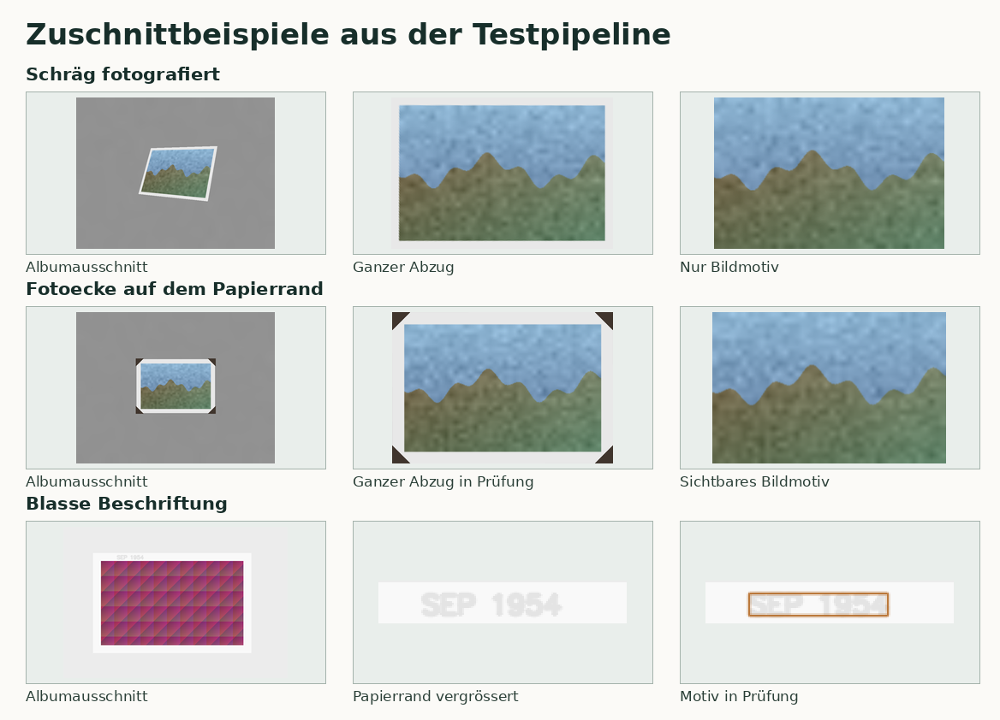

# PhoSca

Local-first photo album digitization stack for high-resolution album page ingestion, segmentation, OCR review, enhancement, metadata persistence, and manual correction.

## Wie PhoSca funktioniert

PhoSca speichert die Aufnahme einer Albumseite als Originaldatei und
erzeugt pro physischem Papierabzug eigene Bilddateien. Ein Kontaktabzug
mit mehreren Bildfeldern zählt als ein Abzug. Zwei benachbarte
Einzelabzüge sollen zwei getrennte Ergebnisse liefern. Die Desktop-Ansicht
enthält den vollständigen Zuschnitt-Editor. Unter `/mobile` lassen sich
Seiten aufnehmen oder hochladen, die Abzugsanzahl prüfen, Papierecken
korrigieren und verfügbare Bilder ansehen und herunterladen.

### 1. Aufnahme, Upload und Speicherung

Die React-Oberfläche legt ein Album an und sendet die Dateien an FastAPI.
Mobil kann sie grosse Dateien in Teilen übertragen und bei fehlender
Verbindung in IndexedDB zwischenspeichern. Der Server prüft Dateityp,
Lesbarkeit, Dateigrösse und Pixelzahl. Er speichert die unveränderten
Originalbytes mit SHA-256 unter `storage/uploads/<album-id>/`. Die
Datenbank verknüpft Album-ID, Seiten-ID, Dateiname und Status. Beim
Wiederholen eines mobilen Uploads kann der Server die Seite anhand ihres
Hashes wiederverwenden. Für die Arbeit mit dem Bild berücksichtigt er
die EXIF-Ausrichtung. Bei HDR-JPEGs bleibt die Gain-Map in der
Originaldatei erhalten.

`POST /api/v1/albums/{album_id}/pages/upload` akzeptiert JPEG und PNG
als Multipart-Felder `files` oder `file`. Die Standardlimits betragen
50 MiB pro Datei, 200 MiB pro Anfrage und 40 Megapixel. `201` liefert
Seiten-ID, Dateiname, Status und SHA-256. `verified: true` bestätigt
den geprüften Upload. Ein normales Duplikat desselben Hashes im selben
Album liefert `409`. Ein Aufruf mit `X-Upload-Retry: 1` kann die
vorhandene Seite zurückgeben. Der Chunk-Endpunkt `/upload/chunk` sammelt
Teile über Upload-ID und inklusive `Content-Range` und validiert die
zusammengesetzte Datei vor der Speicherung.

Die Datenbank trennt das Original `Page`, die Abzüge `ExtractedPhoto`,
die Ausführung `ProcessingRun` mit einzelnen `StageRun`-Einträgen
und die erzeugten Dateien `Asset`. Ein `ReviewEvent` dokumentiert
einen Entscheid mitsamt Prüfsnapshot. Der Seitenstatus
`review_needed` ist ein reguläres Verarbeitungsergebnis. Er kann vom
Status eines einzelnen Abzugs oder Zuschnittmodus abweichen.
[Upload](backend/app/routers/pages.py) · [Speicherung](backend/app/services/uploads.py) ·
[Datenmodell](backend/app/models/entities.py) · [Offline-Warteschlange](frontend/src/offlineQueue.js)

### 2. Abzüge auf der Seite finden

Der Upload startet bei `AUTO_ANALYZE_UPLOADS=true` die
Hintergrundverarbeitung im API-Dienst. Für getrennt eingereihte
Analysen stehen Celery und Redis zur Verfügung. Die Verarbeitung
kontrolliert den Datei-Hash erneut und misst die Unschärfe. Der
konfigurierte YOLO-ONNX-Detektor liefert Vorschläge für einzelne
Abzüge und kann ihre sichtbaren Flächen als Masken schätzen.
Bei fehlenden, auffälligen oder schwierigen Vorschlägen ergänzt
OpenCV Konturen, Kontrastflächen oder Papierränder. Dichte Seiten kann
das System zusätzlich in überlappenden Teilbildern untersuchen.

PhoSca gleicht Vorschläge mit den Originalpixeln ab. Es prüft
überlappende Masken, Helligkeits- und Farbverläufe entlang möglicher
Papierkanten sowie Anzeichen für Albumfenster, Negativhüllen, getrennte
Abzüge oder ein gemeinsames Papier mit mehreren Bildfeldern. Das
System kann Teilvorschläge zusammenführen oder bei unklarer Zuordnung
eine zusätzliche Kontur zur Prüfung anzeigen. Die sichtbare Maske und
die vier Eckpunkte für die Entzerrung werden getrennt gespeichert.

Bei hellen Abzügen auf dunklem Scannergrund sucht PhoSca einen am
Aufnahmerand abgeschnittenen Umriss zunächst im verkleinerten Bild.
Es misst die sichtbaren Seiten anschliessend im Original und prüft,
ob ein dünner Streifen Scannergrund quer zwischen der Papierkante
und dem gegenüberliegenden Aufnahmerand verläuft. Ein bestätigter
Streifen sperrt den gemeinsamen Umriss. Wenn zwei Modellvorschläge
an unterschiedlichen Aufnahmerändern enden und den gemeinsamen
Umriss weitgehend abdecken, kann die Anzahl offen bleiben. PhoSca
erhält dann beide Masken und zeigt die gemessenen Papierkanten als
gestrichelte Linien in der Anzahlprüfung. In der Einzelprüfung
zeichnet **Ganzer Abzug** dieselben Kanten ein. Beide Zuschnitte
bleiben in Prüfung, bis die physische Zuordnung und die vollständige
Aufnahme geklärt sind.
[Prüfung am Aufnahmerand](data/evaluation/README.md#review-a-shared-capture-corner-and-preserve-separate-prints)

Bei einem strittigen Mehrbildabzug verknüpft PhoSca den gemessenen
Aussenumriss mit dem vorhandenen Gesamtvorschlag und markiert die
Schnittlinien der Teilvorschläge. **Aussenumriss prüfen** lädt die
gemessenen Ecken als Entwurf für diesen Abzug. Auf dem Desktop wird
der Abzug auf der Seite ausgewählt. Mobile lädt seine Geometrieaufgabe
direkt anhand der Abzug-ID. Beim Öffnen und Verschieben der Ecken
bleibt die gespeicherte Anzahl gleich. Erst Speichern übernimmt die
Ecken. Überlappende Vorschläge halten beide Zuschnitte in Prüfung, bis
der Reviewer ihre Zuordnung geklärt hat.
[Beispiel Kontaktabzug](data/evaluation/README.md#open-the-measured-contact-outline-from-count-review)

Wenn der Zuschnitt an einer Papierkante in Prüfung bleibt und zwei
Linien im Original ausreichend gestützt sind, zeichnet **Ganzer Abzug**
beide als gestrichelte Kanten ein. Die Linien folgen dem beobachteten
Abschnitt. Der Editor bittet den Reviewer, die Papierkante zu bestimmen.
Der gespeicherte Zuschnitt, die Anzahl der erkannten Abzüge und die
Downloadfreigabe bleiben beim Einblenden der Linien gleich. Ein bereits
vorhandener Umriss- oder Kantenhinweis hat Vorrang.
[Kantenvergleich](data/evaluation/README.md#show-competing-edges-in-review)

Ist eine Seite neben hellem Untergrund nur abschnittsweise sichtbar,
kann **Ganzer Abzug** an beiden Enden gestrichelte Hinweise zeigen.
PhoSca prüft dazu die sichtbaren Materialwechsel, das Ende der
angrenzenden Kanten und die Fläche zum nächsten Abzug. Die unklare
Stelle bleibt zwischen den Linien offen. Die Ecken im Editor sind
weiterhin die bisher gespeicherten Ecken, bis sie bewusst geändert werden.
[Beispiel unscharfer Scan](data/evaluation/README.md#show-the-visible-spans-of-an-interrupted-paper-edge)

Ragt eine Ecke weit über den Abzug hinaus, prüft PhoSca, wo die
beiden angrenzenden Papierkanten im Original enden. Eine gestützte
innere Kante kann in der Geometrieprüfung eine zweite Vorschau geben.
Daneben bleibt der bisherige Zuschnitt sichtbar. Die gestrichelten
Abschnitte helfen bei der Entscheidung, ob der Streifen zum Papier
gehört. Schutzwarnungen gelten weiter und die Galerie zeigt die
bisherige Vorschau, solange die Geometrie in Prüfung ist.
[Beispiel Golden 33](data/evaluation/README.md#compare-an-overextended-corner-with-the-measured-edge)

Bei genau einer strittigen automatischen Gesicht- oder Kopfmarkierung
kann der Editor die Stelle am Original vergrössert zeigen. Gehört sie
zur Albumseite, kann der Reviewer das beim Speichern der vier Ecken
bestätigen. Die Markierung wird nur für diesen Abzug und diese Ecken
aus der Prüfung genommen. Weitere geschützte Stellen bleiben geprüft.
Ändern sich die Originaldatei oder ihre Schutzbereiche, wird die
Freigabe erneut geprüft. Das Seitenverhältnis wird separat bestimmt.
[Beispiel Schutzmarkierung](data/evaluation/README.md#review-one-album-page-mark-during-a-corner-edit)

Vor dem Speichern einer Korrektur prüft PhoSca geschützte Stellen
in den Originalkoordinaten. Für **Ganzer Abzug** zählt der sichtbare
Teil der bisherigen Abzugsfläche. Für einen ausdrücklich gesetzten
Ausschnitt unter **Nur Bildmotiv** zählt der ganze Abzug als Grundlage.
Würde der neue Ausschnitt geschützte Bildfläche verlieren, markiert
der Editor die Stelle rot. Die zuletzt gespeicherten Ecken und Downloads
stehen weiter zur Verfügung. Sie werden erst durch eine gültige
Korrektur ersetzt.
[Beispiel Golden 10](data/evaluation/README.md#protect-visible-source-content-in-ordinary-edits)

Bei einer manuellen Korrektur vergleicht PhoSca die Fläche zwischen
den vier Ecken mit den aktiven Nachbarabzügen. Eine deutliche Überdeckung
hält beide Zuschnittmodi zurück. Die violette Kontur zeigt den
konkurrierenden Nachbarvorschlag im Original. Gehört beim Ausweichen
ein ausgelassener Streifen laut bisheriger sichtbarer Kontur zum
Abzug, markiert der Editor auch diesen möglichen Inhaltsverlust.
Bei tatsächlich verdeckten Papierkanten hilft eine zweite Aufnahme
mit getrennten Abzügen.
[Beispiel Golden 05](data/evaluation/README.md#check-ordinary-corner-edits-at-neighboring-prints)

Ein grosser Vorschlag, der wegen mehrerer innerer Konturen als
Albumfläche verworfen wurde, kann in der Anzahlprüfung wieder zur
Auswahl stehen. Dafür prüft PhoSca drei Aussenkanten am dunklen
Albumuntergrund und Motivstrukturen, die über die geschätzten
Innenkanten hinweg verlaufen. Der Editor zeigt die ursprüngliche
Kontur und lädt auf Wunsch einen separaten Entwurf mit vier Ecken.
Der Reviewer entscheidet über die vorhandenen Vorschläge und speichert
einen zusätzlichen Abzug bewusst.
[Beispiel Willett-Album](data/evaluation/README.md#compare-a-large-mounted-print-with-album-container-proposals)

Die ONNX-Koordinaten werden nach dem Entfernen des Letterbox-Paddings
auf das Quellbild zurückgerechnet. Eine auf eine Linie kollabierte
Vorhersage kann verworfen werden, während die übrigen Vorschläge einer
Inferenz erhalten bleiben. Das Modellregister prüft die Gewichtsdatei
gegen ihren SHA-256. Die Standardschwellen
`YOLO_PROPOSAL_THRESHOLD=0.25` und `YOLO_CONFIDENCE_THRESHOLD=0.70`
haben verschiedene Aufgaben. Die erste begrenzt die Modellvorschläge.
Die zweite beeinflusst, ob ein Vorschlag mit seiner verfügbaren
Konfidenz zur Prüfung muss. Ein hoher Score allein klärt weder die
Pixelzugehörigkeit zwischen Nachbarn noch die physische Papierkante.
[Verarbeitungsdienst](backend/app/services/pipeline.py) ·
[Erkennung und Zusammenführung](backend/app/pipeline/segmentation.py) ·
[Konfiguration](backend/app/config.py)

### 3. Zwei Zuschnitte aus denselben Originalpixeln bilden

| Modus | Ergebnis |
| --- | --- |
| **Ganzer Abzug** | Der entzerrte physische Abzug bis zur Papierkante. Sichtbarer Bildinhalt und der echte Papierrand bleiben erhalten. |
| **Nur Bildmotiv** | Der entzerrte Bildbereich innerhalb der Motivgrenze. Bei einem verifizierten randlosen Abzug können beide Modi dasselbe Bild verwenden. |

| Geometriefeld | Bedeutung |
| --- | --- |
| `bounding_box` | Achsenparalleler Such- und Anzeigeausschnitt. |
| `visible_polygon` | Schätzung der sichtbaren Abzugsfläche, gegebenenfalls mit mehr als vier Punkten. Grundlage für Instanz- und Überlappungsprüfung. |
| `warp_quad` | Vier Eckpunkte der verwendeten Projektion. Sichtbare Kontur und Projektionsviereck können voneinander abweichen. |
| `image_quad` | Vier ausdrücklich gesetzte Motivecken im selben Seitenkoordinatensystem. Beim Speichern müssen sie innerhalb des Papier-Vierecks liegen. |
| `print_size_mm` | Gemessene physische Breite und Höhe. Die Reihenfolge der Ecken bestimmt, welche Kante zu welcher Dimension gehört. |
| `page_to_output`, `shape` | 3×3-Homographie von Quellpixelzentren zu Ausgabepixelzentren und Rastergrösse pro Modus. Die Homographie enthält die gewählte Ausgabeausrichtung. |

Die präzisen Polygonkoordinaten verwenden `(0, 0)` bis `(1, 1)`
für die äussersten Pixelzentren. Ein Punkt wird im Raster mit
`x · (Breite − 1)` und `y · (Höhe − 1)` abgebildet. Das Bezugsbild
ist das dekodierte, EXIF-ausgerichtete Quellraster. Bei zur Aufnahme
passender geometrischer Kamerakalibrierung kann es vor der Projektion
entzerrt werden.

Für **Ganzer Abzug** verfeinert PhoSca die vermuteten Papierecken
mit Messungen am Original. Eine perspektivische Projektion bildet
das Viereck auf ein Rechteck ab. Für das Seitenverhältnis nutzt
PhoSca nach Möglichkeit eingegebene Papiermasse, eine zur Aufnahme
passende Kamerakalibrierung oder Hinweise auf die Papierebene.
Unzureichende Messpunkte, Wölbung, Verdeckung oder widersprüchliche
Kanten können eine Prüfung auslösen.

Gemessene Papiermasse haben Vorrang. Bei vorhandener Kamera-Matrix
liefert eine tragfähige Schätzung der Papierebene oder eine orthogonale
Rekonstruktion das Verhältnis. Ohne diese Daten verwendet PhoSca
nahezu frontale Seitenlängen oder prüft, ob die perspektivische
Schätzung bei leicht veränderten Eingaben stabil bleibt. Eine
schräg gesehene Kante allein kann bei unbekannter Kamera mehrere
physische Seitenverhältnisse erlauben. In diesem Fall ist
`PRINT_ASPECT_UNCERTAIN` mit Papiermassen oder einer besseren Aufnahme
auflösbar. Aussagen zur Kamerakalibrierung sind an den SHA-256 der
Aufnahme gebunden. Solche Ergebnisse einer automatischen Erkennung
benötigen weiterhin Prüfung.

Bei einem gezackten Abzug kann PhoSca eine gemessene Aussenkontur
und vier zugehörige Ecken im Editor anzeigen. Ein überlappender
Teilvorschlag bleibt als eigener Prüfpunkt erhalten. Solange
beide Vorschläge dieselbe Fläche beanspruchen, bleiben beide
benannten Exporte gesperrt. Die Sperre gilt auch nach dem Speichern
der Ecken. Nach Klärung der Überlagerung kann PhoSca den ganzen Abzug
entlang seiner gemessenen Kontur mit Transparenz zur Prüfung
darstellen. Ein bewusst gewähltes Motiv im Innern kann separat
exportiert werden, sofern sein Rand innerhalb des gemessenen Papiers
und mit Abstand zu anderen Abzügen liegt.
[Überlappung und gezackte Papierkante](data/evaluation/README.md#show-scalloped-paper-in-ownership-review)

Für **Nur Bildmotiv** untersucht PhoSca zusätzlich die Übergänge
zwischen Papier und Bild. Der Renderer berechnet beide Ausgaben
direkt aus der Quellseite. Beim präzisen Sampling gehen in die
Interpolation nur Quellpixel ein, die zur jeweiligen Fläche gehören.
Die Randprüfung betrachtet nur Papierstreifen zwischen Aussenkontur
und vorgeschlagener Motivgrenze. Für deutliche Markierungen verwendet
sie zusammenhängende Komponenten aus der Helligkeitsdifferenz zum
lokalen Papier. Der erste Test sucht Reihen mehrerer Komponenten.
Wenn er keine findet, sucht ein zweiter Test einzelne Zeichen oder
verbundene Schrift. Er verlangt einen vom Motiv getrennten
Papiersaum, annähernd gleichmässige Strichdicke und eine definierte
Form aus geschlossenen Innenräumen, einem Stamm oder einer Spitze
mit zwei Schenkeln. Für beide Tests wird der Strich in die
Aufnahme zurückprojiziert. Mindestens 70 % der abgetasteten
Strichpixel müssen dort den erforderlichen Kontrast zum Papier
erreichen.

Für schwache Schrift prüft PhoSca ausserdem schmale Striche mit
lokalem Helligkeits- oder Farbkontrast auf beiden Seiten. Bei
verbundenen blassen Zeichen zieht der Detektor den lokalen
Papiermedian ab und sucht ausgerichtete Strichblöcke mit gemeinsamer
Schriftlinie. Auch offene Zeichen können zu diesem Signal beitragen.
Die bestätigenden Originalpixel müssen auf demselben Papier und
ausserhalb des Motivs liegen. Nach einem deutlich bestätigten Fund
sucht PhoSca auf hellen Papierstreifen weiter. Es spart die bereits
gefundene Stelle samt vier Pixeln Abstand in der Papierebene aus. So
kann eine blasse Beschriftung neben der Kopfzeile oder auf einer anderen
Seite einen eigenen Hinweis erhalten. Bei einem bereits bestätigten
Schriftzug lässt sich der Hinweis über einen Bindestrich verlängern.
Der Strich und zwei weitere strukturierte Schriftteile müssen in
derselben Zeile liegen und sich einzeln in den Originalpixeln
bestätigen lassen. Ein bestätigter Fund setzt für
**Nur Bildmotiv** den
Prüfgrund `IMAGE_MARGIN_MARKS_REVIEW` und speichert die Fundstellen in
Koordinaten der Quelle. Der Hinweis fordert dazu auf,
den gesamten Rand zu prüfen. Die Prüfung verändert die Geometrie und
die Pixel von **Ganzer Abzug** nicht. Wenn
Fotoecken Papier verdecken, kann **Ganzer Abzug** in Prüfung liegen,
während das vollständig sichtbare Motiv geometrisch verwendbar ist.

Beim Sampling begrenzt das gewählte Projektionsviereck die zulässigen
Quellpixel für die JPEG-Ausgabe. An einer Kante fallen bilineare Taps
ausserhalb dieser Fläche oder des Rasters weg. Die übrigen Gewichte
werden renormalisiert. Wenn die Interpolationszelle am Eckpunkt keinen
zulässigen Tap enthält, kann der nächste zulässige Quellpixel in
höchstens zwei Originalpixeln Abstand verwendet werden. Fehlt auch
dieser, bleibt die Geometrie zur Prüfung. Eine Prüfvorschau kann eine
gemessene, nicht rechteckige Kontur mit Transparenz rendern. Die
Qualität des Samplers und die Richtigkeit der gewählten Papiergrenze
werden im Benchmark getrennt gemessen.
[Perspektive und Modi](backend/app/pipeline/perspective.py) ·
[Quellpixel-Sampling](backend/app/pipeline/crop_sampling.py) ·
[Motivrand und Beschriftung](backend/app/pipeline/motif_margin.py)
· [Formprüfung für einzelne Striche](backend/app/pipeline/margin_stroke_shapes.py)

### 4. Prüfen, korrigieren und exportieren

Die Warteschlange führt offene Fragen zur Abzugsanzahl, Geometrie,
Texterkennung und Bildverbesserung. In der Originalansicht lassen sich
gemessene Kanten einblenden. Im Desktop-Editor können Nutzer Vorschläge
verwerfen, fehlende Abzüge mit vier Punkten ergänzen und Papier- sowie
Motivecken getrennt setzen. Gemessene Breite und Höhe in Millimetern
und die gewählte Drehung bleiben in der Korrektur gespeichert. Bei
unklarer Motivgrenze startet der Editor am Papierrand und wartet auf
eine bewusste Auswahl. Eine offene Motivprüfung bleibt auch nach einer
älteren allgemeinen Geometriebestätigung sichtbar.

Mobile zeigt offene Motivkanten und erkannte Randbeschriftungen auf der
Originalseite. Sobald ein manuell bestätigter Ganzabzug verfügbar ist,
lässt sich **Nur Bildmotiv** auch unter **Cropping prüfen** bearbeiten.
Die Motivecken bleiben ein eigener Entwurf. Ein Antippen, eine Bewegung
unter zwei Bildschirmpixeln oder eine zurückgezogene Ecke genügt beim
ersten Entwurf für die Speicherung nicht. Die Vorschau verwendet das
Seitenverhältnis aus der entzerrten Papierebene. Beim Speichern gehen
die unveränderten Papierecken, Masse und die gewählte Drehung mit den
Motivecken an die bestehende Editor-API. Die Freigabe des Motivs setzt
eine gültige Geometrie und die bestehende Prüfung voraus.
[Motivkorrektur am Kontaktabzug](data/evaluation/README.md#review-and-correct-the-motif-on-mobile)

Nach einer Änderung rendert die API die Varianten erneut vom
Albumoriginal. Ein Modus kann eine Vorschau mit Korrekturhinweisen
zeigen, während sein Download gesperrt bleibt. Die Galerie lädt die
gewählte verfügbare Variante. Manuelle Korrekturen durchlaufen
weiterhin Geometrie-, Nachbarschafts- und Pixelprüfungen. Rechenläufe,
Bilddateien, Prüfentscheide und Korrekturrevisionen bleiben mit der
Quellseite verknüpft.

| Aktion | Verhalten |
| --- | --- |
| Anzahl bestätigen | Der `segmentation`-Entscheid bezieht sich auf die Seite. Die `photo_count_revision` und gegebenenfalls die IDs offener Vorschläge müssen zum aktuellen Stand passen. Eine veraltete Bestätigung liefert `409`. |
| Abzug korrigieren oder ergänzen | `PATCH /api/v1/photos/{id}/bounding-box` setzt die überprüfte Geometrie. `POST /api/v1/pages/{id}/manual-photos` ergänzt einen Abzug. Ungültige Ecken können mit `422` abgelehnt werden. Ein überlappender Vorschlag hält bei ungeklärter Papierzugehörigkeit beide Modi zurück. |
| Falsches Objekt markieren | `wrong_object` bezieht sich auf die aktuelle Box und Maske. Der Eintrag wird aus der aktiven Anzahl und Kundenansicht entfernt. Die Prüfgeometrie bleibt für die Historie erhalten. |
| Geometrie vollständig bestätigen | `POST /api/v1/review/events` archiviert den Entscheid zur aktuellen Geometrie. Ist der ganze Abzug gesperrt oder eine echte Motivprüfung offen, liefert `correct` ein `409`. Ein gleichlautender Wiederholungsaufruf mit demselben Idempotenzschlüssel wird als Wiederholung erkannt. |
| Erneut berechnen | `POST /api/v1/photos/{id}/reprocess` rendert mit den aktuellen Daten vom gespeicherten Albumoriginal. Eine Neuberechnung allein erledigt keinen historischen Entscheid, dessen Snapshot eine offene Motivprüfung enthält. |

Die Zustände liegen unter `enhancement_applied.correction.crop_modes`,
getrennt als `full_print` und `image_only`. Der Wechsel von
`ready` zu `review_needed` kann trotz vorhandener Geometrie erfolgen,
etwa bei fehlender Kalibrierung oder einem offenen Besitzkonflikt.
`reason_codes` erklären den Zustand. `geometry_status: ready` kann
dabei die bereits berechnete Geometrie kennzeichnen. Die Varianten
folgen diesem Vertrag.

| Abruf | Ergebnis |
| --- | --- |
| `GET /api/v1/pages/{id}/image` | Unveränderte gespeicherte Albumaufnahme. |
| `GET /api/v1/photos/{id}/image?variant=full_print` oder `image_only` | JPEG des angeforderten Modus, wenn er bereit und verfügbar ist. Ein gesperrter Modus liefert `404` und keine Download-URL. |
| `full_print_preview`, `image_only_preview` | Separat erzeugte PNG-Prüfvorschau, falls für den offenen Modus ein Vorschauartefakt existiert. Die Antwort verwendet `Cache-Control: private, no-store`. |
| `original`, `source_corrected` am Foto-Endpunkt | Quellengetreue, bereits perspektivisch korrigierte JPEG-Ansicht. Die unveränderte Albumdatei ist über den Seiten-Endpunkt verfügbar. |
| `source_corrected_untrimmed` | Entzerrte Quellenansicht für die Kontrolle. Ihre Verfügbarkeit erlaubt keine Freigabe der benannten Modi. |
| `source_corrected_trimmed` | Alter Name für einen getrimmten Zuschnitt. Beim präzisen Pfad gelten auch die Sperren von `image_only`. |

Eine manuelle Geometriekorrektur löscht die automatische
`segmentation_confidence`. Die Geometrie-, Zuordnungs- und
Samplingprüfungen gelten weiterhin. Bei einem Hinweis auf eine
unterbrochene Papierkante speichert PhoSca die Messabschnitte aus
dem Original im Prüfprotokoll. Beide Zuschnitte bleiben in Prüfung,
bis dieselbe manuell gewählte Seite beide Abschnitte mit höchstens
zwei nativen Pixeln Abweichung abdeckt. Eingetragene Masse ändern
das Seitenverhältnis. Ihre Eingabe löst die Kantenprüfung nicht auf.
Bei einer automatischen
Erkennung überprüft der Download-Endpunkt den Freigabenachweis auch
beim Abruf. Ein alter Zustand `ready` genügt deshalb nach einer
Änderung der Konfiguration oder des Freigabedokuments allein nicht.
[Review-API](backend/app/routers/review.py) · [Editor-API](backend/app/routers/photos.py) ·
[Varianten und Download](backend/app/pipeline/variants.py)

### 5. Text, Bildverbesserung und Betrieb

PaddleOCR kann Text auf der Seite erkennen und Abzügen zuordnen.
Die Oberfläche unterstützt Korrekturen und eine Textsuche. PhoSca
kann pro Abzug weitere Bildversionen erzeugen, etwa eine konservative
Farb- oder Rauschkorrektur sowie optionale Restaurierungsvarianten.
Die ursprüngliche perspektivisch korrigierte Version bleibt
erhalten. Eigene Qualitätsregeln steuern die Wahl der Standardversion.
Ein perzeptueller Hash weist auf ähnliche Abzüge hin.

OCR arbeitet auf der Seite und ordnet Text später anhand seiner Lage
zu. Bei fehlender OCR kann ein vorhandener Sidecar Text liefern.
Beim Wiederholen ersetzt der OCR-Schritt die ungeprüften Einträge.
Bestätigte Texte bleiben erhalten. Der Seitenlauf kann trotz gesperrter
Ganzabzüge OCR erzeugen und die nachgelagerte Verbesserung für diese
Abzüge auslassen.

Docker Compose verbindet Nginx und React mit FastAPI, PostgreSQL,
Redis, den Celery-Workern sowie dem Volume für Originale und
Derivate. Lokal kann SQLite als Entwicklungsdatenbank dienen.
Das Modellregister bindet die konfigurierten Gewichte an ihre Hashes.
Bei aktiviertem `AUTH_REQUIRED` prüft die API Rollen und Albumzugriff
über einen API-Schlüssel oder eine Browsersitzung.

Die Derivate liegen unter
`processed/<album>/runs/<run>/stages/<stage>/photos`. Ein Lauf bindet
Quellhash, Pipelineversion und Konfigurationsfingerabdruck.
Korrekturen wechseln die aktive Variantenreferenz. Speicherbereinigung
ist ein separater Vorgang. `Album.completed` beschreibt den Abschluss
der Verarbeitung. Seiten mit offenen Prüfungen zählen als
verarbeitet. Die Qualitätsfreigabe der Bildverbesserung und die
Freigabe der beiden benannten Zuschnitte verwenden getrennte Regeln.
[Verarbeitung und OCR](backend/app/services/pipeline.py) ·
[Freigabe von Bildversionen](backend/app/pipeline/release.py) · [Betrieb](docs/OPERATIONS.md)

### 6. Training und Produktionsfreigabe

Die Qualitätsmessung ordnet Vorschläge eindeutig den sichtbaren
Abzügen zu. Sie misst Erkennungspräzision, Trefferquote und die
Übereinstimmung von Masken und Zuschnitten per IoU. Für beide Modi
prüft sie Eckfehler in Originalpixeln, Seitenverhältnis, Landmarken,
Orientierung, Inhaltsverlust, fremde Interpolationspixel und Laufzeit.
Sie erfasst auch brauchbare Geometrien, die zur Prüfung zurückgehalten
werden. Für echte Freigabereferenzen toleriert die Prüfung höchstens
zwei Originalpixel Eckfehler und ein Prozent Abweichung im
Seitenverhältnis. Die Anforderungen für einzelne Ausgaben sind
strenger als ein hoher mittlerer IoU. Im Freigabereport wird jeder
vorhergesagte Abzug höchstens einer Referenz zugeordnet.

| Prüfbereich | Mindestanforderung |
| --- | --- |
| Instanzerkennung und finale Masken | Zuordnung bei IoU ≥ 0,85, mittlerer Polygon-IoU ≥ 0,85, Präzision und Trefferquote je ≥ 90 %, Kanten-F-Score ≥ 0,80. Auf dieser Stufe gelten zusätzlich höchstens 8 % Inhaltsverlust, höchstens 12 % fremde Fläche und keine als schwerwiegend klassifizierten Fehler. |
| Ausgabe pro Modus | Zugeordnete Instanz, richtige Orientierung, höchstens 2 Originalpixel Eckfehler, höchstens 1 % Seitenverhältnisfehler und, falls Referenzlandmarken vorhanden sind, höchstens 2 px Landmarkenfehler bei p95. |
| Sampling pro Modus | Null Inhaltsschnitt und null fremde Beiträge jenseits eines Bands von einem Originalpixel, null Abtastungen ausserhalb des Quellrasters, höchstens 1 px Samplingdefizit und höchstens 1 px Abweichung zwischen Homographie und Geometriemetadaten. Der synthetische Test verlangt zusätzlich null fremde Quellsamples über die gesamte Ausgabe. |
| Status pro Modus | Unwiederherstellbare Referenzen müssen in Prüfung liegen. Keine verifizierte falsche oder unwiederherstellbare Ausgabe darf als bereit gelten. |

Die automatische Freigabe braucht einen bestandenen Nachweis für die
eingesetzte Konfiguration. Die Herkunft der Modellgewichte wird mit
Quellen, Album-IDs, Bild-Hashes und Splits dokumentiert. Die
Detektorkonfidenz wird auf einem separaten Datensatz für die
eingesetzte Konfiguration kalibriert. Der Fit ist isoton und erfolgt
pro Detektorquelle, etwa für ONNX und klassische Konturen getrennt.
Ein Fit benötigt pro Quelle mindestens 20 Vorhersagen insgesamt,
darunter richtige und falsche Beispiele. Quellen ohne Fit bleiben
unkalibriert. Testquellen dürfen sich weder
nach Album-ID noch nach Bild-Hash mit Trainings-, Entwicklungs- oder
Kalibrierungsquellen überschneiden. Beide Modi brauchen überprüfte
Referenzen aus mindestens zwei gemeinsamen physischen Albumgruppen.
Pro Modus müssen mindestens **90 %** der wiederherstellbaren
Zuschnitte automatisch freigabefähig sein, insgesamt und in jeder
erforderlichen Gruppe. Der Server akzeptiert den Bericht nur mit
passenden Modell-, Profil-, Quellen- und Berichtshashes. Die
Release-Regel bezieht sich auf tatsächlich automatisch
freigabefähige Ausgaben.

Die automatische Freigabe bleibt gesperrt. Auf dem eingefrorenen
synthetischen Satz findet der Detektor-Kontrolllauf **18/18 Abzüge**.
Mit denselben automatisch gefundenen Vorschlägen bestehen
**6/11 Ganzabzüge** und **7/12 Motive** die jeweilige Geometrieprüfung.
Ein getrennter Lauf mit vorgegebenen, leicht versetzten
Startkonturen besteht **11/11 Ganzabzüge** und **12/12 Motive**.
Die Trennung zeigt, wie viel die Qualität der Erkennung zur
Ausgabequalität beiträgt. Unabhängige Originalraster und die passende
Kalibrierung für die Freigabe sind noch unvollständig.
[Prüfverfahren und Belege](data/evaluation/README.md) ·
[Auswertung im Code](scripts/evaluate_onnx_segmentation.py) ·
[Freigabeprüfung im Code](backend/app/pipeline/crop_validation.py)

## Technische Rückschau

### Ausgangsbefund und Fehlersuche

Der Ausgangsbefund aus neun echten Cloud-Ansichten waren 22 Treffer,
sechs fehlende Abzüge und 17 Fehlvorschläge. Das entspricht 78,6 %
Trefferquote und 56,4 % Präzision. Elf der Fehlvorschläge stammten aus
drei physischen Mehrbildabzügen. Der exakte Cloud-Lauf liess sich aus
den verfügbaren Originalen, Modellgewichten und Reports nicht erneut
ausführen. Der spätere Entwicklungsvergleich verwendet sieben andere
reproduzierbare Ansichten. Davon stammen mehrere aus demselben Scan.
[Ausgangsbefund und reproduzierbarer Vergleich](data/evaluation/README.md#replay-the-available-real-image-development-views)

Für die Fehlersuche vergleiche ich pro Abzug vier Zustände. Der rohe
Detektor zeigt, ob es überhaupt einen Vorschlag gab. Die finale Maske
zeigt, ob mehrere Abzüge zusammengelegt oder ein Abzug fragmentiert
wurde. Der auf die Quelle zurückprojizierte Zuschnitt zeigt, ob
Entzerrung und Randbehandlung Inhalt entfernen. Der API- und
Browserpfad zeigt, ob genau diese Variante als Vorschau, Prüfung
oder Download behandelt wird. So lässt sich derselbe Fehler gezielt
einer Stufe zuordnen. [Instanzdiagnostik und Renderprüfung](data/evaluation/README.md)

### Erkennung, Training und Fusion

| Versuch | Ergebnis und Entscheidung |
| --- | --- |
| Klassische Geometrie gezielt verbessern | Die Liniensuche holte auf Golden-Seite 11 einen Abzug mit 0,911 Masken-IoU zurück. Der zweite blieb unerkannt. Auf Seite 37 verdrängte ein Diagonalfragment die vollständige Kontur. Nach der Korrektur erreichte die Maske 0,994 IoU, während eine gemessene Papierkurve weiterhin Prüfung verlangte. Der klassische Golden-Lauf verbesserte sich insgesamt von 12/29 mit 16 Fehlvorschlägen auf 14/29 mit 15. [Liniensuche](data/evaluation/README.md#line-pair-search-after-rejected-contours) · [Konturauswahl](data/evaluation/README.md#nested-classical-contours-on-the-same-print) |
| Synthetisch auf physische Papierabzüge trainieren | Modell-only erkannte 12/12 Mehrbildabzüge und 32/34 getrennte Abzüge im gezielten Stock-Test bei IoU 0,85, ohne Fehlvorschläge. Der Hybrid blieb auf echten Golden-Seiten bei 14/29, mit 16 statt 15 Fehlvorschlägen gegenüber klassischer Geometrie. Der Kandidat wurde für den Einsatz verworfen. [Stock-Experiment](data/evaluation/README.md#synthetic-stock-detector-experiment) |
| Transfer mit wenigen echten Kameraoriginalen prüfen | Im Mischarm ersetzten 40 Derivate von fünf Originalen 40 der 96 Trainingsbilder. Checkpoint-Ausgangspunkt, Validierung, Input von 512 × 512 und Schwellen blieben im Vergleich gleich. Die Golden-Erkennung im Hybrid stieg von 14/29 mit 20 Fehlvorschlägen auf 29/29 mit zwei. Auf dem eingefrorenen Satz erreichte der Mischarm 17/18 mit vier Fehlvorschlägen, 9/11 bestandene Ganzabzüge und 10/12 Motive. Auf dem realen Kontaktbogen lieferte er drei Fehlvorschläge mehr als der synthetische Kontrollarm. Beide Gewichte bleiben Entwicklungsartefakte. Die Golden-Seiten teilen die physische Quellgruppe mit dem alten Kameramaterial. [Gepaarter Transfer](data/evaluation/README.md#compare-real-camera-pages-against-a-paired-synthetic-control) |
| Mehrbildabzüge mit dichterem Druckraster trainieren | Auf 24 neuen synthetischen Seiten stiegen die rohen Treffer von 8/12 auf 11/12 bei Mehrbildabzügen und von 18/24 auf 21/24 bei getrennten Papieren. Bei einem zuvor korrekten Paar schlug das dichte Modell jedoch eine gemeinsame Aussenkontur vor. Auf dem echten JPEG75-Kontaktbogen fand die Variante mit dem weniger dichten Raster einen Abzug ohne Fehlvorschlag. Bei der dichteren Variante verdrängte die klassische Fusion die bessere Modellkontur. Beide Varianten verschlechterten die Zuschnittprüfung in beiden Modi und bleiben Entwicklungsartefakte. [Gepaarter Mehrbildtest](data/evaluation/README.md#compare-sparse-and-dense-artwork-on-the-same-physical-stock) |
| Lokale Maskenverfeinerung nachtrainieren | Auf 166 dichten Validierungsausschnitten stieg der mittlere IoU von 0,562 auf 0,907. Auf dem Met-Entwicklungsscan sank die Trefferzahl von 44 auf 42. Zusätzlich fiel die eingefrorene Erkennungsprüfung aus. Der Verfeinerer wurde nicht übernommen. [Dense-Gutters-Auswertung](data/evaluation/README.md#precise-crop-validation) |
| Reale Entwicklungsansichten getrennt auswerten | Klassisch ergaben sich 22/24 Treffer und acht Fehlvorschläge, gemischt 23/24 und drei. Der Gesamtwert verdeckt einen Rückschritt beim angeschnittenen NerdScan-Abzug mit 35,3 % Verlust der Entwurfsfläche. Dieser Vergleich zeigt, warum ein Gewinn der Gesamterkennung und ein sicherer Zuschnitt getrennt bewertet werden. [Realer Entwicklungsvergleich](data/evaluation/README.md#replay-the-available-real-image-development-views) |
| Schwache Zusatzvorschläge am Original überprüfen | Zwei zusätzliche klassische Golden-Vorschläge wanderten nach nativer Grenzprüfung in die Zählprüfung. Die aktive Zählung erreichte damit 29/29 ohne zusätzlich gezählte Objekte. Beide Vorschläge blieben für den Reviewer sichtbar. [Prüfung von Fallback-Konturen](data/evaluation/README.md#review-unsupported-fallback-outlines-before-counting-a-print) |

### Konturen, Perspektive und Ausgabesicherheit

- **Mehrbildabzug als physische Instanz.** Beim Kontaktbogen stützen
  übereinstimmende Rasterabstände, durchgehendes Papier an den Rändern
  und fehlende Hinweise auf einen eigenen Schatten die Zuordnung zu
  einem Abzug. Im 33-%-JPEG75-Fall steigt der Masken-IoU der angebotenen
  Aussenkontur gegen den Entwurf von 0,8317 auf 0,9885. In der
  verlustfreien Variante steigt er von 0,8286 auf 0,9898. Die
  konkurrierenden Fragmente bleiben sichtbar und zunächst gezählt.
  Bei weniger als zwei Originalpixeln eigenem Rand kann ein zweites
  Papier gleich aussehen. Ein lockerer Vorschlag mit drei gestützten
  Seiten überschritt bei Domoritz in 28 von 190 Gegenproben eine
  bekannte physische Trennung. Eine solche Geometrie bleibt ein
  Korrekturhinweis. [Kontaktbogen](data/evaluation/README.md#compare-the-whole-contact-print-with-its-counted-fragments) ·
  [Unschärfe-Gegenproben](data/evaluation/README.md#split-print-under-mild-blur)
- **Bessere Vorschau bei verbleibendem Randfehler.** Beim JPEG55
  verbesserte die neu entzerrte Aussenkontur den Zuschnitt-IoU
  gegen den Entwurf von 0,8363 auf 0,9884. Der fehlende Inhalt sank
  von 16,37 % auf 1,07 %. Der grösste Eckfehler blieb bei 4,84
  Originalpixeln. 220 Ausgabepixel erhielten fremde Beiträge jenseits
  des Ein-Pixel-Bands. Das Ergebnis blieb als Prüfvorschau verfügbar.
  Die nachträgliche Suche eines Rastermusters um acht Pixel in beide
  Richtungen lieferte auch bei 47 von 63 Kontrollen mit getrennten
  Papieren fälschlich dieselbe Rasterevidenz. Die automatische
  Entscheidung behält die engere Prüfung.
  [Vorschau und Messreihe](data/evaluation/README.md#straighten-the-proposed-contact-print-for-review)
- **Papierkurve und Motivkurve unterscheiden.** Die Eingabe von
  Papiermassen hatte auf Golden-Seite 37 früher eine Freigabe trotz
  offener Papierkurve erlaubt. Der neue Pfad hält die Kurve auch nach
  manueller Änderung fest. Er akzeptierte 36 belegte gerade
  Papiergrenzen mit gekrümmtem Druckmotiv und hielt 180 getestete
  Eckänderungen an tatsächlich gewölbten Abzügen zurück. Beim
  JPEG75-Kontaktabzug bleiben konkurrierende Motivübergänge und
  Beschriftung auf dem Papier entscheidend. Ein höherer
  Krümmungsschwellwert würde diese Fragen offenlassen.
  [Papierkurven](data/evaluation/README.md#keeping-a-measured-paper-curve-in-review-after-a-manual-edit) ·
  [Kontaktbogenmotiv](data/evaluation/README.md#require-an-intentional-motif-outline-in-review)
- **Manuelle Prüfung und Export vor Inhaltsverlust schützen.** Das
  alte, pauschal um 6 % eingerückte Motiv erhielt nur einen von
  1’938 vermessenen Beschriftungspunkten und schnitt fünf Felder
  der letzten Reihe an. Heute erfordert der Editor eine bewusste
  Motivkontur. Eine ältere allgemeine Geometriebestätigung kann
  eine offene Motivprüfung nicht ausblenden. Ausserdem hält ein
  überlappender aktiver Fragmentvorschlag beide Exporte zurück,
  bis seine Zuordnung geklärt ist. Am echten Kontaktabzug ergab
  der Standardweg nach ausdrücklicher Korrektur zwei Downloads
  mit allen 35 Bildfeldern und allen 1’938 geprüften
  Beschriftungspunkten im Motiv. [Manueller Ablauf](data/evaluation/README.md#require-an-intentional-motif-outline-in-review) ·
  [Alte Bestätigungen](data/evaluation/README.md#keep-genuine-motif-reviews-open-after-legacy-geometry-approvals) ·
  [Überlappende Papieransprüche](data/evaluation/README.md#keep-manual-exports-held-while-paper-proposals-overlap)

### Schrift am Motivrand und Datenlage

Die erste Randprüfung erkannte 25 von 54 zuvor geometrisch bereiten
Zuschnitten mit teilweisem oder vollständigem Schriftverlust. Der
zweite Schritt mit beidseitigem Originalkontrast fing drei weitere
Verluste ab. In derselben 162-Fälle-Reihe blieben alle Ganzabzüge
pixelgleich. Von den 54 Ausgangsfehlern bestehen noch 26. Sie
enthalten Bleistift, einzelne Zeichen, verbundene Schrift und
Ausschnitte einer real geformten Beschriftung. Der separate Test mit
216 Beispielen schwacher Beschriftung und 660 Gegenproben verbesserte
die Erkennung von 19 auf 52. Bei den Gegenproben kam keine
Fehlmarkierung hinzu. Eine pauschale niedrigere
Kontrastschwelle hatte in früheren Reihen auch Papierstruktur,
Spiegelungen und Kratzer markiert.
[Erster Randschutz](data/evaluation/README.md#review-visible-markings-outside-the-proposed-motif) ·
[Graphit und blaue Schrift](data/evaluation/README.md#check-faint-graphite-and-blue-ink-against-the-original-paper)

In einer weiteren Serie mit 216 markierten Streifen stieg die
Erkennung mit der Formprüfung für einzelne Komponenten von 11 auf 37.
Unter 198 Gegenproben kamen keine neuen Prüfhinweise hinzu.
Die neuen Treffer enthalten einzelne Zeichen wie **A** und **B**
sowie verbundene Schrift. Sehr blasses Graphit, manche
Einzelzeichen und kurze Schrift ohne geschlossene Innenräume bleiben
offen. [Formprüfung](data/evaluation/README.md#hold-motif-trims-for-isolated-strong-strokes)

Beim historischen Detektor gehören der archivierte 28/29-Bericht
(`e4168ae…`) und die spätere 29/29-Zusammenfassung (`4d823588…`)
zu verschiedenen Modell-Digests. Das Modellregister nennt für die
spätere Datei eine NCHW-Eingabe mit 1024 × 1024 Pixeln. In der
vorliegenden Arbeitskopie fehlen die registrierte ONNX-Datei und
Teile ihres Trainingsinventars. Bei den zusätzlichen
Archivkandidaten sind zum Teil getrennte Aufnahmen katalogisiert,
aber native Paare, überprüfte Grenzen, Nutzungsrechte oder der
Ausschluss von Trainingsüberlappung sind noch offen. An der Freigabe
fehlen damit konkrete Artefakte und eine dazu passende Kalibrierung.
[Modellregister](models/manifest.json) ·
[Historische Modellherkunft](data/evaluation/README.md#recover-detector-provenance-from-the-git-archive) ·
[Archivpaare](data/evaluation/README.md#verify-that-catalogued-pairs-represent-independent-acquisitions)

### Nächste technische Hypothesen

1. **Bei konkurrierenden Linien das Papier zuordnen.** Im eingefrorenen
   Kontrolllauf liegt bei allen sieben umstrittenen Seiten eine
   korrekte Papierkante bereits im Suchband. Die Bewertung kann eine
   etwa neun bis zwölf Pixel weiter innen liegende Motivkante
   bevorzugen. Zwei Prüfvorschauen gewinnen den fehlenden Rand mit
   einer materialgestützten Wiederholung. Für die übrigen Fälle
   stehen mehrere Seiten oder unterschiedlich heller Untergrund zur
   Prüfung. [Diagnose mit Startversatz und Linienvergleich](data/evaluation/README.md#measure-seed-displacement-and-competing-print-edges)
2. **Den Besitzkonflikt auf ScanCropper auflösen.** Ein zusätzlicher
   Modellvorschlag umfasst einen Teil des oberen Abzugs. In der
   Ablation ohne genau diesen Vorschlag stieg die Masken-IoU von
   0,85386 auf 0,99795. Der Fusionssieger blieb derselbe. Der Editor
   zeigt die gemessene Kontur inzwischen beim aktiven Konflikt.
   Sehr dünne aufgelegte Abzüge mit derselben Vorlage können
   dieselben Übergänge zeigen. Ihre Anzahl bleibt eine Prüfentscheidung.
   [Fusionsprüfung und ScanCropper-Ablation](data/evaluation/README.md#audit-cross-source-fusion-and-scalloped-stock-conflicts)
3. **Restfehler bei blasser und offener Schrift prüfen.** Der lokal
   geschätzte Papiermedian und die Gruppierung verbundener
   Striche bringen das blasse Beispieldatum in Prüfung. In der
   gepaarten Serie bleiben 22 von 54 früher verlustreichen
   Motivzuschnitten offen. Besonders schwacher Kontrast,
   Einzelzeichen und isolierte Striche brauchen weitere
   Gegenproben auf ganzen Originalen.
   [Vergleich der Schrifterkennung](data/evaluation/README.md#compare-local-paper-centering-and-noise-scaling-for-faint-dates)
4. **Zwei echte Albumgruppen als unabhängigen Endtest sichern.** Die
   Quellenaufarbeitung soll nutzbare Originale mit belegtem Papier-
   und Motivbezug liefern. Danach lassen sich getrennte
   Kalibrierungsquellen für die tatsächlich aktiven Detektorquellen
   beschaffen und das festgelegte Modell einmal auf dem
   zurückgehaltenen Freigabesatz prüfen. Für die Modellwahl und
   Grenzwertsuche sind separate Entwicklungsalben erforderlich.
   [Referenzformat und Splitregeln](data/evaluation/README.md)

## Beispiele und offene Fälle



- **Schrägaufnahme.** Beide Zuschnitte gelingen. PhoSca entzerrt den ganzen
  Abzug und entfernt im Motivmodus den hellen Papierrand. Die synthetische
  Probe hat bekannte Referenzgeometrie und einen leicht versetzten
  Startvorschlag.
- **Fotoecke auf Papier.** Für den ganzen Abzug erscheint eine
  Prüfvorschau. Das vollständig sichtbare Motiv lässt sich in dieser
  synthetischen Probe separat entzerren.
- **Blasser Datumsaufdruck.** Der frühere Motivzuschnitt verlor in
  dieser Probe alle 727 vermessenen Schriftpunkte. Jetzt markiert
  PhoSca den verdächtigen Randbereich im Original und hält den
  Motivexport für die gezielte Korrektur zurück. Nach der bewussten
  Korrektur enthielt der exportierte Zuschnitt alle 727 Messpunkte.
- **Echter Kontaktabzug.** PhoSca markierte einen Teil der Beschriftung
  am Original. Nach der manuellen Korrektur mit Test-Papiermassen
  enthielten beide Galerie-Downloads alle 35 Bildfelder. Im Motiv
  waren alle 1’938 vermessenen Beschriftungspunkte enthalten.
  [Kontaktabzug und Downloadpfad](data/evaluation/README.md#review-visible-markings-outside-the-proposed-motif)
- **Echter Abzug am Aufnahmebildrand.** Beim NerdScan-Entwicklungsbild
  traf die getestete Konfiguration drei erwartete Abzüge und lieferte
  zwei zusätzliche Vorschläge. Beide Modi blieben in Prüfung.
  Beim unteren Abzug zeigt der Editor die gemessene obere und linke
  Papierkante. Rechts und unten endet die Aufnahme. Der
  überlappende Teilvorschlag kann separat beurteilt werden.
  Bei angeschnittenen Originalen hilft eine neue Aufnahme mit sichtbar
  belassenen Papierrändern. [Entwicklungsreferenz](data/evaluation/nerdscan-clipped-development.json) ·
  [Auswertung](data/evaluation/README.md#show-the-visible-paper-sides-in-a-clipped-overlap)
- **Derselbe Scan um 180° gedreht.** Die Erkennung trifft zwei von drei
  Abzügen und liefert vier zusätzliche Vorschläge. Drei Vorschläge
  überdecken Teile desselben randnahen Abzugs. Die Anzahlprüfung
  zeigt seine zwei sichtbaren Papierseiten und verknüpft damit die
  drei Vorschläge. Falsche Teilvorschläge lassen sich einzeln
  entfernen. Bei künstlich getrennten Abzügen auf demselben Scan
  bleiben die beiden Einzelmasken erhalten.
  [Original und Gegenproben](data/evaluation/README.md#review-a-shared-capture-corner-and-preserve-separate-prints)

Die Abbildung enthält generierte Testbilder und lässt sich lokal neu berechnen.

```bash
PYTHONPATH=backend python scripts/render_crop_examples.py
```

## Run With Docker Compose

1. Copy `.env.example` to `.env`.
2. Set `HOST_STORAGE_PATH` to the absolute path of this repository's `storage` directory.
3. Start the stack:

```bash
docker compose up --build
```

Services:

- Frontend dashboard: `http://localhost/` (port 5173 for local Vite development)
- Backend API: `http://localhost:8000`
- Metrics: `http://localhost:8000/metrics`
- CPU worker queue: decode, geometry, hashing, persistence
- Analysis queue: segmentation/OCR, one resident process per accelerator
- Restoration queue: optional enhancement, one resident process per accelerator

The backend and worker run as UID `1000`, containers use `no-new-privileges`, and the storage volume is configured with `noexec,nosuid,nodev`.

## Database Migrations

Inside the backend container:

```bash
alembic upgrade head
```

The initial migration creates albums, pages, extracted photos, OCR results, audit logs, indexes, and a PostgreSQL full-text index over OCR text.

## Local Development

For a lightweight SQLite-backed dev run:

```powershell
$env:DATABASE_URL='sqlite+aiosqlite:///./dev.db'
$env:REDIS_URL='redis://localhost:6379/0'
$env:STORAGE_PATH='C:\Users\gabri\Documents\Projects\PhoSca\storage'
$env:YOLO_MODEL_PATH=(Join-Path $PWD 'models/yolov8-seg-album.onnx')
$env:MODEL_MANIFEST_PATH=(Join-Path $PWD 'models/manifest.json')
python -m uvicorn app.main:app --app-dir backend --host 0.0.0.0 --port 8000
```

In another terminal:

```bash
cd frontend
npm run dev
```

The development servers listen on all network interfaces. Open
`https://<PC-IP>:5173/mobile` on a phone in the same WLAN (for example,
`https://192.168.1.20:5173/mobile`). HTTPS is required for the live in-browser
camera. Trust the local certificate on the phone once; otherwise the browser
will block `getUserMedia`. The desktop interface remains available at the root
URL. Windows Firewall may ask once for permission on private networks.

Original mobile captures are stored unchanged below
`storage/uploads/<album-id>/`. The database keeps the original filename,
SHA-256 hash and the generated page ID. Derived photos are stored separately.
Uploads trigger photo detection and extraction automatically. In the photo
detail, **Ganzer Abzug** keeps the original print border and **Nur Bildmotiv**
uses the verified inner edge. The preview and download follow the selected
option. Review the source page when a boundary cannot be verified. Reprocess
an existing photo to generate the new variants from its stored album page.
For a strongly oblique photo of a flat print, measure the print and enter the
width and height in millimetres in the corner editor. Use numbered edges 1–2
for width and 2–3 for height. PhoSca uses those measurements for perspective
correction in both crop modes and retains them for subsequent processing.
In the crop editor, choose **Ausrichtung ab Albumseite** to keep the source
orientation or rotate the rectified photo in 90° steps. The selection applies
to both crop modes and is retained when the photo is reprocessed.
Use **Fehlenden Abzug ergänzen** in the desktop review and mark the four
corners to add a print that was missed during analysis. Saving the print
reopens the page's photo-count review and adds it to the crop editor.

`ENABLE_BORDER_TRIM=false` disables automatic inner-edge detection. Reviewers
can still provide inner corners. `ENABLE_PRECISE_PHOTO_CROPS=false` disables
the precise crop path for ordinary new processing. The configured detector
can still run. Automatic downloads of the two precise modes require a passing independent album report for the
deployed checkpoint and settings at `CROP_VALIDATION_REPORT_PATH`. The
preview and manual corner editor are available while automatic crops are in
review. See [crop evaluation](data/evaluation/README.md) for the report format.
For HDR JPEGs the app processes the primary image and keeps the original gain
map in the stored file.

## ML Models

Place local-only model files under `models/`:

- `models/yolov8-seg-album.onnx`
- `models/photo-orientation.onnx` (optional 0/90/180/270 classifier)
- `models/paddleocr/`

The segmentation ONNX parser supports YOLO-style box outputs and segmentation prototype masks, including channels-first and channels-last prototype tensors. Classical boundary analysis is enabled as risk-triggered geometric evidence: it runs when the model is missing, empty, or produces a suspicious instance set, and is fused with additional checks for overlapping prints. Photo orientation correction uses `models/photo-orientation.onnx` when present; without a calibrated model, face/detail evidence is advisory only and pixels are preserved for review. Train the optional orientation model from manually reviewed upright crops with `scripts/train_orientation_model.py`. PaddleOCR is loaded lazily; OCR can also be tested with `.ocr.json` sidecars next to uploaded page images.

## Tests And Scans

```bash
python -m pytest
cd frontend && npm run build && npm audit
python -m bandit -r backend/app
```

Earlier smoke and setup results:

- Supplied dataset copied from `PHOTOALBUM/` to `data/raw_album_pages/`: 40 album-page JPEGs.
- Blur gate at `100.0`: 12 keep, 28 discard. See `data/blur_scores.csv`.
- Local real-data smoke run: 40 pages processed, 0 failures, 85 photos extracted with classical segmentation fallback.
- Synthetic load dataset generated: 400 images in `data/load_dataset/`.
- Test coverage: 74% line coverage with `pytest --cov=backend/app --cov-report=term-missing`.
- Security scans: `bandit -r backend/app` clean; `npm audit --audit-level=high` clean.

Docker Desktop note: containers were observed running inside the `docker-desktop` WSL VM, but the Windows Docker API/port proxy returned HTTP 500 and did not publish ports to `localhost`. Logs showed Docker Desktop waiting on the VM init control API. Restart Docker Desktop fully if `docker ps` returns API 500, then rerun `docker compose up --build -d`.

Fast segmentation-only smoke check:

```powershell
$env:SMOKE_LIMIT='3'
$env:SMOKE_SEGMENTATION_ONLY='true'
python scripts/run_real_data_smoke.py
```

Load-test scaffold:

```bash
locust -f locustfile.py --host http://localhost:8000
```

## Backups

See `docs/OPERATIONS.md` and `scripts/backup.sh`. Backups include PostgreSQL dumps and storage syncs, encrypted with GPG.

## Annotation And Regression

See `docs/SEGMENTATION_STRATEGY.md` for the failure analysis, researched options, and selected segmentation/orientation architecture. The shortest path for YOLO polygon annotations is the workspace under `data/segmentation_training/`:

```bash
python scripts/setup_segmentation_training.py bootstrap
python scripts/convert_label_studio_to_yolo.py --input data/segmentation_training/exports/label_studio_export.json --output data/segmentation_training/labels
python scripts/setup_segmentation_training.py train
```

`bootstrap` copies the existing example pages from `data/raw_album_pages`, creates editable Label Studio preannotations, and writes `data/segmentation_training/label_studio_tasks.json`. Review complete printed photos as `photo` polygons, export the reviewed JSON into `data/segmentation_training/exports/label_studio_export.json`, then run the conversion and training commands. The training command prepares `data/yolo_dataset`, validates labels, fine-tunes the YOLO segmentation model, and exports `models/yolov8-seg-album.onnx`.

Use `docs/LABEL_STUDIO.md` for the labeling UI details. Ten locked golden pages and their verified polygon labels are available as a same-domain regression holdout; they are not an album-independent consumer benchmark. The lower-level commands remain available:

```bash
python scripts/export_label_studio_tasks.py --source-images data/raw_album_pages --output data/label_studio_tasks.json --preannotate
python scripts/convert_label_studio_to_yolo.py --input data/label_studio_export.json --output data/label_exports/yolo
# Or export masks reviewed inside PhoSca directly:
python scripts/export_reviewed_dataset.py --database-url $DATABASE_URL --output data/reviewed_dataset
python scripts/split_reviewed_dataset.py --input data/reviewed_dataset/manifest.jsonl --output data/reviewed_dataset/splits
# Derive legacy YOLO labels only from explicitly approved, valid geometry:
python scripts/export_reviewed_yolo_labels.py --album-id <album-id> --output data/label_exports/yolo --manual-only --require-complete
python scripts/prepare_yolo_dataset.py --source-images data/raw_album_pages --source-labels data/label_exports/yolo
python scripts/validate_yolo_dataset.py --data data/data.yaml
python scripts/train_segmentation_model.py --data data/data.yaml --export models/yolov8-seg-album.onnx
python scripts/train_orientation_model.py --images data/orientation_photos --output models/photo-orientation.onnx
python scripts/validate_segmentation.py --album-id <album-id>
python scripts/validate_ocr.py --album-id <album-id>
```

Safety and operations evidence. See [crop evaluation data](data/evaluation/README.md) for exporting calibration scores from reviewed albums.

```bash
python scripts/evaluate_onnx_segmentation.py --include-classical-fallback --output runs/cropping-current.json
python scripts/evaluate_enhancement.py --output-dir runs/enhancement-current
python scripts/fit_confidence_calibration.py runs/crop-quality/calibration-scores.json --holdout-id <independent-holdout-id>
python scripts/evaluate_shadow_drift.py stable.json shadow.json --output evidence/shadow-drift.json
python scripts/run_retention.py
python scripts/verify_launch_gates.py evidence/launch-gates.json
```

`scripts/setup_segmentation_training.py` orchestrates the normal bootstrap/prepare/train loop. `scripts/export_label_studio_tasks.py` creates Label Studio import JSON and can seed editable polygon predictions from the classical detector. `scripts/convert_label_studio_to_yolo.py` converts reviewed Label Studio JSON exports into YOLO segmentation labels. `scripts/export_reviewed_yolo_labels.py` exports masks corrected in the PhoSca review canvas into the same YOLO label directory. `scripts/prepare_yolo_dataset.py` recreates deterministic train/val/golden splits from raw images plus exported YOLO labels. `scripts/validate_yolo_dataset.py` checks label completeness, polygon validity, and golden leakage before training. `scripts/train_segmentation_model.py` lazily imports Ultralytics; install it only in the training environment if it is not already available. `scripts/train_orientation_model.py` requires PyTorch plus `onnx`, uses manually upright crops under `data/orientation_photos`, and exports a 0/90/180/270 correction classifier. `scripts/validate_segmentation.py` measures polygon IoU from saved segmentation masks and falls back to boxes only for legacy rows without masks. These are diagnostic checks for segmentation and OCR. The precise crop release requirements are documented in [crop evaluation](data/evaluation/README.md).
