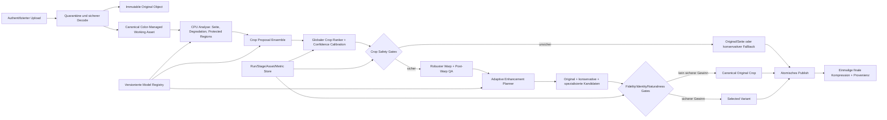

# PhoSca: Technische Gesamtanalyse und Masterplan für Cropping und Enhancement

**Stand:** 10. Juli 2026  
**Analysierter Code-Stand:** `897e408f267fe6b73c60e2d343e144d66d885686` (`main`)  
**Scope:** vollständiges Repository, Schwerpunkt Albumseiten-Segmentierung, Fotoextraktion/Perspektivkorrektur, optionales inhaltsbewusstes Cropping, Enhancement, Qualitätskontrolle, Datenfluss, Betrieb, Sicherheit und Evaluation  
**Art der Arbeit:** Read-only-Analyse; es wurden keine Implementierungsänderungen, Commits oder Pushes vorgenommen. Diese Datei ist das einzige neu erstellte Projektergebnis.

---

## 1. Executive Summary und Architekturentscheidung

PhoSca ist in der aktuellen Form **nicht produktionsreif für eine autonome Consumer-Ausgabe**. Das Problem ist nicht primär ein einzelner falscher Schwellenwert, sondern eine Kombination aus fehlender produktiver Modellbasis, unkalibrierten Heuristiken, destruktiver Kandidatenreduktion, semantisch blindem Cropping, pauschalem generativem Enhancement und einer Freigabelogik, die Warnungen und Modellfehler nicht als Blocker behandelt.

Die wichtigste begriffliche Trennung lautet:

1. **Albumseite → vollständige physische Prints:** Das ist eine geometrische Extraktionsaufgabe. Hier darf Ästhetik niemals dazu führen, dass Teile des gedruckten Fotos abgeschnitten werden.
2. **Optionaler Print → Zielseitenverhältnis/Kompositionscrop:** Das ist eine semantische und ästhetische Reframing-Aufgabe. Sie existiert im aktuellen Code praktisch nicht und muss als getrennte, nachgelagerte Funktion gebaut werden.

Die bestehende Anwendung muss nicht vollständig verworfen werden. FastAPI, React, SQLAlchemy/Postgres, die Idee asynchroner Jobs, Audit-Metadaten und Varianten können als **Control Plane** weiterentwickelt werden. Folgende Kernbereiche sollten jedoch ersetzt oder grundlegend neu gebaut werden:

- Kandidatenerzeugung, globale Kandidatenauswahl und Confidence-Modell des Croppings;
- robuste Quad-/Maskengeometrie, Safe Margins und Post-Warp-Gates;
- semantischer Motivschutz für Gesichter, Köpfe, Personen, Tiere, Produkte und Text;
- Enhancement-Diagnostik, Processing Planner und Modellrouting;
- pauschale Real-ESRGAN/GFPGAN/LaMa-Kette und das aktuelle „Premium“-Modul;
- farbverwaltete, weitgehend verlustfreie Pixel-/Asset-Pipeline;
- finaler Variantenselector mit echten Hard Gates und automatischen Fallbacks;
- versionierte, idempotente Workflow-/Asset-Architektur und getrennte CPU-/GPU-Worker;
- Benchmark-, Human-Evaluation-, Monitoring-, Security- und Datenschutzsystem.

**Klare Empfehlung:** kein vollständiger Rewrite in einer anderen Sprache. Python bleibt für Computer Vision und ML sinnvoll. Die aktuelle API/UI kann erhalten bleiben; die Bildpipeline und ihr Betriebsmodell sollten modular neu entwickelt werden. Der klassische Crop-Fallback darf künftig nur noch eine Proposal-Quelle sein und keine Consumer-Ausgabe autonom freigeben. Real-ESRGAN und GFPGAN können als Vergleichsbaseline oder optionale Kandidaten bleiben, nicht als Standardroute.

### Die fünf größten aktuellen Probleme

1. **Cropping arbeitet real ohne produktives Modell und ohne Motivschutz.** Das konfigurierte ONNX-Modell, Trainingslabels und Golden Labels fehlen. Die laufende Qualität hängt an fest codierten Kontur-/Kontrastheuristiken, die weder Gesichter noch Personen oder Hauptmotive kennen.
2. **Korrekte Crop-Kandidaten können vor der eigentlichen Qualitätsbewertung verloren gehen.** Große Container werden bei der frühen Greedy-Konsolidierung bevorzugt, unterdrücken kleinere korrekte Prints und werden anschließend selbst verworfen. Das erzeugt sowohl leere Seitenresultate als auch interne Fragment-Crops.
3. **Enhancement verändert fast jedes Bild mit derselben generativen Grundkette.** Real-ESRGAN x2 und in den normalen Presets GFPGAN laufen unabhängig davon, ob das Bild gut ist oder ob überhaupt ein Gesicht erkannt wurde. Ein echter No-op-Pfad fehlt.
4. **Quality Gates sind nicht end-to-end wirksam.** Blur- und Review-Status werden überschrieben; die finalen SR-/Face-/Premium-Ergebnisse werden nicht gegatet; Fehlerfallbacks werden als `_enhanced.jpg` gespeichert und die API/UI liefern standardmäßig `enhanced` aus.
5. **Es gibt keine belastbare Qualitätsmessung.** Die Golden-Segmentierung ist mangels Labels übersprungen, der Validator ignoriert False Positives, Enhancementtests mocken die Modelle, und ein Smoke-Test zählt Crops statt deren Korrektheit. Damit kann das Projekt aktuell weder Verbesserung noch Nichtverschlechterung beweisen.

---

## 2. Methodik, Evidenz und Grenzen der Analyse

Untersucht wurden:

- alle Backend-, Frontend-, Pipeline-, Modell-, Datenbank-, Worker- und Deploymentpfade;
- alle Cropping-, Segmentierungs-, Perspektiv-, Orientierungs-, Border-Trim- und Enhancementmodule;
- Konfigurationen, Schwellenwerte, Tests, Trainings-/Validierungsskripte und vorhandene Laufartefakte;
- die 42 Bilder in `PHOTOALBUM/`, die 40 vorbereiteten Trainingsseiten, Golden Fixtures und lokale SQLite-Laufdaten;
- Modell- und Lizenzlage sowie aktuelle Primärquellen zu Cropping, Segmentierung, Restoration und IQA.

### 2.1 Verifizierte lokale Fakten

| Evidenz | Ergebnis | Bedeutung |
|---|---:|---|
| `python -m pytest -q` | 50 bestanden, 2 übersprungen | Funktions-/Strukturtests sind grün, die fehlenden Golden-Gates bleiben aber ungetestet. |
| `scripts/validate_yolo_dataset.py` | `valid=false`; 25 Trainbilder, 5 Valbilder, jeweils 0 Labels; 10 Goldenbilder, 0 Goldenlabels | Es existiert keine trainier- oder auswertbare produktive Segmentierungsbasis. |
| `models/` | nur `.gitkeep` unter PaddleOCR; kein Segmentierungs-/Orientierungsmodell | Der aktuelle reale Crop-Pfad nutzt den klassischen Fallback. |
| `PHOTOALBUM/` | 42 JPEG-benannte Dateien, tatsächlich 42 MPOs mit je 2 Frames, 41× 2560×1920 und 1× 1920×2560; alle mit ICC und EXIF | Der Decoder wählt still einen Frame und verliert ICC/Mehrbildsemantik. |
| aktueller klassischer Detektor auf 40 Seiten | 97 Detektionen; 3 Seiten ohne Detektion; 22/97 unter 0,7; 2 geometrisch ungültig; ca. 842 ms Mittel, 1,33 s p95 pro Seite auf der lokalen CPU | Der Fallback ist weder vollständig noch ausreichend kalibriert. Die Laufzeitmetadaten melden trotzdem `0.0 ms`. |
| visuelle aktuelle Hard Cases | `page_03`, `page_05`, `page_11`: sichtbare Prints, aber 0 Resultate; `page_01`: 4 sichtbare Prints, 5 Resultate; `page_13`: 4→3; `page_38`: 3→6 | Sowohl Misses als auch False Positives/Fragmente sind reproduzierbar. |
| archivierter Voll-Lauf vom 21.06.2026 | 42 Seiten, 103 Fotos, 27 Seiten und 37 Fotos `review_needed`, ca. 46 Minuten CPU-Laufzeit | Selbst der frühere Voll-Lauf war weit von autonomer Consumer-Abdeckung entfernt. |
| archivierte Enhancement-Metadaten | 100/103 als farbkorrekturbedürftig, 97/103 als inpainting-bedürftig; medianer Laplace-Score 52,0→42,1; keine Variant-Warnung | Die Diagnostik feuert nahezu pauschal und die Warnlogik erkennt lokale/semantische Schäden nicht. |

Der archivierte Voll-Lauf entstand vor den letzten Segmentierungsänderungen und ist deshalb **indikative Betriebsevidenz, kein aktueller Benchmark**. Die aktuellen 40 Seiten haben keine Ground Truth; aus den beobachteten Fällen darf daher keine seriöse Gesamt-Precision oder Recall abgeleitet werden.

### 2.2 Wichtige Bewertungsgrenzen

- Ohne gelockte Polygone kann die aktuelle Crop-Qualität nur anhand reproduzierbarer Einzelbeispiele, nicht vollständig statistisch bewertet werden.
- Ohne hochqualitative Referenzscans derselben physischen Fotos gibt es für Enhancement kaum echte Paardaten.
- No-reference-IQA ist kein Ersatz für menschliche Bewertung. Insbesondere PIPAL zeigt, dass klassische IQA-Metriken bei GAN-Restoration inkonsistent sein können ([PIPAL, ECCV 2020](https://www.ecva.net/papers/eccv_2020/papers_ECCV/html/1421_ECCV_2020_paper.php)).
- Vorhandene extreme Enhancement-Artefakte in `test_output/` belegen das Gefahrenbild, ihre genaue Modell-/Codeprovenienz ist wegen älterer Läufe jedoch nicht vollständig gesichert.

---

## 3. Vollständige Ist-Pipeline

```text
Upload JPEG/PNG
  ├─ Originalbytes unter storage/uploads speichern
  ├─ SHA-256 prüfen
  └─ OpenCV IMREAD_COLOR → Blur-Laplace-Score
       ↓
Albumseitenanalyse
  ├─ 8-bit BGR → LAB-CLAHE + Bilateralfilter
  ├─ YOLO-ONNX, falls Datei vorhanden
  └─ sonst/bei 0 Modelltreffern: klassische Kontur-/Kontrastsegmentierung
       ↓
Je Detektion
  ├─ Seite erneut dekodieren
  ├─ Maske/Polygon auf Quad oder Bounding Box reduzieren
  ├─ Perspective Warp
  ├─ Uniform-Border-Trim bis 12 % je Seite
  ├─ optionale Orientierungsheuristik/ONNX
  └─ als JPEG Q92 speichern
       ↓
Enhancement
  ├─ korrigiertes JPEG erneut dekodieren
  ├─ heuristische Degradationsanalyse
  ├─ optional OpenCV-NLM-Denoise
  ├─ optional globale Farbkorrektur
  ├─ optional Scratch-Maske + LaMa
  ├─ immer Real-ESRGAN x2
  ├─ in light/balanced/aggressive zusätzlich GFPGAN
  ├─ fixer Blend mit hochskaliertem Eingang
  └─ enhanced JPEG Q92
       ↓
Premium
  ├─ enhanced → CLAHE
  ├─ fixes Unsharp Masking
  ├─ 16 % Source-Blend
  └─ premium JPEG Q92
       ↓
Persistenz
  ├─ selected_variant hart = enhanced
  ├─ pHash auf enhanced
  ├─ EXIF des finalen enhanced bereinigen/Caption schreiben
  └─ API und UI zeigen standardmäßig enhanced
```

### 3.1 Stufen und konkrete Risiken

| Stufe | Implementierung | Aktuelles Verhalten | Hauptproblem |
|---|---|---|---|
| Upload | `services/uploads.py`, `utils/file_security.py` | vollständige Dateien im RAM; MIME-Allowlist JPEG/PNG | keine Pixel-/Frame-/Dimensionslimits, kein Decode-Sandboxing, keine Authentifizierung |
| Decode | `pipeline/image_ops.py:16-20` | `cv2.IMREAD_COLOR` | 8-bit BGR, ICC/Alpha/16-bit/CMYK/MPO-Frames und EXIF-Orientierung nicht als expliziter Contract |
| Blur | `services/pipeline.py:61-72` | `review_needed` unter globalem Laplace-Threshold 100 | status wird in der nächsten Stufe überschrieben; motiv-/auflösungsabhängige Einzelmetrik |
| Cutout Prep | `pipeline/enhancement.py:5-21` | CLAHE/Bilateral auf voller Seite | Geometrie bleibt erhalten; Farb-/Kantenstatistik des Detektors verändert sich dennoch |
| Segmentierung | `pipeline/segmentation.py:1402-1458` | ONNX nur falls vorhanden; sonst klassisch | aktuell ausschließlich Heuristik; Modell- und Fallbackresultate werden nicht fusioniert |
| Perspective | `pipeline/perspective.py:68-115` | Quad sortieren, maximale Kantenlängen, Warp | degenerierbare Punktordnung, keine Corner-Uncertainty/Homographie-QA |
| Border Trim | `pipeline/border_removal.py:23-82` | bis 12 % je Rand entfernen | semantisch blind; kann relevante dunkle/ruhige Bildränder abschneiden |
| Orientierung | `pipeline/orientation.py:142-187` | optionales Modell, sonst Haar+Detail-Schwerkraft | Modell fehlt; Heuristik schwach bei Gruppen, Landschaft, Text, Profilen und kleinen Gesichtern |
| Diagnose | `pipeline/degradation.py:32-151` | globale handgemachte Scores | unkalibriert, motivabhängig, keine Unsicherheit/OOD-Erkennung |
| Restoration | `pipeline/dl_enhancement.py:166-229` | monolithische Kette | No-op fehlt; GFPGAN/SR unabhängig vom Bedarf; Modellfehler werden geschluckt |
| Premium | `pipeline/diffusion_restoration.py:33-70` | fixes CLAHE+Unsharp | kein Diffusionsmodell, keine Bedarfserkennung, kein finales Gate |
| Auswahl | `pipeline/variants.py:80-120`, `routers/photos.py:58-73`, `App.jsx:1353-1368` | enhanced wird fest gewählt | Warnung/Fallback/selected_variant beeinflusst reale Ausgabe nicht zuverlässig |
| Orchestrierung | `services/pipeline.py:315-374` | Seite und Fotos seriell in einem Task | nicht idempotent, viele Zwischencommits, keine echte DAG/CPU-GPU-Trennung |

---

## 4. Root-Cause-Analyse Cropping

### 4.1 Aufgabenverwechslung: Print-Extraktion ist kein ästhetisches Reframing

Die vorhandene Pipeline versucht, die physischen Grenzen gedruckter Fotos auf einer Albumseite zu erkennen. Sie enthält **keinen** Algorithmus, der innerhalb eines extrahierten Fotos mehrere Seitenverhältnis-Crops erzeugt, Motivabdeckung prüft und Komposition rankt. Anforderungen wie „keine abgeschnittenen Köpfe“, „Gruppenbilder korrekt behandeln“ oder „Outpainting statt aggressivem Zuschneiden“ sind deshalb nicht durch Threshold-Tuning der bestehenden Albumseiten-Konturen lösbar.

Für das Archivmaster muss grundsätzlich das vollständige Print erhalten bleiben. Eine ästhetische Zielratio-Version ist ein separates Derivat und darf nie das Archivmaster ersetzen.

### 4.2 P0: Produktives Segmentierungsmodell und Ground Truth fehlen

Der konfigurierte Pfad `models/yolov8-seg-album.onnx` existiert nicht. Train-, Val- und Golden-Labels fehlen vollständig. Damit wird `detect_photos_classical()` zum realen Hauptdetektor, obwohl die Dokumentation Instance Segmentation als Zielarchitektur beschreibt.

Root Cause:

- Architektur wurde vorgezogen, bevor Daten- und Modell-Lifecycle fertig waren.
- Smoke-Erfolg wurde über „Pipeline lief durch“ und Anzahl Crops definiert, nicht über korrekte Instanzen.
- Das Dataset besteht aus nur 40 homogenen Seiten desselben Aufnahmeumfelds.

Folge: Jede Aussage über Consumerqualität ist aktuell unbewiesen; Schwellenwerte wurden an wenigen Beispielen statt an kalibriertem Holdout entwickelt.

### 4.3 P0: Greedy-Konsolidierung vernichtet richtige Alternativen

`_consolidate_candidates()` sortiert Kandidaten nach Fläche und unterdrückt überlappende kleinere Kandidaten schon bei `overlap_min > 0.45` oder Box-IoU `> 0.25` (`segmentation.py:874-886`). Die eigentliche Kandidatenbewertung/Container-Rejection findet erst danach statt (`:1025-1038`).

Das erzeugt eine konkrete Fehlerkette:

1. Ein großer Albumseiten-/Kontrastcontainer wird bevorzugt.
2. Er unterdrückt mehrere kleinere, korrekte Print-Kandidaten.
3. Der große Container wird später als `candidate_too_large` oder `frame_touching_container` verworfen.
4. Es bleiben keine Detektionen.

Dieses Muster erklärt die aktuellen 0-Resultat-Seiten `page_03`, `page_05` und `page_11`. Die Lösung ist nicht ein anderer IoU-Schwellwert, sondern: **erst alle Kandidaten vollständig bewerten, dann verworfene Kandidaten entfernen und erst danach qualitäts-/masken- und seitenlayoutbasiert ein Kandidatenset wählen**.

### 4.4 P0: Proposal- und Release-Threshold sind vermischt

YOLO-Vorschläge unter `0.7` werden sofort gelöscht (`segmentation.py:1368-1369`). Sobald nur eine Modell-Detektion übrig bleibt, wird das gesamte Modellset zurückgegeben und der klassische Pfad nicht mehr ergänzend genutzt (`:1448-1449`).

Konsequenzen:

- schwächere, aber richtige Prints verschwinden statt gerankt zu werden;
- ein einzelner sicherer Treffer verhindert die Suche nach weiteren verpassten Prints;
- der spätere Review-Check nutzt denselben Threshold und kann niedrige Modell-Confidence praktisch nicht mehr sehen;
- Confidence aus Modell und Heuristik wird fälschlich als dieselbe Größe behandelt.

Erforderlich sind ein niedriger Proposal-Threshold, ein gelernter/calibrierter Ranker und ein deutlich strengerer Auto-Release-Threshold.

### 4.5 P0: Keine semantischen Protected Regions

Weder Segmentierung noch Perspective/Border Trim prüfen Gesichter, Köpfe, Personen, Keypoints, Tiere, Produkte, Text, Saliency oder Subject Masks. Face Detection wird erst nach dem Crop zur Orientierungsheuristik benutzt (`orientation.py:76-98`).

Damit kann das System nicht wissen, ob:

- ein interner Kontur-Fragmentcrop einen Menschen halbiert;
- Border Trim Haare, Hände, Füße, Text oder einen ruhigen Bildrand entfernt;
- ein Zielratio-Crop ein Mitglied einer Gruppe ausschließt;
- ein unsicherer Print-Rand besser expandiert als enger geschnitten werden sollte.

Motivschutz muss als **Hard Constraint** umgesetzt werden. Ein hoher ästhetischer Score darf einen Kopf- oder Körperschnitt nie kompensieren.

### 4.6 P0: Robuste Quad-Geometrie fehlt

Sowohl Segmentierung als auch Perspective nutzen die Summe-/Differenz-Heuristik zur Punktsortierung (`segmentation.py:170-178`, `perspective.py:37-45`). Bei symmetrischen, etwa 45° gedrehten Quads kann sie dieselbe Ecke doppelt wählen und nur drei eindeutige Punkte liefern. Das kann eine degenerierte oder stark verzerrende Homographie erzeugen.

Weitere Lücken:

- keine explizite Eindeutigkeit, Zyklusordnung und Orientierung der Ecken;
- kein Convexity-, Flächen-, Winkel- oder Self-Intersection-Gate;
- keine Condition Number/Reprojection Error der Homographie;
- keine Corner-Kovarianz oder Sicherheitsmarge;
- keine Prüfung auf Black Fill, starke lokale Skalierung oder Border Residual nach Warp.

### 4.7 P1: Harte, inkonsistente und motivabhängige Heuristiken

Beispiele:

- Mindestfläche `2 %` der Seite (`segmentation.py:1003`);
- Contour-Fläche maximal `75 %` (`:664-667`);
- Proposal-Aspekt `0.4–2.35` (`:668-671`);
- Line-Pair-Fläche maximal `35 %` (`:761-765`);
- Kandidaten ab `62 %` werden verworfen (`:548-563`);
- klassischer Geometry-Check hart `0.5–3.0`, unabhängig von Settings (`:1018-1023`);
- feste Canny-/Morphologie-Pässe (`:843-866`).

Diese Regeln benachteiligen kleine Prints, Panoramen, sehr schmale Portraits, große Einzelprints, randnahe Prints, andere Kameraauflösungen und Seiten mit 10+ Fotos. Die heuristische Confidence startet bei `0.42`, wird auf mindestens `0.35` geklemmt und verwendet primär Edge Support, Kontrast und Fläche (`:598-612`). Rectangularity, Exterior Support, Motivabdeckung, Kandidatenübereinstimmung und erwarteter Corner Error fließen nicht konsistent ein.

### 4.8 P1: Kontrastregionen verwechseln Bildinhalt mit Printgrenzen

`_find_contrast_candidates()` segmentiert Farbdistanz und Sättigung und verbindet Regionen durch Morphologie (`segmentation.py:798-833`). Himmel, Wasser, dunkle Wände, Vegetation und hochgesättigte Motive können dadurch als eigenständige Prints erscheinen. Umgekehrt verschwinden Fotos, deren Randfarbe dem Albumuntergrund ähnelt.

Das Hintergrundmodell wird aus dem äußeren Bildrahmen geschätzt (`:434-485`). Smartphone-Aufnahmen enthalten dort häufig gleichzeitig Boden, Fliesen, Albumdeckel, Schatten, Seitenpapier oder Hände. Ein einzelnes Median-Lab-Modell ist dafür strukturell ungeeignet.

### 4.9 P1: Modellresultate erhalten weniger Qualitätsprüfung als Fallbackresultate

YOLO-Masken werden im Wesentlichen nur auf Confidence und Aspect Ratio geprüft (`segmentation.py:1243-1282`). Container-, Boundary-, Hintergrund- und Vollständigkeitsprüfungen des klassischen Pfads werden nicht auf Modellresultate angewandt. NMS arbeitet auf axis-aligned Box-IoU (`:1285-1310`) und kann überlappende Prints falsch unterdrücken.

Ein hochkonfidenter Ganzseiten- oder Fragmentmaskenfehler kann somit leichter freigegeben werden als ein klassischer Kandidat.

### 4.10 P1: Training/Runtime-Auflösungsmismatch

Das Trainingsskript nutzt standardmäßig `imgsz=1024` (`scripts/train_segmentation_model.py:17`) und exportiert dynamische ONNX-Dimensionen (`:63`). Bei dynamischen Dimensionen fällt die Runtime jedoch auf `640×640` zurück (`segmentation.py:1415-1417`). Kleine Prints und präzise Kanten werden dadurch zur Laufzeit wesentlich schlechter aufgelöst als im Trainings-/Validierungscontract vorgesehen.

### 4.11 P1: Sichtmaske, vollständige Printgrenze und Warp-Quad werden vermischt

Eine YOLO-Maske mit mehr als vier Punkten wird konvex gemacht, approximiert oder in ein `minAreaRect` umgewandelt (`perspective.py:11-34`). Bei Überlappung oder Occlusion sind aber mindestens drei verschiedene Geometrien nötig:

- sichtbare Maske;
- geschätzte vollständige/amodale Printgrenze;
- robustes Warp-Quad mit Unsicherheit.

Die aktuelle Reduktion kann Seitenpapier einschließen, Perspektive verlieren oder sichtbaren Inhalt abschneiden. Die Review-UI kürzt Modellpolygone zusätzlich auf die ersten vier Punkte (`App.jsx:640-647`) und erlaubt degenerierte/gekrezte Quads ohne vollständige Servervalidierung.

### 4.12 P1: Border Trim ist ein unkontrollierter zweiter Crop

Nach dem Warp darf `remove_uniform_border()` bis zu 12 % je Rand entfernen (`border_removal.py:23-82`). Die Entscheidung basiert auf Randfarbe und Kanten, nicht auf Print-/Motivsemantik. Es gibt keine Safe Margin, kein Vorher-/Nachher-Subject-Coverage-Gate und keine alternative konservative Variante. Der exakte Trim-Offset wird nicht als reproduzierbarer Transform gespeichert.

### 4.13 P0/P1: Review ist kein Release-Gate

Auch `review_needed`-Detektionen werden gewarpt, enhanced, persistiert und über die normale Photo-API angeboten (`services/pipeline.py:94-118,315-319`). Das Album kann trotz Review-Seiten als `completed` gelten. Der Consumer sieht deshalb kein garantiert sicheres Resultat, sondern ein Ergebnis mit internem Warnflag.

---

## 5. Root-Cause-Analyse Enhancement

### 5.1 P0: Diagnose beeinflusst die Hauptmodellkette kaum

Die Presets `light`, `balanced` und `aggressive` aktivieren 2×-Upscaling und Face Restoration. `should_enhance_faces`, `face_count` und `face_sizes` werden berechnet (`degradation.py:121-152`), aber `_run_upscale_or_faces()` entscheidet allein anhand des Presets (`dl_enhancement.py:145-163`). GFPGAN wird mit `only_center_face=False` auf das Gesamtbild angewandt; Real-ESRGAN läuft immer.

Das ist der zentrale Grund für künstliche, inkonsistente und überarbeitete Resultate: Die Pipeline ist nur oberflächlich adaptiv. Ein gutes Bild, ein Landschaftsbild ohne Gesicht und ein stark beschädigtes Gruppenfoto gelangen weitgehend in dieselbe Grundkette.

### 5.2 P0: Kein echter No-op- und Minimal-Change-Pfad

„Light“ bedeutet schwächere Parameter, nicht „nichts tun“. Auch bereits gute Bilder werden 2× hochskaliert, potenziell face-restored und neu komprimiert. Das System optimiert nicht die Frage „Ist eine Änderung überhaupt nötig?“, sondern nur „Welches Preset soll auf jeden Fall laufen?“.

Für Consumerqualität muss das Original immer Kandidat A sein. Der Selector darf nur eine bearbeitete Variante wählen, wenn ein statistisch und semantisch belastbarer Vorteil besteht.

### 5.3 P0: Degradationsanalyse ist unkalibriert und motivabhängig

Probleme in `degradation.py:32-151`:

- Laplace-Varianz hängt stark von Auflösung, Motivtextur, Resize und JPEG ab.
- Das Residuum eines 3×3-Medianfilters liefert bei flächigen/quantisierten Bildern häufig `noise_level=0`.
- „Yellowing“ ist ein globaler Lab-b-Mittelwert und verwechselt Haut, warmes Licht, Sonnenuntergang und beabsichtigtes Sepia mit Alterung.
- „Fading“ ist `1 - globaler 5–95%-Dynamikumfang`; Himmel, Nebel, High-Key und bewusst kontrastarme Bilder gelten dadurch als beschädigt.
- JPEG-Blockiness wird an einem festen 8×8-Raster gemessen, obwohl Warp/Re-Encode das Raster verschieben kann.
- Haar-Cascades sind unzuverlässig für kleine, profilierte, verdeckte, dunkle und unscharfe Gesichter.
- Die Severity nimmt im Wesentlichen das Maximum unkalibrierter Größen; eine einzige Fehlmessung kann „aggressive“ auslösen.
- Es gibt keine Wahrscheinlichkeit, Unsicherheit oder OOD-Erkennung pro Schadensart.

In 21 lokal gespeicherten aktuellen Deep-Learning-Läufen war `noise_level` immer exakt 0, während Scratch-Inpainting in 19/21 Fällen lief. Ein nahezu leerer Himmels-Crop wurde wegen `fading=0.714` und Scratch-Score aggressiv verarbeitet. Das ist ein direktes Beispiel für Motiv- statt Degradationserkennung.

### 5.4 P0: Scratch-Erkennung verwechselt reale Struktur mit Defekten

Die Maske kombiniert Morphologie, Gabor und optional Frangi mit globalen Percentilen (`inpainting.py:24-85`). Haare, Äste, Falten, Wasser, Schrift, Kabel, Schmuck und Texturen erfüllen dieselben linienartigen Kriterien. Die Freigabe akzeptiert bis zu 3 % Maskenfläche ohne semantische Schutzmasken.

Zusätzliche Probleme:

- LaMa wird geladen, bevor sicher ist, dass überhaupt ein sinnvoller Defekt existiert;
- Analyse und Inpainting können unterschiedliche Sensitivitäten verwenden;
- keine gesonderte Maskenpräzision, Change-Locality oder Seam-Prüfung;
- Gesichter, Augen, Text und Hauptmotive sind nicht geschützt;
- generisches Inpainting rekonstruiert nicht nachweisbar historische Wahrheit, sondern synthetisiert plausible Pixel.

### 5.5 P0: Das Quality Gate kann Qualitätsverlust akzeptieren

`QualityAssessor` gewichtet Laplace-Schärfe und Dynamikumfang jeweils 38 %, Rauschen 24 % und zieht einfache Clipping-/Blockiness-Penalties ab (`quality_assessment.py:81-145`). Natürlichkeit, Identität, Haut, lokale Textur, Semantik, Halluzinationen, Haloing und Farbrichtigkeit fehlen.

Die Scratch-Sonderregel akzeptiert einen Schritt fast pauschal, solange Rauschen/Clipping nicht deutlich steigen (`dl_enhancement.py:130-142`). In lokalen Metadaten wurden Scratch-Schritte mit `overall_delta=-0.0203`, `-0.0245` und sogar `-0.0826` als `accepted` gespeichert.

Noch kritischer: Nach Real-ESRGAN/GFPGAN und nach Premium gibt es überhaupt kein Gate. Der riskanteste Teil der Kette ist damit unkontrolliert.

### 5.6 P0: Globale Source Similarity erkennt lokale Identitätsänderung nicht

`variants.py` berechnet mittlere absolute Pixeldifferenz und mittlere Farbverschiebung nach Downscale. Ein Gesicht oder Auge belegt nur einen kleinen Anteil des Bildes; massive lokale Änderungen können bei hoher globaler Similarity unsichtbar bleiben. Im archivierten Lauf lag selbst das Minimum der Source Similarity über 0,83, und es wurde keine Warnung erzeugt.

Erforderlich sind patchweise, semantisch gewichtete Vergleiche sowie separate Face-/Text-/Subject-Gates.

### 5.7 P0: Fehlerfallback wird als erfolgreiches Enhancement ausgeliefert

`dl_enhance_photo()` fängt jede Exception und gibt das Eingangbild mit `method="failed"` zurück (`dl_enhancement.py:227-229`). Der Service speichert es als `_enhanced.jpg`, wählt enhanced und persistiert normal (`services/pipeline.py:217-254`). API und Frontend verwenden ebenfalls enhanced als Default.

Damit sind „Modell ausgefallen“, „Original unverändert“ und „erfolgreich enhanced“ aus Kundensicht nicht sauber getrennt. Ein read-only Container kann Modellgewichte nicht herunterladen und dennoch scheinbar erfolgreiche Bilder produzieren.

### 5.8 P1: Farbkorrektur ist weder farbverwaltet noch motivbewusst

`color_correction.py` arbeitet auf gamma-kodierten 8-bit-Werten:

- globales Gray-World-White-Balance ohne sichere Neutralflächen;
- starre Lab-Schwellen;
- unabhängiges Per-Channel-Percentile-Stretching;
- globaler Bilateralfilter;
- keine Haut-, Himmel-, Monochrom-/Sepia- oder Gamut-Erkennung;
- keine ICC-Transformation oder lineare Lichtverarbeitung.

Das Gate belohnt größeren Dynamikumfang, nicht Farbtreue. Historische Farbcharakteristik oder bewusst warme Stimmung kann dadurch entfernt werden.

### 5.9 P1: Wichtige Parameter und Funktionen sind nur Scheinkonfiguration

`sharpen_amount`, `face_model`, `denoiser_model` und `codeformer_fidelity` existieren in `presets.py`, werden aber nicht wirksam umgesetzt. `sr_model` wählt im Wesentlichen die Tile-Klasse, nicht ein alternatives Modell. `upscale_factor` wird im GFPGAN-Pfad durch das fest initialisierte 2×-Modell übergangen.

Gleichzeitig fehlen echte spezialisierte Pfade für:

- Motion- versus Defocus-Deblur;
- JPEG-/Ringing-/Artifact Removal;
- bedarfsabhängige SR bei konkretem Ausgabeziel;
- konservative Face Restoration pro ROI;
- ausgabegrößenabhängiges, halo-kontrolliertes Sharpening.

### 5.10 P1: „Premium“ ist nur ein ungegatetes fixes Filterrezept

`diffusion_restoration.py` verwendet keine Diffusion. Es führt immer CLAHE, ein festes Unsharp Masking und einen Source-Blend aus (`:19-30,54-64`). Der Name suggeriert eine höherwertige Restoration, tatsächlich ist es eine weitere pauschale Bearbeitung ohne Bedarfserkennung und finales Gate.

### 5.11 P0/P1: Modellbereitstellung ist nicht reproduzierbar

Real-ESRGAN- und GFPGAN-Gewichte stehen als GitHub-URLs im Runtimecode (`dl_enhancement.py:41-67`); LaMa lädt ebenfalls bei Bedarf. Backend und Worker laufen mit read-only Root-Dateisystem, und `/app/models` wird zwar read-only gemountet, aber von diesen Pfaden nicht benutzt (`docker-compose.yml:45-50,67-72`).

Folgen:

- Cold Start kann am Schreibzugriff scheitern;
- Netzwerkausfall oder Upstream-Änderung beeinflusst Produktion;
- keine SHA-256-/Signaturprüfung;
- unversionierte `torch`, `torchvision`, `realesrgan`, `gfpgan`, `facexlib` und LaMa-Abhängigkeiten;
- Modellname statt exaktem Weight Hash in Metadaten;
- vorhandener Torchvision-Kompatibilitätsshim zeigt bereits Dependency Drift.

### 5.12 P1: Verlustbehafteter und nicht farbverwalteter Datenfluss

Der korrigierte Crop wird als JPEG Q92 gespeichert, erneut dekodiert und enhanced/premium erneut als JPEG Q92 geschrieben. Das erzeugt mindestens zwei Generationen verlustbehafteter Kompression nach dem ursprünglichen JPEG/MPO. ICC, Alpha und höhere Bittiefe gehen verloren. Blending, Kontrast und Farbkorrektur erfolgen auf gamma-kodierten Werten.

Diese Architektur erschwert zudem objektive Vorher-/Nachher-Vergleiche: Ein Teil der Differenz stammt aus Zwischenkompression statt aus dem eigentlichen Modell.

---

## 6. Querschnittliche Root Causes: Architektur, Betrieb, Sicherheit

### 6.1 Status und Gates sind keine echte Zustandsmaschine

- Der Blur-Gate-Status `review_needed` wird beim Start der Segmentierung überschrieben.
- `PhotoStatus.failed` wird im normalen Fotopfad nirgends gesetzt; die spätere Auswertung ist faktisch tot.
- Review-Fotos werden trotzdem vollständig enhanced und persistiert.
- Ein Album kann trotz Review-Seiten `completed` werden.
- Modellfehler fallen still auf Original zurück, ohne Release zu blockieren.

Erforderlich sind explizite Zustände wie `candidate`, `quarantined`, `safe_original`, `processing`, `gate_failed`, `released`, `could_not_improve_safely`.

### 6.2 Pipeline ist nicht idempotent oder atomar

Jede erneute Segmentierung erzeugt neue `ExtractedPhoto`-Zeilen; frühere Autoresultate werden weder ersetzt noch als Run versioniert. `processed_pages` kann mehrfach erhöht werden. Dateien werden direkt in finale Pfade geschrieben und bei Reprocess überschrieben, während jede Stufe separat committet.

Ein Crash kann daher Mischzustände aus alter DB, neuen Dateien und teilweise überschriebenen Assets hinterlassen. Es fehlen Run-/Stage-IDs, Idempotency Keys, atomisches Publish und reproduzierbare Transformmatrizen.

### 6.3 CPU/GPU-Orchestrierung ist nicht skalierbar

Obwohl einzelne Celery-Tasks existieren, verarbeitet der normale Page-/Albumtask Seiten und Fotos seriell. `analyze-now`, Reprocess und Bounding-Box-Update können schwere synchrone CV/DL-Arbeit direkt im API-Prozess ausführen. Compose konfiguriert keine GPU; Celery startet mit Default-Prefork, wodurch jedes Child eigene schwere Modelle laden kann.

Es fehlen:

- getrennte CPU-, GPU- und experimentelle Queues;
- kontrollierte Concurrency pro GPU;
- Backpressure, Timeouts, Retries, `acks_late`, OOM-Tile-Backoff und Cancellation;
- warm gehaltene Modelle und Readiness-Selftests;
- Hardware-/Latenz-/VRAM-Telemetrie.

### 6.4 Bilddekodierung und Speicherverbrauch

Eine 2560×1920-Seite benötigt als BGR bereits rund 14 MiB. Sie wird für Ingestion, Segmentierung, OCR und pro Print erneut dekodiert. LAB-/Float-Bilder, Laplacian, Masken und 2×-Outputs vervielfachen den Peak. Ein fälschlich ganzseitiger 2×-Crop hat fast 20 MP und rund 56 MiB nur für ein 8-bit-BGR-Array.

Uploads werden vollständig in RAM gesammelt und gejoint. Es fehlen Max-Pixel-/Frame-/Dimension-Gates und ein isolierter Decoder gegen Dekompressionsbomben oder Codec-CVEs.

### 6.5 Security und Datenschutz sind vor Consumerbetrieb P0

Die API besitzt keine Authentifizierung, Autorisierung oder Tenant-/Owner-Isolation. Kenntnis einer UUID genügt für Bild-/OCR-Abruf und mutationsreiche Endpunkte. Training und Metrics sind nicht angemessen geschützt. Heavy Processing ist außerhalb der Uploadrate weitgehend unlimitiert.

Weitere Risiken:

- Rohuploads behalten EXIF/GPS und können heruntergeladen werden; nur finale JPEGs werden bereinigt.
- Offline-Uploads liegen unverschlüsselt und ohne TTL in IndexedDB.
- keine Album-/Asset-Löschung, Retention, DSAR-/Erase- oder Backup-Löschkette;
- DLQ kopiert Originale und Pfade langfristig;
- zehn reale Familienbilder sind als Golden Fixtures im Git-Repository und damit in dessen Historie gespeichert;
- Face Embeddings wären biometrisch sensibel und dürfen künftig nur flüchtig für Gates genutzt werden.

Der Schweizer EDÖB betont Privacy by Design/Default sowie angemessene technische und organisatorische Maßnahmen wie Verschlüsselung, Authentisierung und Datenminimierung ([EDÖB TOM-Leitfaden](https://www.edoeb.admin.ch/en/23012024-guide-to-technical-and-organisational-data-protection-measures-tom-available-in-english), [Privacy by Design im DSG](https://www.edoeb.admin.ch/de/das-neue-datenschutzgesetz-aus-sicht-des-edob)). Für Uploads empfiehlt OWASP Defense in Depth, sichere Decode-/Rewrite-Prüfung, Größenlimits, Authentisierung und Speicherung außerhalb des Webroots ([OWASP File Upload Cheat Sheet](https://cheatsheetseries.owasp.org/cheatsheets/File_Upload_Cheat_Sheet.html)).

### 6.6 Supply Chain und Modelllizenzen

Das Repository ist MIT-lizenziert, der Trainingpfad nutzt jedoch Ultralytics YOLO. Nach der aktuellen offiziellen Ultralytics-Angabe stehen Trainingcode **und daraus erzeugte Modelle standardmäßig unter AGPL-3.0**, sofern keine Enterprise-Lizenz abgeschlossen wird ([Ultralytics License](https://www.ultralytics.com/license)). Das ist vor einem proprietären Consumerprodukt zwingend zu klären.

Weitere Lizenzpunkte:

- MMDetection/RTMDet: Apache-2.0 ([MMDetection](https://github.com/open-mmlab/mmdetection));
- SAM 2: Code und Checkpoints Apache-2.0 ([SAM 2](https://github.com/facebookresearch/sam2));
- Real-ESRGAN: BSD-3-Clause ([Real-ESRGAN](https://github.com/xinntao/Real-ESRGAN));
- GFPGAN: Apache-2.0 mit Drittkomponentenhinweisen ([GFPGAN](https://github.com/TencentARC/GFPGAN));
- CodeFormer: NTU S-Lab License, Nutzung standardmäßig nur nicht-kommerziell ([Lizenztext](https://github.com/sczhou/CodeFormer/blob/master/LICENSE));
- SUPIR: offizielle Implementierung explizit non-commercial ([SUPIR](https://github.com/Fanghua-Yu/SUPIR)).

Jedes Modell benötigt vor Aufnahme in Produktion einen dokumentierten Code-, Weight-, Dataset- und Patent-/Lizenzreview.

---

## 7. Empfohlene Zielarchitektur



### 7.1 Komponenten

| Komponente | Empfehlung | Begründung |
|---|---|---|
| Control Plane | FastAPI, React und Postgres weiterverwenden, aber Auth/Tenant/Run-Model ergänzen | vorhandene Produktstruktur ist brauchbar; Algorithmusprobleme erfordern keinen UI-Sprachwechsel |
| Workflow | mittelfristig durable Workflow Engine wie Temporal; kurzfristig idempotente Celery-Chains/Chords | explizite Retries, Resume, Timeouts, Cancellation und Stage-State statt eines monolithischen Albumtasks |
| Asset Store | S3-kompatibel/verschlüsselt oder lokal content-addressed; immutable Assets | Multi-Host-Fähigkeit, atomisches Publish, Versionierung, Checksums und Lifecycle |
| Decode/Color | isolierter Decoder, bevorzugt libvips/pyvips plus LittleCMS; MPO/EXIF explizit | geringerer Speicher, Color Management, sichere Pixel-/Framecontracts |
| CV Research | PyTorch/OpenCV | bestes Ökosystem für Training und Geometrie |
| Production Inference | ONNX Runtime CUDA/OpenVINO für passende Modelle, TensorRT nach Paritätstest; optional Triton als Modellserver | stabile Inputcontracts, Modellresidenz, getrennte GPU-Skalierung |
| Model Registry | MLflow oder einfaches signiertes Artifact Manifest mit Weight SHA-256, Lizenz, Model Card, Inputcontract | reproduzierbare Runs und sichere Deployments |
| Observability | OpenTelemetry + Prometheus/Grafana + strukturierte redigierte Logs | Request→Job→Page→Photo→Stage nachvollziehbar; Qualitätsdrift statt nur HTTP 5xx |

### 7.2 Neues Datenmodell

Mindestens erforderlich:

```text
ProcessingRun
  id, tenant_id, source_asset_id
  pipeline_version, git_sha, config_hash
  status, created_at, completed_at

StageRun
  run_id, stage, attempt, status
  model_artifact_id, parameter_hash, hardware
  latency_ms, peak_ram, peak_vram, error_code

Asset
  id, tenant_id, parent_asset_id
  kind: original/canonical/crop_candidate/restoration_candidate/released
  content_hash, storage_uri, mime, dimensions, color_profile
  transform/provenance, retention_class

CropCandidate
  source/model_version
  visible_mask, estimated_full_quad, bbox
  corner_covariance, predicted_iou, detector_scores
  protected_region_coverage, composition_scores
  uncertainty, fallback_level, gate_results

EnhancementPlan
  degradation probabilities/severities/uncertainties
  selected steps and skipped-step reasons
  protected regions and target output contract

GateResult
  gate_name, version, threshold_version
  metric values, decision, reason codes
```

Idempotency Key: `(source_content_hash, canonical_transform_hash, pipeline_version, model_hashes, parameter_hash, target_contract)`.

### 7.3 Canonical Pixel- und Formatpipeline

1. Originalbytes unverändert und verschlüsselt speichern.
2. Container/Frame/EXIF/ICC/Bit-Tiefe prüfen und dokumentieren.
3. EXIF-Orientierung genau einmal als Transform anwenden.
4. ICC in einen definierten Arbeitsfarbraum konvertieren; für Ton-/Blendoperationen lineares Licht oder klar dokumentiertes sRGB verwenden.
5. 16-bit oder Float für Zwischenverarbeitung, Alpha bewusst erhalten/flatten.
6. Crop in-memory oder als lossless Arbeitsasset an Enhancement übergeben.
7. Nur das ausgewählte Endresultat einmal in den Auslieferungscodec komprimieren, mit explizitem sRGB-Profil, Chroma-/Qualitäts- und Metadatacontract.
8. Original, Transform und ausgewählte Variante dauerhaft; abgelehnte Zwischenkandidaten nach kurzer TTL löschen.

Für sehr große Assets sind tiled TIFF/Zarr oder libvips-gestützte lazy Operationen sinnvoll. JPEG XL/AVIF können als spätere Auslieferungsoptionen evaluiert werden; ein kompatibles sRGB-JPEG bleibt zunächst der sichere Standardexport.

---

## 8. Verbesserter Cropping-Algorithmus

### 8.1 Zwei Aufgaben strikt trennen

Der Begriff „Cropping“ bezeichnet im Produkt derzeit zwei fachlich verschiedene Probleme:

1. **Print Extraction:** Ein physisches Foto vollständig aus einer Albumseite extrahieren und perspektivisch entzerren. Hier ist Vollständigkeit wichtiger als Ästhetik. Der sichtbare Druckrand darf im Zweifelsfall erhalten bleiben.
2. **Content-aware Reframing:** Ein bereits korrekt extrahiertes Foto optional in ein Zielseitenverhältnis bringen. Hier spielen Komposition und Ästhetik eine Rolle, aber nie vor Motivschutz.

Diese Aufgaben dürfen weder dasselbe Modell noch dieselben Gates und Scores verwenden. Das unveränderte, vollständig extrahierte Foto ist der archivische Master. Ein Reframe ist eine abgeleitete, reversible Variante und darf den Master nie ersetzen.

### 8.2 Stufe A: vollständige Print Extraction

#### A1 – kanonische Eingabe und Seitentyp

- Sichere Dekodierung mit Pixel-, Frame- und Dimensionslimit.
- MPO und Mehrbildcontainer explizit behandeln; nicht stillschweigend Frame 0 wählen.
- EXIF-Orientierung und ICC-Profil normalisieren.
- Seitentyp klassifizieren: einzelne Datei/Scan, Albumseite, Collage, Dokument, unsicher.
- Bei Albumseiten zunächst Seitenkontur, Seitenebene und starke perspektivische Verzerrung bestimmen. Erst danach einzelne Prints suchen.

#### A2 – Proposal Ensemble

Mehrere unabhängige Proposal-Quellen bleiben bis zur Rankingstufe erhalten:

- trainierter Photo-Print-Instance-Segmenter;
- Multi-Scale- und Tiled-Inferenz, typischerweise 1.024–1.536 Pixel auf der kurzen Seite;
- Linien-/Kontur-/Rechteckdetektor als geometrischer Spezialist;
- kontrast- und farbflächenbasierte Vorschläge als schwacher Recall-Kanal;
- optional SAM 2 zur Maskenverfeinerung, aber nicht als alleiniger Detektor;
- bei niedrigem Recall optional text- oder promptgestützte Grounding-DINO-Proposals.

Der Proposal-Schwellenwert soll bewusst niedrig sein, beispielsweise 0,15–0,25 nach Kalibrierung. Er ist **nicht** der Release-Schwellenwert. Alle Quellen laufen grundsätzlich zusammen; ein einzelner Modelltreffer darf den Fallback-Kanal nicht abschalten.

#### A3 – Masken, amodale Kontur und Warp-Quad auseinanderhalten

Für jeden möglichen Print werden drei Geometrien geführt:

- **sichtbare Maske:** welche Pixel tatsächlich als Print sichtbar sind;
- **geschätzte vollständige Printkontur:** amodale Form inklusive teilweise verdeckter Ränder;
- **sicheres Warp-Quad:** konservativ erweiterte, valide vier Eckpunkte für die Transformation.

Aus einer Maske werden mehrere Quad-Hypothesen erzeugt: robuste Linienanpassung mit RANSAC, Direct-Quadrilateral-Fit, MinAreaRect nur als Fallback sowie ein expandiertes Sicherheits-Quad. Für jede Ecke wird Unsicherheit beziehungsweise Kovarianz geschätzt.

#### A4 – semantische Protected Regions

Vor dem endgültigen Crop werden unverletzbare oder stark geschützte Regionen bestimmt:

- Gesichter plus Kopf-/Haar-/Kinnmarge;
- Personen- und Posebereiche, insbesondere Extremitäten nahe einer Grenze;
- Tiere, Produkte und dominante Objekte;
- Text, Signaturen, Datumsstempel und handschriftliche Notizen;
- Subject-Segmentation und robuste Saliency als weiche Ergänzung;
- für Gruppenbilder ein Gruppen-Cluster, der alle primären Gesichter umfasst.

Gesichtsboxen allein genügen nicht: Eine Box schützt weder Haare noch Körper. Protected Regions werden daher aus Face/Landmark-, Person/Pose-, Objekt- und Subject-Masken vereinigt. Bei widersprüchlichen Detektoren gilt die konservative Union.

#### A5 – Kandidaten statt frühem Greedy-NMS

Für jede Proposal-Gruppe bleiben mehrere Kandidaten erhalten:

- maskennah;
- geometrisch regulär;
- sicher expandiert;
- achsenparallel konservativ;
- gegebenenfalls vollständige Seite als Null-Risiko-Fallback.

Ein globaler Kandidatengraph modelliert Überdeckung, gegenseitigen Ausschluss und die erwartete Anzahl von Prints. Die Auswahl maximiert den Gesamtnutzen der ganzen Seite, nicht nur den Score eines einzelnen Rechtecks. So kann eine grosse fehlerhafte Kontur nicht vorzeitig zwei korrekte kleine Fotos unterdrücken.

Harte Ausschlussbedingungen werden **vor** dem Ranking angewendet:

- nicht-konvexes oder selbstschneidendes Quad;
- doppelte oder nahezu kollineare Eckpunkte;
- schlechte Homographie-Kondition;
- relevante Protected Region ausserhalb des sicheren Quads;
- unakzeptabler schwarzer Füllanteil oder extreme lokale Skalierung;
- geometrisch unmögliche Überdeckungen.

#### A6 – Ranking

Der Ranker erhält unter anderem:

| Signal | Rolle |
|---|---|
| vorhergesagte Masken-IoU und Boundary Quality | primäre geometrische Qualität |
| Eckpunktunsicherheit und Linienkonsistenz | Warp-Risiko |
| Protected-Region-Abdeckung | harte Sicherheitsbedingung beziehungsweise hohe Strafe |
| Photo-likeness innerhalb und Album-likeness ausserhalb | Trennbarkeit |
| Informationsverlust gegenüber Proposal-Union | Vollständigkeit |
| Überdeckung mit anderen ausgewählten Prints | globaler Seitenkonflikt |
| Stabilität über Auflösung, Flip/TTA und Proposal-Quellen | epistemische Unsicherheit |
| Randabstand und geschätzter Druckrand | konservative Sicherheitsmarge |
| ästhetischer Score | nur bei optionalem Reframing, nicht bei Print Extraction |

Zunächst ist ein transparentes, kalibriertes Gradient-Boosted- oder Logistic-Ranking-Modell sinnvoll. Ein Deep Ranker folgt erst, wenn genügend paarweise Kandidatenlabels existieren. Scores werden mittels Isotonic Regression oder Temperature Scaling auf beobachtete Erfolgswahrscheinlichkeiten kalibriert.

#### A7 – robuste Entzerrung

- Eckpunkte per konvexer Hülle und Winkelreihenfolge statt Summe/Differenz sortieren.
- Mindestwinkel, Kantenlänge, Flächenverhältnis und Homographie-Kondition validieren.
- Sicherheitsmarge in Seitennormalenrichtung einrechnen.
- Ausgabegrösse anhand beider gegenüberliegenden Kanten robust schätzen.
- Reprojection-, Border-fill-, Stretch- und Local-scale-Checks nach dem Warp durchführen.
- Bei Verletzung zum nächstkonservativeren Kandidaten zurückgehen.

### 8.3 Stufe B: optionales Content-aware Reframing

Ein Zielformat-Crop wird erst nach sicherer Print Extraction erzeugt:

1. Zielseitenverhältnis und Mindestauflösung festlegen.
2. Kandidatenfenster um die Union primärer Protected Regions erzeugen.
3. Kandidaten mit Kopf-, Gesichts-, Körper-, Produkt- oder Textanschnitt hart verwerfen.
4. Verbleibende Kandidaten nach Motivabdeckung, Blickrichtung, Drittelregel/Balance, negativer Fläche, Horizont, Ästhetik und Informationsverlust ranken.
5. Für Gruppenbilder darf ein Crop kein primäres Gesicht ausschliessen; Nebenpersonen werden nur über eine explizite Relevanzklassifikation herabgestuft.
6. Originalseitenverhältnis bleibt immer Kandidat.

Reihenfolge bei fehlendem sicheren Zielformat:

1. weniger aggressiver Crop;
2. Originalseitenverhältnis;
3. deterministisches Padding/Letterboxing mit neutraler oder aus dem Rand extrapolierter Farbe;
4. optionales generatives Outpainting als klar gekennzeichnete, nicht-archivische Variante;
5. Original.

Outpainting darf nicht still als Sicherheitsfallback eingesetzt werden. Es erzeugt neuen Inhalt, benötigt Provenienz, UI-Kennzeichnung, Abuse-Prüfung und eine eigene Einwilligungs-/Produktentscheidung.

### 8.4 Cropping-Confidence und Fallback

Eine vorläufige Auto-Release-Regel sollte konservativ beginnen:

- kalibrierte Wahrscheinlichkeit „vollständig und korrekt“ mindestens 0,995;
- fünftes Perzentil der vorhergesagten Quad-IoU mindestens 0,95;
- normalisierter Eckfehler höchstens 0,5 % der kurzen Printseite;
- 100 % Abdeckung aller primären Kopf-/Gesichtsregionen inklusive Sicherheitsmarge;
- mindestens 99 % Abdeckung der primären Subject-Maske;
- stabile Printanzahl und Zuordnung über Skalen/TTA;
- ausreichend grosser Abstand zum zweitbesten inkompatiblen Kandidaten;
- keine nicht zugeordnete photo-like Region auf der Seite;
- alle Post-Warp-Gates bestanden.

Die Zahlen sind Startwerte und müssen auf dem Safety-Holdout kalibriert werden. Reicht die Sicherheit nicht, eskaliert der Fallback stufenweise:

1. expandiertes Warp-Quad;
2. konservativer achsenparalleler Crop;
3. vollständige Albumseite beziehungsweise Originaldatei;
4. interne Review-Queue.

Dem Endkunden wird nie ein Kandidat ausgegeben, von dem das System selbst weiss, dass er unsicher ist. Stattdessen erscheint das Original oder eine konservative Variante mit verständlichem Status.

---

## 9. Verbesserter adaptiver Enhancement-Algorithmus

### 9.1 Grundprinzip

Enhancement ist eine **entscheidungsbasierte Kandidatenpipeline**, kein fester Filterstapel. Ein bereits gutes Bild soll im Idealfall bitnah beziehungsweise visuell unverändert bleiben. Jeder Schritt braucht:

- eine diagnostizierte Degradation mit Wahrscheinlichkeit, Schweregrad und Unsicherheit;
- eine erwartete Nutzenhypothese;
- geschützte Regionen und einen maximal erlaubten Eingriff;
- einen Stage-Gate-Vergleich gegen seine Eingabe;
- eine reversible Kandidatenentscheidung.

### 9.2 Degradation Analysis und Routing

Ein versionierter Degradation Planner schätzt getrennt:

| Dimension | Beispiele |
|---|---|
| Rauschen | Poisson/Gaussian, chromatisch, Scannerkorn, Filmkorn |
| Unschärfe | Defokus, Bewegung, optisch, Downsampling, lokal |
| Kompression | JPEG-Blockbildung, Ringing, Mosquito Noise |
| Auflösung | echte Detaildichte, Upscaling-Bedarf, Zielgrösse |
| Ton/Farbe | Unter-/Überbelichtung, Clipping, Cast, Fading, Kontrast |
| Defekte | Kratzer, Staub, Falten, Flecken, Risse |
| Gesichter | Grösse, Blur, Occlusion, Pose, Identitätsmessbarkeit |
| Inhalt | Haut, Text, feine Muster, Himmel, Haar, Schwarzweiss/Sepia |
| Unsicherheit | OOD, widersprüchliche Diagnosen, geringe Messbarkeit |

Der Planner gibt keinen einzelnen Max-Severity-Wert aus, sondern einen Graphen möglicher Schritte. Niedrige Diagnose-Confidence führt zu No-op oder konservativer Verarbeitung.

### 9.3 Kandidatenfamilien

Mindestens folgende Kandidaten werden je nach Bedarf erzeugt:

1. **Canonical Original:** nur korrekt orientiert und farbverwaltet.
2. **Conservative:** schwache, deterministische Ton-/Farbkorrektur und gegebenenfalls leichtes Denoising.
3. **Specialized Restoration:** genau die diagnostizierten Schritte, etwa Deblock → Denoise → Deblur.
4. **Defect Repair:** nur bei hochkonfidenter Defektmaske.
5. **Resolution Candidate:** fidelity-orientierte Super-Resolution nur bei belegtem Auflösungsdefizit.
6. **Face ROI Candidate:** lokale Gesichtsrestauration nur für tatsächlich degradierte, ausreichend grosse Gesichter.
7. **Experimental Generative:** Diffusions-/stärker generative Rekonstruktion, standardmässig nicht auto-release-fähig.

Die finale Auswahl optimiert die kleinste Veränderung, die einen gemessenen Nutzen bringt und alle Gates besteht.

### 9.4 Empfohlene Schrittlogik

#### Deblocking und Denoising

- Nur bei hinreichender Artefakt-/Noise-Confidence.
- Noise-Profil pro Kanal und Bildregion bestimmen; glatte Flächen und Texturen getrennt bewerten.
- Leichtes JPEG-Deblocking vor starkem Denoising.
- NAFNet oder Restormer als spezialisierter Kandidat; klassische BM3D/fastNlMeans als transparenter Baseline-/Fallback.
- Hautporen, Haar und Text über Masken beziehungsweise lokale Detailbudgets schützen.

#### Deblurring

- Blurtyp und Point-Spread-Funktion grob klassifizieren.
- Kein Blind-Deblur bei geringer Confidence oder starken JPEG-Artefakten.
- Bewegungs- und Defokusmodelle getrennt evaluieren; Unschärfe nicht durch Sharpening vortäuschen.
- Ringing-, Doppelkontur- und Text-Lesbarkeits-Gates anwenden.

#### Kratzer, Staub und Defekte

- Eigener segmentierender Defektdetektor mit Pixel-Confidence statt rein morphologischer Linienheuristik.
- Haar, Äste, Text, Schmuck und Kanten als negative/protected Klassen trainieren.
- Kleine, sichere Masken mit Telea/PatchMatch; grössere sichere Flächen mit LaMa/MAT-ähnlicher Inpainting-Klasse.
- Inpainting darf ausserhalb der dilatierten Maske plus Feather-Zone praktisch nichts verändern.
- Protected-Region-Überdeckung blockiert Auto-Release.

#### Farbe, Belichtung und Kontrast

- Profilbewusste Verarbeitung in einem definierten Arbeitsfarbraum.
- Exposition, White Balance und lokale Tonkurve getrennt schätzen.
- Schwarzweiss- und Sepia-Erkennung verhindert unerwünschte Neutralisierung/Kolorierung.
- Hauttöne und bekannte neutrale Flächen als weiche Constraints.
- Kein globales Percentile-Stretching, wenn Highlights/Schwarz bewusst sind.
- Delta-E-, Gamut-, Clipping- und lokale Kontrast-Gates.

#### Super-Resolution

- Nur wenn Zielausgabe tatsächlich mehr Pixel als die belastbare native Detaildichte benötigt.
- Zunächst fidelity-orientierte Modelle wie SwinIR/RealESRNet/HAT evaluieren.
- Real-ESRGAN bleibt ein stärker perceptualer Kandidat, nicht pauschaler Standard.
- 2×/4× nicht blind erzwingen; Output Contract bestimmt Skalierung.
- Downscale-Cycle-, Text-, Gesicht-, periodische Muster- und Halluzinationschecks.

#### Face Restoration

- Nur ROI-basiert, nicht als unkontrollierte Vollbildoperation.
- Aktivierung nur bei messbarer Gesichtsdegradation und ausreichender Eingangsgrösse.
- Gesichtsausrichtung über Landmarks; Restaurationsstärke an Pose, Occlusion und Auflösung koppeln.
- restaurierte ROI mit farb- und frequenzkonsistentem Feathering zurückblenden.
- Face Count, Landmark-Geometrie, Identität, Alterungsmerkmale, Brille, Zähne und Hauttextur prüfen.
- Ist Identität aus dem Input nicht zuverlässig messbar, ist generative Gesichtsrestauration **nicht** auto-release-fähig.

#### Sharpening

- Ausschliesslich output-size-aware nach Resampling.
- Edge-aware und halo-limitiert, mit lokalem Detailbudget.
- Kein Sharpening, um erfolgloses Deblurring/SR zu kaschieren.
- Überschwinger, Halos, Edge-width und Rauschverstärkung messen.

### 9.5 Per-Stage- und Finalauswahl

Jeder Stage Runner erzeugt Eingabe, Ausgabe, Differenzbild, lokale Metrikkarten und GateResult. Fällt ein Gate, bleibt die vorherige Variante aktiv. Die Endauswahl vergleicht alle überlebenden Kandidaten gegen das Canonical Original und bevorzugt:

1. bestandene harte Safety-Gates;
2. nachweisliche Reduktion der diagnostizierten Degradation;
3. geringste semantische und perceptuelle Abweichung;
4. geringere Rechenkosten bei statistisch gleichwertiger Qualität.

Die bisherige globale MAE-„Source Similarity“ wird lediglich ein schwaches Signal. Lokale Gesichtsschäden, neue Texte oder Haarverlust können trotz hoher globaler Ähnlichkeit auftreten.

---

## 10. Modell- und Technologieentscheidungen

### 10.1 Cropping und semantische Analyse

| Aufgabe | Startempfehlung | Vorteile | Nachteile/Risiken | Entscheidung |
|---|---|---|---|---|
| Print Instance Segmentation | RTMDet-Ins/Mask R-CNN/Mask2Former in MMDetection, auf PhoSca-Daten trainiert | reifes Ökosystem, Masken und Scores, ONNX/TensorRT-Pfad | Annotationen und Domänentraining nötig | Bake-off; kein YOLO-Lock-in |
| schneller Baseline-Detektor | lizenzkonform betriebener YOLO-artiger Segmenter | schnell, einfaches Deployment | Ultralytics-AGPL/Enterprise-Lizenz muss vor Produktnutzung geklärt werden | nur nach Legal-Entscheid |
| Maskenverfeinerung | SAM 2 | starke interaktive/prompt-basierte Segmentierung | schwerer, nicht domänenspezifisch, keine automatische Vollständigkeitsgarantie | optionaler Refiner/Fallback |
| Open-vocabulary Proposal | Grounding DINO | ergänzt seltene Objekte/Photo-Prompts | Latenz, Scorekalibrierung, kein finaler Geometriespezialist | offline/shadow evaluieren |
| Subject Segmentation | BiRefNet/DIS-Klasse | präzise Vordergrundmasken | Saliency ist nicht automatisch Produktrelevanz | weiches Ranking-Signal |
| Face/Landmarks | RetinaFace/SCRFD plus 2D-Landmarks mit kommerziell geklärten Weights | robuste Head-Safety | Modellgewichte können eigene Nutzungsbedingungen haben | zwingend, Lizenz-Audit |
| Person/Pose/Object | RTMDet/RTMPose oder äquivalent | Körper-/Extremitätenschutz, Gruppen | zusätzliche GPU/CPU-Kosten | Analysemodell, ggf. kleine Variante |
| Composition Ranker | zunächst transparente Features; später GAIC/ProCrop-inspirierter Pairwise Ranker | kalibrierbar und erklärbar | eigener Pairwise-Datensatz erforderlich | erst für optionale Reframes |
| Aesthetic Score | NIMA/MUSIQ-artig als ein Feature | nützlich für Tiebreak | Bias, kann Sicherheit nicht bewerten | nie harte Release-Metrik |

### 10.2 Enhancement

| Aufgabe | Kandidaten | Vorteile | Nachteile/Risiken | Empfehlung |
|---|---|---|---|---|
| Denoise/Deblur | NAFNet, Restormer, klassische Baselines | hohe Fidelity, spezialisierbar | korruptionsspezifisches Training; grosse Bilder teuer | beide gegen projektspezifische Daten testen |
| All-in-one Routing | PromptIR/DA-CLIP/AirNet-Klasse | ein Modell für mehrere Degradationen | Fehlrouting und versteckte Eingriffe | Research/Planner-Hilfe, nicht alleiniger Gatekeeper |
| Fidelity SR | SwinIR, RealESRNet, HAT | weniger generativ | kann zu glatt bleiben; GPU-Kosten | Standardkandidaten |
| Perceptual SR | Real-ESRGAN | robust bei realen Degradationen, bestehende Integration | Halluzinationen/Text-/Gesichtsänderungen | nur bedingt und gegatet |
| Face Restoration | GFPGAN ROI; CodeFormer mit hoher Fidelity | sichtbarer Nutzen bei stark degradierter Eingabe | Identitätsänderung; CodeFormer-Repo/Weights sind für kommerzielle Nutzung gesondert zu prüfen | GFPGAN nicht global; Lizenz und Identity Gate zwingend |
| Defekt-Inpainting | Telea/PatchMatch; LaMa/MAT-Klasse | gestufte Lösung nach Maskengrösse | semantische Erfindung bei falscher Maske | nur bei sicherer Maske |
| Diffusionsrestauration | SUPIR/DiffBIR/OSEDiff/SinSR-Klasse | starke perceptuelle Ergebnisse | Halluzination, hohe Kosten, unklare/oft nichtkommerzielle Lizenzen | opt-in Research, nicht Launch-Default |
| IQA | TOPIQ, MUSIQ, MANIQA plus Full-reference LPIPS/DISTS | komplementäre Signale | Domänenbias, manipulierbar | Ensemble, nie allein |

### 10.3 Architektur- und Sprachentscheidung

Python bleibt für CV/ML die richtige Hauptsprache. Eine komplette Neuentwicklung in Rust/C++ würde das Modellökosystem erschweren und die Root Causes nicht lösen. Sinnvoll sind native Bibliotheken und Dienste an klaren Grenzen:

- libvips/LittleCMS für Decode, Color und grosse Raster;
- OpenCV für robuste Geometrie;
- ONNX Runtime/OpenVINO/TensorRT für validierte Produktionsexporte;
- optional Triton für Modellresidenz, Dynamic Batching und GPU-Metriken;
- FastAPI/Postgres/React als modernisierter Control Plane;
- Temporal als Ziel für durable Orchestrierung; Celery kann während der Migration bestehen.

### 10.4 Build-versus-buy und Lizenz-Gate

Für jeden Modellkandidaten müssen vor einem Bake-off feststehen:

- Code- und Weight-Lizenz getrennt;
- kommerzielle Nutzung und Weitergabe;
- Trainingsdatenherkunft und bekannte Consent-/Biometriefragen;
- Exportfähigkeit, Operator-Support und deterministische Version;
- Weight SHA-256, signierte Downloadquelle und offline verfügbarer Build;
- erwartete VRAM-/RAM-Limits;
- Model Card mit bekannten Fehlermodi.

Modelle dürfen im Produktionscontainer weder zur Laufzeit von GitHub heruntergeladen noch durch unversionierte Dependencies verändert werden.

---

## 11. Confidence-, Fallback- und Qualitäts-Gate-Strategie

### 11.1 Entscheidungszustände

Jede Stage endet in genau einem maschinenlesbaren Zustand:

| Zustand | Bedeutung | Aktion |
|---|---|---|
| PASS | sicherer messbarer Nutzen | Kandidat darf zur nächsten Stage |
| PASS_CONSERVATIVE | nur konservative Variante sicher | aggressive Kandidaten verwerfen |
| ABSTAIN | Nutzen/Sicherheit nicht ausreichend messbar | Eingabe unverändert weiterreichen |
| FALLBACK | technischer oder qualitativer Fehler | definierte vorherige Variante |
| REVIEW | intern wertvoll, aber nicht auto-release-fähig | Queue; Endkunde erhält sicheren Fallback |
| REJECT_INPUT | Datei unsicher/defekt/nicht unterstützt | klare Fehlermeldung, kein Teilresultat |

Warnings sind kein Gate. Release-Entscheidungen werden zentral vom Final Selector getroffen, nicht implizit durch API-Defaults oder UI-Präferenzen.

### 11.2 Cropping-Gates

**Pre-Warp**

- zulässige Printanzahl und globale Kandidatenkonsistenz;
- gültige, konvexe, gut konditionierte Geometrie;
- Protected-Region-Abdeckung;
- Photo-likeness innen und geringe Albumflächenkontamination;
- Scale-/TTA-Stabilität und kalibrierte Confidence.

**Post-Warp**

- keine abgeschnittenen Protected Regions;
- kein unzulässiger schwarzer/gespiegelter Fill;
- keine extreme lokale Streckung;
- Mindestauflösung und plausibles Seitenverhältnis;
- Rand-/Maskenabdeckung und Reprojection;
- OCR/Textregionen nicht unvollständig;
- perceptuelle Übereinstimmung in überlappenden Bereichen.

### 11.3 Enhancement-Gates

**Globale harte Gates**

- valide Dimension, Farbraum, Profil und Decoderstatus;
- keine neue starke Clipping-Zunahme; Startwert höchstens +0,5 Prozentpunkte je Highlight/Shadow, später kalibrieren;
- kein NaN, leerer Kanal, Farbkanaltausch oder Encoderfehler;
- keine starken Seam-, Checkerboard-, Halo- oder Ringing-Detektionen;
- keine unerklärte Änderung ausserhalb erlaubter Masken;
- OCR-Text bleibt gleich; kein neuer plausibler Text;
- Face Count sinkt nicht und es entstehen keine neuen Gesichter.

**Lokale Gates**

- Face-Landmarks und Identitätsdistanz nach Gesichtsgrösse;
- Hauttextur-/Frequenzbereich und lokale Farbverschiebung;
- Haar-, Schmuck-, Muster- und Textkanten;
- Inpainting-Differenz zu mindestens 99 % innerhalb Maske plus Feather-Zone;
- Downscale-/Degradation-Cycle-Consistency für SR;
- Defektwahrscheinlichkeit fällt, ohne saubere Negativregionen zu verändern.

**Nutzen-Gates**

- diagnostizierte Zieldegradation verbessert sich mit Mindestmarge;
- IQA-Ensemble verschlechtert sich nicht;
- Full-reference-Metriken gegen Canonical Original bleiben innerhalb risikokalibrierter Grenzen;
- Candidate gewinnt im projektspezifisch trainierten Human-Preference-Modell oder bleibt konservativ.

### 11.4 Ergebnis-Fallback

Reihenfolge:

1. beste vollständig bestandene adaptive Variante;
2. conservative Variante;
3. native Auflösung ohne SR/Face-Restoration;
4. Canonical Original;
5. unveränderte Originalbytes als Download.

Der Status „could_not_improve_safely“ ist ein legitimes und für Consumer-Vertrauen besseres Ergebnis als ein sichtbar künstliches Bild.

### 11.5 Kalibrierung

- Confidence getrennt nach Bildtyp, Gerätegruppe, Printanzahl und Degradationsklasse kalibrieren.
- Expected Calibration Error, Brier Score und Reliability Diagrams reporten.
- Risk-Coverage-Kurven bestimmen den Auto-Release-Punkt: Wie viele Bilder können automatisiert werden, wenn kritische Fehler unter einem Zielwert bleiben?
- Conformal Risk Control oder konservative obere Konfidenzgrenzen können später die Schwellenwahl absichern.
- Schwellen sind versionierte Artefakte und dürfen nicht als ungetrackte Konstanten im Code leben.

---

## 12. Automatische Erkennung schlechter Ergebnisse

Ein „Quality Critic“ sollte unabhängig vom erzeugenden Modell laufen und sowohl Regel- als auch gelernte Signale kombinieren. Dieselbe Modellfamilie darf nicht gleichzeitig Ergebnis erzeugen und ohne unabhängige Evidenz freigeben.

### 12.1 Fehlerdetektoren

| Fehlerklasse | Automatische Prüfung | Fallback |
|---|---|---|
| Kopf/Gesicht/Körper angeschnitten | Protected-Region-Maske, Landmark-/Pose-Randabstand, Vorher-Nachher-Count | expandierter Crop oder Original |
| Print fehlt/doppelt | globale Set-Zuordnung, unabhängiger photo-like Heatmap-Scan, Scale-Ensemble | vollständige Seite/Review |
| falsche Homographie | Reprojection, Kantenparallelität, lokale Skalierung, Fill-Anteil | alternatives Quad |
| überscharf/Halos | Overshoot beidseits starker Kanten, Edge-width, Hochfrequenzenergie | ungeschärfte Variante |
| Wachshaut/Identitätsänderung | Face Embedding, Landmark NME, Texturstatistik, Skin Color | Face-Step entfernen |
| erfundene Details/Text | OCR-Diff, Patch-Cycle, lokale LPIPS/DISTS, SR-Downscale | fidelity/no-SR/original |
| verlorene Details | lokale Gradienten-/Texturkarte in Haar, Stoff, Gras, Text | leichteres Denoising |
| Farbfehler | Delta E, Haut-/Neutral-Constraints, Gamut/Clipping, Histogrammstruktur | conservative/original |
| Inpainting löscht Inhalt | Masken-FPR, Protected-Overlap, Out-of-mask-Diff | Inpainting entfernen |
| künstliche Nähte | Multiscale Seam Detector, Gradient-/Color discontinuity | vorgelagerte Variante |
| inkompatible Datei | Decoder-Sandbox, Magic/MIME, Frame-/Pixel-/ICC-Validierung | reject input |

### 12.2 Ensemble und Veto

Der Quality Critic liefert keine einzelne „Schönheitszahl“. Er kombiniert:

- deterministische invariantenbasierte Gates;
- full-reference Vergleiche zum Original;
- no-reference IQA-Ensemble;
- domänenspezifische Fehlerklassifikatoren;
- Modellunsicherheit und OOD-Erkennung;
- Cross-model disagreement;
- gegebenenfalls ein Human-Preference-Modell.

Harte Safety-Verletzungen haben Veto. Ein hoher Ästhetikscore kann weder ein abgeschnittenes Gesicht noch Identitätsänderung kompensieren. Bei widersprüchlichen Signalen gewinnt der konservative Kandidat.

### 12.3 Shadow Review und Fehlersammlung

Abgelehnte und niedrigkonfidente Kandidaten werden – nur unter erlaubter Retention und Zugriffskontrolle – in eine interne Review-Queue geschrieben. Reviewer wählen Reason Codes statt Freitext:

- missed_print;
- false_print;
- bad_corner;
- protected_cut;
- wrong_composition;
- too_smooth;
- oversharpened;
- identity_changed;
- color_unrealistic;
- defect_not_removed;
- content_removed;
- content_hallucinated;
- no_change_needed;
- technical_failure.

Diese Labels speisen aktives Lernen, Schwellenkalibrierung und Release-Regressionen. Nutzerfeedback darf nur nach Consent und mit klarer Datenverwendung in Training einfliessen.

---

## 13. Benchmark- und Evaluationssystem

### 13.1 Grundsätze

- Datensätze werden nach Album, Nutzer, Haushalt, Aufnahmegerät und physischem Print gruppenweise getrennt; keine nahezu identischen Seiten über Train/Validation/Test.
- Ein unveränderlicher, zugriffsbeschränkter Safety-Holdout wird erst für Release-Entscheidungen geöffnet.
- Jede Pipelineversion läuft auf denselben manifestierten Bytes, Annotationen und Hardwareprofilen.
- Ergebnisse enthalten Modellhashes, Parameter, Seeds, Decoder- und Libraryversionen.
- Gesamtmetriken werden immer nach Strata aufgeschlüsselt; Durchschnittswerte dürfen seltene kritische Fehler nicht verstecken.
- Bestehende 40 Albumseiten bleiben als Regressionstest, sind aber kein belastbarer Benchmark.

### 13.2 Cropping-Datensatz

**Pilot:** mindestens 500 vollständig annotierte Albumseiten.  
**Launch:** 2.000–5.000 Seiten plus mehrere Tausend unabhängige Protected-Region-Sicherheitsfälle.

Erforderliche Strata:

- 0, 1, 2, 3, 4–6 und mehr als 6 Prints;
- Hoch-/Querformat, quadratisch, Panorama und ungewöhnliche Printformate;
- weisse, schwarze, farbige, gemusterte und stark strukturierte Albumseiten;
- überlappende, schräg montierte, teilweise verdeckte, gewellte oder eingerissene Prints;
- Tape, Fotoecken, Schatten, Reflexionen, Glanz, Finger und transparente Folien;
- Polaroids, Randdrucke, Postkarten, handschriftliche Rückseiten und Scans;
- 0,5 bis mindestens 50 Megapixel, Smartphone, Scanner, Kamera, Screenshots;
- Einzelporträt, Gruppen, Kinder, Tiere, Produkte, Landschaft, Text und Mischmotive.

Annotationen pro Print:

- sichtbare Pixelmaske;
- vollständige/amodale Kontur beziehungsweise sichere Ecken;
- Occlusion- und Truncation-Flags;
- Protected Regions samt primär/sekundär;
- akzeptable Crop-Varianten und „kein sicherer Crop“;
- Schweregrad und Reason Codes.

Mindestens zwei Annotatoren plus Adjudication für Grenzfälle. Inter-Annotator-Agreement und Annotation QA werden als eigene Metrik geführt.

### 13.3 Enhancement-Datensatz

**Launchziel:** 1.000–2.000 repräsentative Fotos, davon 300–500 echte Paare aus demselben physischen Print:

- hochwertige Flatbed-/Repro-Referenz;
- typische Smartphone-/Albumaufnahme als degradierte Eingabe.

Zusätzlich:

- synthetische, physikalisch plausible Degradationen auf hochwertigen Referenzen;
- bereits gute Bilder als No-op-Sicherheitsset;
- Gesichter verschiedener Grössen/Pose/Occlusion, Gruppen, Hauttöne und Altersgruppen;
- Schwarzweiss, Sepia, Filmkorn, Text, feine Muster und Schmuck;
- getrennte Kratzer-/Staubmasken mit vielen schwierigen Negativen wie Haare, Äste und Schrift;
- Geräte-, Codec-, Auflösungs- und Qualitätsstrata.

Synthetic-to-real dient Training und Unit Tests, ersetzt aber keine echten gepaarten oder menschlich bewerteten Daten.

### 13.4 Geeignete öffentliche Datensätze

Öffentliche Daten decken Teilprobleme ab und müssen lizenzrechtlich geprüft werden:

| Teilproblem | mögliche Datensätze |
|---|---|
| Image Cropping/Komposition | FCDB, FLMS, GAICD/GAICv2, CPC, ProCrop |
| Saliency/Subject | SALICON, DUTS, DIS/BiRefNet-Benchmarks |
| Gesichter/Landmarks | WIDER FACE, WFLW; Gewichte und biometrische Nutzung separat prüfen |
| Personen/Objekte | COCO und passende Pose-Datensätze |
| Dokument-/Perspektive | SmartDoc, MIDV-artige Benchmarks |
| Denoising | SIDD, DND |
| Deblurring | GoPro, RealBlur, DPDD |
| Super-Resolution | DIV2K, RealSR, DRealSR |
| JPEG-Artefakte | LIVE1, Classic5 |
| Perceptual Quality | PIPAL, SPAQ, KonIQ-10k |
| alte Fotos | Real Old Photo Restoration Datensätze/Paare, Lizenz und Domänenlücke prüfen |

Keiner dieser Datensätze bildet PhoScas Albumseiten, Familienfotos und Consumer-Fehlerrisiko vollständig ab. Der projektspezifische Datensatz ist unverzichtbar.

### 13.5 Cropping-Metriken

Detection/Segmentation wird mit **eindeutiger Hungarian-Zuordnung** zwischen Prediction und Ground Truth bewertet. Falschpositive müssen zählen; ein Treffer darf nicht mehreren Referenzen zugeordnet werden.

- AP/AR über IoU-Schwellen;
- Masken-IoU, Boundary F-score;
- normalisierter Eckpunktfehler;
- exakte Printanzahl und Page-perfect Rate;
- False Crop Rate, Miss Rate und Duplicate Rate;
- Protected-region Cut Rate, Head/Face Cut Rate;
- primäre Subject Coverage und Informationsverlust;
- Homographie-Reprojection, Stretch und Black-fill;
- Auto-release False Accept/False Reject;
- ECE, Brier Score und Risk-Coverage;
- P50/P95/P99-Latenz, Peak RAM/VRAM.

Empfohlene Launchziele nach Kalibrierung:

- Precision und Recall jeweils mindestens 99,5 % in der freigegebenen In-Domain-Verteilung;
- Page-perfect mindestens 98 % insgesamt und 95 % in jedem kritischen Hard Stratum;
- null kritische Kopf-/Gesichtsanschnitte im Safety-Holdout;
- obere 95-%-Konfidenzgrenze der kritischen Auto-release-Fehlerrate unter 0,1 %;
- 100 % definierter sicherer Fallback bei Abstention/Fehler.

Bei null Fehlern in n unabhängigen Fällen liegt die grobe einseitige 95-%-Obergrenze nach der „Rule of Three“ bei etwa 3/n. Für eine belegbare Rate unter 0,1 % sind deshalb mindestens ungefähr 3.000 unabhängige Sicherheitsfälle ohne Fehler nötig; Korrelationen erfordern mehr.

### 13.6 Enhancement-Metriken

Keine Einzelmetrik reicht aus:

- PSNR/SSIM nur bei pixelregistrierten Referenzpaaren;
- LPIPS, DISTS und Full-reference TOPIQ für perceptuelle Abweichung;
- No-reference TOPIQ/MUSIQ/MANIQA als Ensemble, getrennt kalibriert;
- Delta E 2000, Gamut- und Clipping-Änderung;
- Noise Power, Blockiness, Ringing, MTF/Acutance, Halo- und Seam-Score;
- Scratch-Pixel-Precision/Recall sowie False-positive Rate auf sauberen Haar-/Text-/Musterregionen;
- Face Recall, Landmark NME, Identity Similarity nach Gesichtsgrösse;
- No-op False-positive Rate: Anteil guter Bilder, die unnötig sichtbar geändert werden;
- Hallucination-/Content-removal-Rate;
- Gate Recall für schlechte Ausgaben und Gate False Reject für gute Ausgaben;
- GPU-Sekunden, Kosten, Latenz und Speicher pro Stratum.

### 13.7 Menschliche Qualitätsbewertung

Blinde, randomisierte A/B- oder A/B/Original-Studien:

- Original, aktuelle Pipeline und neue Kandidaten in zufälliger Position;
- getrennte Fragen zu Natürlichkeit, Identität, Detail, Farbe, Defektentfernung, Crop-Vollständigkeit und Gesamtpräferenz;
- „gleich/keine Änderung nötig“ als erlaubte Antwort;
- mindestens drei unabhängige Ratings pro Bild, mehr bei niedriger Übereinstimmung;
- Bradley-Terry- oder Elo-artige paarweise Modellierung mit Konfidenzintervallen;
- ausgewogene Strata und Analyse nach Hauttönen, Alter, Motiv und Gerät;
- Expert Review für kritische Gesicht-/Restaurationsfälle, Consumer Panel für Produktpräferenz.

Akzeptanz sollte nicht nur „neue Variante gewinnt häufiger“ lauten. Zusätzlich dürfen kritische Schadenraten, No-op-FPR und Gruppenfairness nicht schlechter werden.

### 13.8 Benchmark-Harness

Der Harness braucht:

- unveränderliche Dataset Manifests mit Hashes;
- standardisierte Inference Runner und Resource Sampling;
- gespeicherte Kandidaten, Differenz-/Overlaybilder und Reason Codes;
- automatische HTML/Markdown-Reports mit Worst Cases;
- Vergleich gegen aktuelle Pipeline, Original und Ablations;
- Bootstrap-Konfidenzintervalle und Signifikanztests;
- Slice Discovery für neue Fehlermuster;
- Regression Budget pro Metrik und Stratum;
- Freigabe-Artefakt, das exakt mit dem Deploy verknüpft ist.

---

## 14. Performance-, GPU-, Infrastruktur- und Kostenoptimierung

### 14.1 Leistungsbudget

Vor Optimierung werden SLOs je Produktmodus definiert, beispielsweise:

- Upload/Validierung: P95 unter 2 Sekunden für typische Datei;
- Crop Preview: P95 unter 5 Sekunden je Albumseite;
- Standard Enhancement: P95 unter 15 Sekunden je Print;
- Albumjob: progressive Ergebnisse und klarer ETA statt monolithischem Warten;
- technische Fehlerrate unter 0,5 %, sicherer Fallback 100 %.

Diese Werte sind Produktannahmen, keine gemessenen Zusagen, und müssen anhand Hardware und Nutzererwartung bestätigt werden.

### 14.2 Worker-Topologie

- CPU-Queue: Decode, Hashing, leichte Analyse, Geometrie, Encoding.
- Analyse-GPU-Queue: Segmentierung, Faces, Objects, Degradation.
- Restoration-GPU-Queue: SR, Deblur, Inpainting, Face Restoration.
- Optionaler Research-GPU-Pool: Diffusion/Outpainting, strikt getrennt.
- Ein kontrollierter Prozess beziehungsweise Model Server pro GPU; keine unkontrollierte Celery-Prefork-Vervielfachung der Gewichte.
- Backpressure nach VRAM, Pixeln und geschätzter Stage-Kosten.
- Priority: interaktive Einzelbilder vor grossen Batchjobs, aber mit Fairness pro Tenant.

### 14.3 Konkrete Optimierungen

- Modelle beim Workerstart laden und Warm-up/Healthcheck ausführen.
- FP16/BF16 nur nach Qualitätsparität; INT8 nur für robuste Analysemodelle mit kalibrierter Evaluation.
- Dynamic Batching für gleichartige Analysemodelle; Restoration meist pixelbudgetbasiert.
- grosse Bilder tiled mit Overlap und Seam-Gate; ROI-Verarbeitung für Faces/Defekte.
- frühe No-op-/Abstain-Entscheidung spart teure Stages.
- Model Cascades: kleiner schneller Detektor, schweres Modell nur bei Unsicherheit.
- ONNX/TensorRT erst nach numerischer und qualitativer Parität zum Referenzmodell.
- Content-addressed Cache für identische kanonische Inputs und Konfigurationen.
- finalen Export einmal encodieren; Zwischenassets lossless oder kurzlebig.
- Dedup über ANN/LSH und Album-Scope statt globalem quadratischem Vergleich.

### 14.4 Kapazitäts- und Kostenmodell

Pro Stage werden gemessen:

- CPU-/GPU-Sekunden;
- Peak RAM/VRAM;
- gelesene/geschriebene Bytes;
- Modell-Warmup und Queue Wait;
- Cache Hit;
- Fallback-/Abstention-Rate;
- Kosten pro freigegebenem Foto und pro Album.

Kostenoptimierung darf Quality Gates nicht abschwächen. Sinnvolle Hebel sind Routing, No-op, Caching, kleinere Analysemodelle und Batchplanung. Generative Stages erhalten ein separates Budget, Quota und Produktfeature.

### 14.5 Resilienz

- idempotente Stage Runs und atomisches Asset Publish;
- Retries nur bei klassifizierten transienten Fehlern;
- Timeout, Circuit Breaker und Dead-letter Queue;
- Worker-Loss darf den Run fortsetzbar lassen;
- lokaler Fallback ohne GPU für Original/konservative Ausgabe;
- modell- und pipelineversionsspezifischer Kill Switch;
- Last-, Soak-, Chaos- und Out-of-memory-Tests vor Launch.

---

## 15. Datenschutz, Sicherheit und Abuse

Nutzerbilder, Familienfotos, Gesichter, Kinder und möglicherweise EXIF-GPS sind hochsensible Inhalte. Privacy und Security sind Teil der Produktqualität.

### 15.1 Sofort relevante Risiken

- keine erkennbare Authentisierung/Autorisierung beziehungsweise Tenant-Isolation für Bild- und Reprocess-Endpunkte;
- erratene/geleakte IDs können Rohbilder, OCR oder Trainingsfunktionen exponieren;
- Original-Metadaten inklusive GPS können erhalten und auslieferbar sein;
- Uploads werden vollständig in RAM verarbeitet, ohne robuste Pixel-/Frame-Limits und Decode-Isolation;
- Chunk-Sessions ohne sichere Bereichs-/TTL-/Lock-Verwaltung;
- persönliche Golden-Testbilder liegen im Git-Repository und gegebenenfalls in dessen Historie;
- Browser-PWA kann Rohbilder langfristig in IndexedDB halten;
- keine belegte Lösch-, Retention-, Backup-Purge- oder Betroffenenrechte-Pipeline;
- runtime Weight Downloads und unpinned ML-Abhängigkeiten sind Supply-chain-Risiken.

### 15.2 Zielkontrollen

**Identität und Zugriff**

- OIDC/OAuth2, serverseitige Sessions oder sichere Tokens;
- tenant_id auf jedem Asset/Run und Row-level beziehungsweise strikt service-seitige Autorisierung;
- signierte kurzlebige Download-URLs; keine ID als Berechtigungsnachweis;
- RBAC für Review, Training, Admin und Export;
- vollständiges Audit Log für Rohbildzugriff, Reprocess, Export und Löschung.

**Upload und Decode**

- Allowlist für Container/Codecs plus Magic-Byte-Verifikation;
- Maximalwerte für Bytes, Pixel, Frames, Seitenverhältnis und Dekompressionsratio;
- Decoder in isoliertem, ressourcenbegrenztem Prozess/Container;
- AV-/Malware-Scan, aktualisierte Decoderbibliotheken;
- zufällige serverseitige Assetnamen, Quarantäne bis Validierung;
- vollständige Chunk-Range-Map, Hash, TTL, Lock und Race-Schutz.

**Datenschutz**

- Privacy by Design/Default, Datenminimierung und dokumentierte Zwecke;
- Verschlüsselung in Transit und at Rest, per-tenant Schlüsseloption für Enterprise;
- EXIF/GPS im Consumer-Export standardmässig entfernen; Originalmetadaten separat geschützt;
- konfigurierbare kurze Retention für Zwischenassets, sichere Löschung inklusive Queues/Caches/Backups;
- Export-/Löschworkflow und Nachweis;
- keine Trainingsnutzung ohne ausdrückliche, widerrufbare Einwilligung;
- Telemetrie standardmässig ohne Pixel, Gesichts-Embeddings oder OCR-Klartext;
- DPIA/DSFA prüfen, insbesondere bei biometrischen Embeddings und Cloud-/Drittlandverarbeitung;
- Schweizer DSG sowie je Zielmarkt DSGVO/weitere Regeln mit Fachberatung operationalisieren.

**Supply Chain**

- gepinnte Lockfiles, SBOM, Vulnerability Scanning und signierte Images;
- Weight Registry mit SHA-256/Signatur und Lizenzmanifest;
- keine Netzwerkdownloads im Inference-Container;
- regelmässige Dependency-/Model-Rollback-Übung.

### 15.3 Abuse-Risiken

- Bilderbomben, polyglotte Dateien, Parser-Exploits und Queue-/GPU-DoS;
- illegale oder missbräuchliche Inhalte;
- Identitätsmanipulation durch Face Restoration/Outpainting;
- Prompt-/Output-Missbrauch, falls generative Funktionen eingeführt werden;
- Extraktion oder Rekonstruktion vertraulicher OCR-/Metadaten;
- Training Data Poisoning über Nutzerfeedback.

Kontrollen: Rate/Pixel/GPU Quotas, Abuse-Detection nach klarer Rechts-/Policygrundlage, Quarantäne, Human Escalation, gesonderte generative Berechtigungen, Provenienz, Watermark-/C2PA-Evaluation, Feedback-Validierung und incidentfähige Audit Trails. Moderation darf wiederum keine unnötige Speicherung sensibler Bilder erzeugen.

### 15.4 Projektspezifische Massnahme

Die im Repository verfolgten realen Familien-/Albumfotos sollten inventarisiert, rechtlich und organisatorisch bewertet, aus normalen Git-Fixtures entfernt und durch synthetische oder consentierte, zugriffsgeschützte Testassets ersetzt werden. Eine Entfernung aus der Git-Historie ist ein gesonderter, potenziell disruptiver Vorgang und darf erst nach Backup-, Koordinations- und Credential-/Remote-Plan erfolgen.

---

## 16. Logging, Monitoring und Telemetrie

### 16.1 Korrelation und strukturierte Events

Jedes Event trägt:

- tenant_hash, request_id, job_id, run_id, page_id, photo_id und stage_run_id;
- pipeline/config/model/weight/threshold/decoder-Version;
- Inputklasse, Pixelzahl und Stratum – ohne Dateinamen oder Bildinhalt;
- Stage-Status, Reason Code, Latenz, Queue Wait, RAM/VRAM und Retry;
- Gatewerte, Entscheidung und Fallback-Level;
- Asset-Hash/Provenienzreferenz, aber keine öffentlichen Storage-Pfade.

Logs enthalten standardmässig weder Bilder noch OCR-Text, EXIF, Embeddings oder Nutzeridentifikatoren. Debug-Sampling sensibler Artefakte erfordert expliziten sicheren Review-Pfad, kurze TTL und Auditierung.

### 16.2 Betriebsmetriken

- Queue Depth/Age nach Klasse und Tenant;
- Throughput, P50/P95/P99-Latenz;
- Fehler-, Retry-, OOM-, Timeout- und DLQ-Rate;
- CPU/RAM/GPU Utilization, VRAM, Temperature, Model Load/Warmup;
- Storage/DB-Latenz, Cache Hit, Encoder-/Decoderfehler;
- Kosten pro Run/Foto/Stage.

### 16.3 Qualitätsmetriken

- Print Count Histogramm und Drift;
- Confidence-, Calibration- und Abstention-Verteilung;
- Fallback-/Review-/Original-release-Rate;
- Protected-cut-, bad-warp- und missing-print-Proxy;
- No-op-Rate je Bildklasse;
- aktivierte Enhancement-Schritte und Intensität;
- Gate-Fail-Gründe, Face-Step-Block und Inpainting-Block;
- IQA-/Color-/Clipping-/Identity-Drift;
- Nutzer-Restore-to-original, Variant Switch und explizites Feedback.

Nutzerinteraktion ist nur ein schwaches Qualitätssignal und darf nicht ohne Consent als Trainingslabel interpretiert werden.

### 16.4 Alerts und Dashboards

Alerts sind auf SLOs und Sicherheitsindikatoren ausgerichtet:

- plötzlicher Anstieg aggressiver Crops, Face Cuts oder Fallbacks;
- neue Model-/Pipelineversion verschiebt Scoreverteilungen;
- Gate wird unerwartet nie oder fast immer ausgelöst;
- übermässige Full-Enhancement-Aktivierung auf guten Bildern;
- GPU-OOM, Queue Age, Decoder-Crash oder Weight-Hash-Mismatch;
- Autorisierungsfehler, ungewöhnlicher Rohbildzugriff und Lösch-SLA-Verletzung.

Canary-Dashboards vergleichen neue und stabile Version slice-by-slice. Eine Version wird automatisch gestoppt, wenn Safety-, Qualitäts- oder Kostenbudgets überschritten werden.

---

## 17. Priorisierter Massnahmenkatalog

### 17.1 Legende

Aufwand gilt als grobe Grössenordnung für ein Team aus zwei bis vier erfahrenen Personen inklusive Engineering, ML und QA, aber ohne Beschaffungs-/Legal-Wartezeiten:

- **XS:** 1–3 Personentage
- **S:** 1–2 Wochen
- **M:** 3–6 Wochen
- **L:** 6–12 Wochen
- **XL:** mehr als 3 Monate

Priorität:

- **P0:** Sicherheits-/Qualitätsblocker, vor weiterer Consumer-Ausgabe;
- **P1:** nötig für belastbare Qualitätsverbesserung und Launch;
- **P2:** hoher Nutzen nach sicherem Kern;
- **P3:** Forschung/optional.

Die Qualitätsgewinne sind Zielhypothesen. Sie werden erst durch den Benchmark bestätigt und dürfen nicht als garantierte Prozentwerte gelesen werden.

### 17.2 Sofortige Fehlerbehebungen

#### S1 – sicheren zentralen Variant Selector erzwingen

- **Aktuelles Problem:** API und Frontend bevorzugen Enhanced, auch wenn Warnings oder Review-Bedarf vorliegen.
- **Vermutete Ursache:** Variantenwahl, Warning und Releaseentscheidung sind auf Backend und UI verteilt; es gibt kein hartes Final Gate.
- **Lösung:** Original als verpflichtenden Kandidaten führen; nur ein zentraler Selector setzt released_asset_id. Bei Warning, Review oder Fehler default auf Canonical Original beziehungsweise Conservative. UI zeigt nur die serverseitig freigegebene Variante als Standard.
- **Erwarteter Qualitätsgewinn:** sofortige Eliminierung bekannter „System wusste es, lieferte es trotzdem“-Fälle; starke Reduktion sichtbarer katastrophaler Fehler.
- **Risiken/Nachteile:** anfänglich höhere Original-/Fallback-Rate und scheinbar weniger „Magie“.
- **Aufwand:** S.
- **Abhängigkeiten/Modelle:** keine neuen Modelle; GateResult/Variant-Status.
- **Tests/Validierung:** Unit-/API-/UI-Tests für jeden Gatezustand; Replay aller aktuellen Fixtures; Fallback muss bei injiziertem Stagefehler 100 % greifen.
- **Priorität:** P0.

#### S2 – aggressive pauschale Enhancement-Schritte deaktivieren

- **Aktuelles Problem:** Face Enhancement und 2× SR laufen in allen Presets; Kratzer-Inpainting kann trotz negativem Gesamtdelta akzeptiert werden.
- **Vermutete Ursache:** Presets sind als fixer Filterstapel implementiert; Konfigurationsfelder und Degradation Report steuern die realen Schritte nicht vollständig.
- **Lösung:** globales GFPGAN, pauschales SR, automatische Kratzerentfernung und sogenanntes Premium-Diffusion standardmässig abschalten. Bis zu validierten Gates nur No-op/leichte deterministic Korrektur freigeben.
- **Erwarteter Qualitätsgewinn:** weniger künstliche Gesichter, gelöschte Haare/Texturen, Halluzinationen und unnötige Rechenkosten.
- **Risiken/Nachteile:** starke Schäden werden zunächst seltener automatisch verbessert.
- **Aufwand:** XS–S.
- **Abhängigkeiten/Modelle:** Feature Flags und Pipelinekonfiguration.
- **Tests/Validierung:** Goldens für no-op, Gesicht, Haar, Text, Himmel; visueller Diff und Aktivierungsquote; kein riskanter Schritt ohne positives Routing.
- **Priorität:** P0.

#### S3 – Warp-Geometrie hart validieren

- **Aktuelles Problem:** doppelte/falsch sortierte Ecken und unplausible Quads können verzerrte oder abgeschnittene Ausgaben erzeugen; das Frontend reduziert Masken auf vier frühe Punkte.
- **Vermutete Ursache:** Summe/Differenz-Sortierung, fehlende Konvexitäts-/Konditionsprüfung und Vermischung von Maske mit Warp-Quad.
- **Lösung:** robuste Winkel-/Hull-Sortierung, Eindeutigkeit, Mindestkanten/-winkel, Konditionszahl, Reprojection und Border-fill prüfen; Masken nie durch first-four-points in ein Quad umdeuten; bei Fehler kein Warp.
- **Erwarteter Qualitätsgewinn:** Beseitigung einer klaren Klasse katastrophaler Geometriefehler.
- **Risiken/Nachteile:** mehr abstain bei schwierigen Seiten.
- **Aufwand:** S.
- **Abhängigkeiten/Modelle:** OpenCV/Geometrie; keine ML-Abhängigkeit.
- **Tests/Validierung:** property-based Tests mit Punktpermutationen, degenerierten/konkaven Quads; synthetische Homographien; Nulltoleranz für Crash/NaN/Black-frame.
- **Priorität:** P0.

#### S4 – Review- und Fehlerzustände nicht überschreiben

- **Aktuelles Problem:** früher erkannter Blur-/Input-Review kann durch den Segmentierungspfad überschrieben werden; review_needed wird trotzdem vollständig verarbeitet.
- **Vermutete Ursache:** ein veränderlicher Status statt append-only Reason Codes und expliziter Zustandsmaschine.
- **Lösung:** Reason Codes akkumulieren, harte/soft Gates trennen, PhotoStatus.failed tatsächlich setzen, Review niemals durch spätere Stage löschen; sichere Ausgabe unabhängig vom internen Weiterrechnen.
- **Erwarteter Qualitätsgewinn:** konsistente Fallbacks und nachvollziehbare Fehler statt widersprüchlicher UI-Zustände.
- **Risiken/Nachteile:** bestehende Clients/DB-Migration anzupassen.
- **Aufwand:** S.
- **Abhängigkeiten/Modelle:** Statusschema/Migration.
- **Tests/Validierung:** Zustandsübergangstabelle, Retry- und Mehrfachfehler-Tests, API-Vertragstests.
- **Priorität:** P0.

#### S5 – Modellartefakte lokal, geprüft und inputkompatibel machen

- **Aktuelles Problem:** Segmentierungs-/Orientierungsgewichte fehlen; Enhancement lädt Weights zur Laufzeit, obwohl Deployment und Read-only-Dateisystem dem widersprechen können; Fehler werden still geschluckt.
- **Vermutete Ursache:** kein Model Registry/Build Contract und keine Startup-Readiness-Prüfung.
- **Lösung:** benötigte Weights vor dem Build versioniert bereitstellen, Hash/Lizenz/Inputshape verifizieren, Warm-up beim Start, Readiness bei fehlendem Modell fehlschlagen lassen. Train- und Inference-Auflösung angleichen beziehungsweise Multi-Scale explizit machen.
- **Erwarteter Qualitätsgewinn:** reproduzierbares Verhalten; verhindert, dass „Modellmodus“ tatsächlich Heuristik oder Original-Passthrough ist.
- **Risiken/Nachteile:** grössere Images und klar sichtbare Startfehler statt stiller Degradation.
- **Aufwand:** S.
- **Abhängigkeiten/Modelle:** Artifact Store, Hashmanifest, Deploymentanpassung.
- **Tests/Validierung:** Offline-Start ohne Netzwerk, Weight-Tamper-Test, Referenzinferenz pro Modell, Inputshape-Matrix.
- **Priorität:** P0.

#### S6 – Evaluator und Datensatzintegrität reparieren

- **Aktuelles Problem:** der aktuelle Validator ignoriert False Positives, erlaubt Mehrfachmatches und der deklarierte YOLO-Datensatz enthält keine Labels.
- **Vermutete Ursache:** Smoke-Test statt echter Evaluationsspezifikation und nicht gepflegte Data Manifests.
- **Lösung:** Hungarian One-to-one Matching, AP/AR/Count/Page-perfect/Protected-cut; Validator muss fehlende Labels und leere Splits hart ablehnen; Dataset Hashes und Splitregeln.
- **Erwarteter Qualitätsgewinn:** keine direkte Pixeländerung, aber verhindert falsche Fortschrittsaussagen und Fehlreleases.
- **Risiken/Nachteile:** Metriken werden zunächst deutlich schlechter aussehen.
- **Aufwand:** S–M.
- **Abhängigkeiten/Modelle:** Annotationformat/Harness.
- **Tests/Validierung:** handkonstruierte FP/FN/Duplicate-Cases; erwartete exakte Scores; CI schlägt bei leeren Labels fehl.
- **Priorität:** P0.

### 17.3 Kurzfristige Qualitätsverbesserungen

#### K1 – projektspezifische Cropping-Annotationen und Hard-case-Taxonomie

- **Aktuelles Problem:** Heuristiken und Schwellen sind nicht gegen repräsentative Ground Truth kalibriert.
- **Vermutete Ursache:** nur 40 Regressionseiten, keine Labels und kein Safety-Holdout.
- **Lösung:** zunächst 500 Seiten mit Masken, amodalen Quads, Protected Regions, akzeptablen Varianten und Reason Codes annotieren; album-/nutzergetrennte Splits.
- **Erwarteter Qualitätsgewinn:** ermöglicht messbare Modell-, Schwellen- und Fallbackverbesserung; hohe indirekte Wirkung.
- **Risiken/Nachteile:** Annotation ist teuer und benötigt strenge Privacy-/QA-Prozesse.
- **Aufwand:** M, parallel durch Labeling-Team.
- **Abhängigkeiten/Modelle:** Annotation Tool, Consent/DPA, Schema.
- **Tests/Validierung:** Double Annotation, Adjudication, IoU-/Corner-/Label-Agreement, Privacy Audit.
- **Priorität:** P0/P1.

#### K2 – Protected-Region-Analyse einführen

- **Aktuelles Problem:** Gesichter, Köpfe, Personen, Produkte, Tiere und Text sind für den Crop unsichtbar.
- **Vermutete Ursache:** rein geometrische Printsuche ohne semantischen Sicherheitspfad.
- **Lösung:** Face/Landmark-, Person/Pose-, Object-, Text- und Subject-Detektoren zu konservativer Protected Union kombinieren; Margin nach Regionstyp und Unsicherheit.
- **Erwarteter Qualitätsgewinn:** grösster direkter Hebel gegen abgeschnittene Köpfe/Körper/Hauptmotive und Gruppenfehler.
- **Risiken/Nachteile:** False Negatives sind kritisch; höhere Latenz; Lizenz-/Bias-Fragen.
- **Aufwand:** M.
- **Abhängigkeiten/Modelle:** kommerziell geklärte Face/Landmark-, RTMDet/RTMPose-/Subject-Modelle.
- **Tests/Validierung:** Recall-orientierter Benchmark nach Grösse, Hautton, Pose, Occlusion und Gruppenanzahl; Protected-cut Nullziel.
- **Priorität:** P0/P1.

#### K3 – Multi-Proposal-/Multi-Candidate-Crop v1

- **Aktuelles Problem:** frühe Konsolidierung verwirft korrekte kleine Konturen; ein Modellhit schaltet den klassischen Fallback ab.
- **Vermutete Ursache:** greedy NMS vor Qualitätsbewertung sowie vermischte Proposal-/Release-Schwellen.
- **Lösung:** Modell-, Linien- und Konturproposals vereinigen, niedrige Proposal-Schwelle, mehrere Quadvarianten, späte globale Set-Auswahl und kalibrierter Release-Score.
- **Erwarteter Qualitätsgewinn:** deutlich höherer Recall ohne proportional mehr falsche Releases; weniger Null-/Übersegmentierung.
- **Risiken/Nachteile:** Kandidatenexplosion, komplexere Diagnose und Tuning.
- **Aufwand:** M–L.
- **Abhängigkeiten/Modelle:** Candidate Schema, Evaluator, zunächst vorhandener Detektor plus Geometrie.
- **Tests/Validierung:** Ablation pro Proposal-Kanal, Recall@K, Kandidatenzahl-/Latenzbudget, Page-perfect und Risk-Coverage.
- **Priorität:** P1.

#### K4 – Post-Warp Quality Gate und sichere Margen

- **Aktuelles Problem:** perspektivische Fehler, schwarzer Fill und zweite semantikblinde Randentfernung gelangen bis zum Resultat.
- **Vermutete Ursache:** nur Pre-Warp-Score; Border Removal ist nicht an Protected Regions gebunden.
- **Lösung:** Reprojection/Fill/Stretch/Boundary/Protected Gates nach Warp; Border Removal in Kandidatenranking integrieren oder bis zur Validierung abschalten.
- **Erwarteter Qualitätsgewinn:** verhindert geometrisch plausible, visuell aber beschädigte Resultate.
- **Risiken/Nachteile:** konservativere Ränder; zusätzliche Berechnung.
- **Aufwand:** S–M.
- **Abhängigkeiten/Modelle:** Protected Regions, GateResult.
- **Tests/Validierung:** synthetische und echte schiefe/gewölbte Seiten, polaroidartige Ränder, Text/Signaturen am Rand.
- **Priorität:** P1.

#### K5 – Degradation Planner mit No-op-Entscheidung

- **Aktuelles Problem:** dieselben Enhancement-Schritte und Presets werden unabhängig vom tatsächlichen Schaden angewendet.
- **Vermutete Ursache:** wenige globale Heuristiken und Max-Severity statt kalibrierter, mehrdimensionaler Diagnose.
- **Lösung:** probabilities/severities/uncertainties je Degradation, Scene/OOD-Analyse und regel-/modellbasierter Routinggraph; gutes Bild explizit No-op.
- **Erwarteter Qualitätsgewinn:** starke Reduktion unnötiger Änderungen und Kosten, konsistentere Ergebnisse je Bildtyp.
- **Risiken/Nachteile:** Fehlklassifikation kann nötige Verbesserung auslassen; benötigt Daten.
- **Aufwand:** M.
- **Abhängigkeiten/Modelle:** Degradation-Datensatz, klassische Features und kleine Diagnosenetze.
- **Tests/Validierung:** per-Klasse ROC/Calibration, No-op-FPR, Routing Confusion Matrix, echte und synthetische Schäden.
- **Priorität:** P1.

#### K6 – stageweise Enhancement-Kandidaten und lokale Gates

- **Aktuelles Problem:** finale SR/GFPGAN-Schritte sind ungegatet; globale Ähnlichkeit verdeckt lokale Schäden.
- **Vermutete Ursache:** linearer Stack ohne Stage Lineage, ROI-Metriken und unabhängigen Quality Critic.
- **Lösung:** Original/Conservative/Specialized als Kandidaten; Differenzkarten, Face/Text/Haar/Inpaint-Gates nach jedem Schritt; Rückfall auf direkte Eingabe.
- **Erwarteter Qualitätsgewinn:** sichtbare Reduktion von Wachs-/Halo-/Halluzinations- und Content-removal-Fehlern.
- **Risiken/Nachteile:** mehr Speicher und Inferenz; Gate-False-Rejects.
- **Aufwand:** M–L.
- **Abhängigkeiten/Modelle:** Candidate/StageRun, IQA- und Semantic-Analyse.
- **Tests/Validierung:** gezielte Fault Injection, lokale Golden Masks, Gate Recall/FPR, Human A/B.
- **Priorität:** P1.

#### K7 – kanonische Farb-/Pixelpipeline

- **Aktuelles Problem:** 8-bit BGR, verlorene ICC/EXIF-/Bit-Tiefeninformation und wiederholte JPEG-Q92-Zyklen verursachen nicht kontrollierte Qualitätsverluste.
- **Vermutete Ursache:** Dateipfade/JPEG sind der interne Stage-Vertrag.
- **Lösung:** sichere kanonische Dekodierung, ICC-Transformation, 16-bit/Float-Working Asset, lossless Übergaben, lineares Licht wo erforderlich und genau ein finaler Encode.
- **Erwarteter Qualitätsgewinn:** konsistentere Farbe/Gradation und weniger kumulative Artefakte; bessere Messbarkeit.
- **Risiken/Nachteile:** Speicher-/Migrationsaufwand und mögliche Unterschiede zu alten Outputs.
- **Aufwand:** M.
- **Abhängigkeiten/Modelle:** libvips/pyvips, LittleCMS, Asset Store.
- **Tests/Validierung:** ICC-/EXIF-/16-bit-/MPO-Matrix, Delta-E-Referenzen, Decode-Bombs, Encode-Roundtrip.
- **Priorität:** P1.

---

### 17.4 Grössere architektonische Änderungen

#### A1 – immutable Asset-, Run- und Provenienzmodell

- **Aktuelles Problem:** Dateipfade und veränderliche DB-Zeilen repräsentieren einen monolithischen Lauf; Wiederverarbeitung kann Resultate duplizieren oder überschreiben.
- **Vermutete Ursache:** fehlende Trennung zwischen Original, Stage Asset, Kandidat, Release und Pipelineversion.
- **Lösung:** ProcessingRun, StageRun, immutable Asset, CropCandidate, EnhancementPlan und GateResult gemäss Abschnitt 7; content-addressed Storage und atomisches Publish.
- **Erwarteter Qualitätsgewinn:** reproduzierbare Resultate, sichere Fallbacks, vollständige Debugbarkeit und exakte A/B-Vergleiche.
- **Risiken/Nachteile:** Datenmigration und mehr Metadaten/Storage.
- **Aufwand:** L.
- **Abhängigkeiten/Modelle:** DB-Migrationen, Object Store, Retention.
- **Tests/Validierung:** Idempotency-/Retry-/Concurrent-run-Tests, Provenance Roundtrip, Migration und Rollback auf Kopie.
- **Priorität:** P1.

#### A2 – durable, idempotente Orchestrierung

- **Aktuelles Problem:** Seiten/Fotos laufen weitgehend sequenziell in einem Celerytask; Retry, Resume, Cancellation und Stagefehler sind nicht zuverlässig modelliert.
- **Vermutete Ursache:** Pipelinefunktion ist zugleich Workflow, State Machine und Algorithmus.
- **Lösung:** kurzfristig explizite idempotente Celery-Chains/Chords; Zielbild Temporal-Workflow mit Activity Timeouts, Retry Policy, Compensation und Resume.
- **Erwarteter Qualitätsgewinn:** indirekt hoch: keine partiellen/duplizierten Resultate, kontrollierte Fallbacks und bessere Nutzererfahrung bei Fehlern.
- **Risiken/Nachteile:** zusätzlicher Betriebsstack; Temporal-Lernkurve.
- **Aufwand:** L.
- **Abhängigkeiten/Modelle:** A1, Queue-/Worker-Topologie.
- **Tests/Validierung:** Kill Worker/DB/Storage Fault Injection, Replay, Cancellation, Duplicate Delivery, Chaos Test.
- **Priorität:** P1.

#### A3 – CPU-/GPU-Services und Model Registry

- **Aktuelles Problem:** CPU-only Segmentierung, potenziell duplizierte Modelle in Prefork-Workern, keine GPU-Queue/Backpressure und runtime Downloads.
- **Vermutete Ursache:** ein allgemeiner Worker für alle Stages ohne Modelllebenszyklus.
- **Lösung:** getrennte Analyse-/Restoration-Pools, ein kontrollierter Model Server/Prozess je GPU, Pixelbudgets, Backpressure, signierte Registry und Readiness.
- **Erwarteter Qualitätsgewinn:** ermöglicht stärkere Modelle bei planbarer Latenz; reproduzierbare Produktion.
- **Risiken/Nachteile:** Infrastruktur-/GPU-Kosten, Operations-Komplexität.
- **Aufwand:** L.
- **Abhängigkeiten/Modelle:** A1/A2, GPU-Infrastruktur, Observability.
- **Tests/Validierung:** Load/Soak/OOM, Modellparität, Rolling Update/Rollback, Kostenbenchmark.
- **Priorität:** P1.

#### A4 – domänenspezifischen Print-Segmenter neu trainieren

- **Aktuelles Problem:** der reale Pfad ist mangels Gewichten heuristisch; bestehende Schwellen bilden Albumdomäne und überlappende Prints nicht zuverlässig ab.
- **Vermutete Ursache:** kein valider Trainingsdatensatz, geringe Modellintegration und unpassende Inferenzauflösung.
- **Lösung:** Bake-off von RTMDet-Ins/Mask R-CNN/Mask2Former oder lizenzgeklärter Alternative; Projektlabels, Hard-negative Mining, Multi-Scale/Tiled Training und kalibrierte predicted-IoU/Eckunsicherheit.
- **Erwarteter Qualitätsgewinn:** grösster ML-Hebel für Print Recall, Masken- und Eckqualität.
- **Risiken/Nachteile:** Daten-/GPU-Aufwand, Domänendrift, Lizenzfragen.
- **Aufwand:** L–XL inklusive Dateniteration.
- **Abhängigkeiten/Modelle:** K1, Model Registry, Training Pipeline.
- **Tests/Validierung:** gesperrter Bake-off, Slice-Metriken, 3+ Seeds, Ablations, Exportparität und Safety-Holdout.
- **Priorität:** P1.

#### A5 – adaptive Restoration Engine

- **Aktuelles Problem:** Enhancement ist ein monolithischer Stack mit alten/globalen Modellen und ungenutzter Konfiguration.
- **Vermutete Ursache:** keine klare Schnittstelle zwischen Diagnose, Planner, spezialisierten Runnern und Quality Critic.
- **Lösung:** Plugin-/Servicevertrag pro Restoration Step; NAFNet/Restormer, Fidelity-SR, Defekt-Inpainting, Color und ROI-Face als unabhängige Kandidaten; Planner und Gates wählen minimalen Pfad.
- **Erwarteter Qualitätsgewinn:** natürliche, motiv- und degradationsspezifische Ergebnisse statt inkonsistenter Überverarbeitung.
- **Risiken/Nachteile:** grosser Integrations- und Evaluationsaufwand; mehr Kandidatenkosten.
- **Aufwand:** XL.
- **Abhängigkeiten/Modelle:** K5–K7, A1–A3, Enhancement-Datensatz.
- **Tests/Validierung:** pro Schritt kuratierte Benchmarks, End-to-end A/B, No-op-FPR, Gatekalibrierung, Hardwarekosten.
- **Priorität:** P1/P2.

#### A6 – Security-/Privacy-Control-Plane

- **Aktuelles Problem:** fehlende Tenant-Autorisierung, unsichere Upload-/Retention-/Metadatenpfade und reale Bilder im Repository.
- **Vermutete Ursache:** Prototyp-Trustmodell statt Consumer-Multitenancy und Data Lifecycle.
- **Lösung:** Auth/Tenant/RBAC, isolierter Uploaddecoder, verschlüsselter Asset Store, Metadatenpolicy, Lösch-/Export-/Retentionworkflow, Audit Log und sichere Testdatenverwaltung.
- **Erwarteter Qualitätsgewinn:** schützt Nutzer und macht eine Consumer-Veröffentlichung überhaupt vertretbar.
- **Risiken/Nachteile:** Produkt-/DB-/Operations-Querschnitt, rechtliche Abstimmung.
- **Aufwand:** L–XL.
- **Abhängigkeiten/Modelle:** Security Engineering, Legal/Privacy, A1/A2.
- **Tests/Validierung:** Threat Model, SAST/DAST, Autorisierungsmatrix, Upload-Fuzzing, Lösch-/Backup-Purge-Nachweis, Penetrationstest.
- **Priorität:** P0/P1.

#### A7 – unabhängiger Quality Critic und Release Service

- **Aktuelles Problem:** erzeugende Algorithmen entscheiden implizit selbst über die Ausgabe; Qualitätswarnungen sind verteilt.
- **Vermutete Ursache:** kein eigener risikobasierter Release Layer.
- **Lösung:** unabhängige Regel-/Modell-Ensembles, Veto-Gates, kalibrierte Risk-Coverage, zentrale Releaseentscheidung und Kill Switch je Version.
- **Erwarteter Qualitätsgewinn:** verhindert die teuersten Fehlreleases und macht Qualitätsziele operationalisierbar.
- **Risiken/Nachteile:** False Rejects, zusätzliche Inferenz und eigenes Drift-Risiko.
- **Aufwand:** L.
- **Abhängigkeiten/Modelle:** Benchmark, Kandidatendaten, IQA/Semantic-Modelle, A1.
- **Tests/Validierung:** unabhängige Bad-output-Sammlung, Gate Recall/FPR, Adversarial/Fault Injection, Canary.
- **Priorität:** P1.

### 17.5 Langfristige Forschung und experimentelle Ansätze

#### F1 – gelernter Composition-/Crop-Ranker

- **Aktuelles Problem:** optionale Zielformat-Crops können trotz Motivabdeckung unpassend komponiert sein.
- **Vermutete Ursache:** Komposition ist kontext- und motivabhängig; feste Drittelregel-/Saliency-Scores reichen nicht.
- **Lösung:** paarweiser Ranker nach GAIC/ProCrop-Prinzip, konditioniert auf Zielratio, Protected Regions und Informationsverlust; Nutzer-/Expertpräferenzen nur consentiert.
- **Erwarteter Qualitätsgewinn:** bessere visuelle Balance bei sicheren Reframes.
- **Risiken/Nachteile:** kultureller/inhaltlicher Bias, Preference Drift, kann Sicherheit nicht ersetzen.
- **Aufwand:** L.
- **Abhängigkeiten/Modelle:** tausende paarweise Labels, K2/K3, Human-eval-Plattform.
- **Tests/Validierung:** blindes A/B, strata-/fairness-Auswertung, Safety Constraints unverändert.
- **Priorität:** P2.

#### F2 – amodale Segmentierung und Albumseiten-Dewarping

- **Aktuelles Problem:** überdeckte, gewellte oder stark perspektivische Prints haben unvollständige Ränder und instabile Quads.
- **Vermutete Ursache:** sichtbare Maske wird als vollständige planare Kontur interpretiert.
- **Lösung:** amodale Kontur-/Eckvorhersage mit Unsicherheit, Seitenoberflächen-/Dewarp-Modell und Mehrhypothesen-Geometrie.
- **Erwarteter Qualitätsgewinn:** höhere Vollständigkeit in anspruchsvollen Albumseiten.
- **Risiken/Nachteile:** geschätzte unsichtbare Geometrie kann falsch sein; darf nur konservativ auto-releasen.
- **Aufwand:** L–XL.
- **Abhängigkeiten/Modelle:** spezielle Annotationen/3D- oder Deformationsdaten.
- **Tests/Validierung:** Occlusion-/Curvature-Strata, Corner Uncertainty Calibration, konservativer Fallback.
- **Priorität:** P2.

#### F3 – sichere ROI-Gesichtsrestauration

- **Aktuelles Problem:** aktuelle globale GFPGAN-Verwendung verändert Identität und auch Bilder ohne Gesichter.
- **Vermutete Ursache:** generativer Prior ohne ROI-, Degradations- und Identitätsgate.
- **Lösung:** GFPGAN/CodeFormer/eigene fidelity-orientierte Kandidaten nur ROI-basiert; identity-preserving Training/Loss, Stärke nach Messbarkeit und Human Safety Review.
- **Erwarteter Qualitätsgewinn:** bessere stark degradierte Gesichter bei wesentlich geringerem Risiko.
- **Risiken/Nachteile:** Identität ist bei kleinen alten Gesichtern oft prinzipiell nicht rekonstruierbar; Lizenz/Biometrie/Fairness.
- **Aufwand:** L–XL.
- **Abhängigkeiten/Modelle:** lizenzgeklärte Gewichte, Face Datensatz/Consent, Identity Gate.
- **Tests/Validierung:** Face-size Slices, Identity/landmark/human rating, demographic slices, „nicht messbar“ muss abstain.
- **Priorität:** P2.

#### F4 – Diffusionsrestauration und generatives Outpainting

- **Aktuelles Problem:** sehr stark beschädigte Bilder oder inkompatible Zielratios sind mit fidelity-only Verfahren begrenzt.
- **Vermutete Ursache:** fehlende Information kann nicht deterministisch rekonstruiert werden.
- **Lösung:** SUPIR/DiffBIR/OSEDiff/SinSR- und Outpainting-Kandidaten in isoliertem Researchpfad, mit Provenienz, opt-in, Seed/Config, C2PA-Evaluation und niemals als Archivmaster.
- **Erwarteter Qualitätsgewinn:** starke subjektive Verbesserung in ausgewählten extremen Fällen.
- **Risiken/Nachteile:** Halluzination, Identitäts-/Geschichtsverfälschung, Lizenz, Kosten, Abuse.
- **Aufwand:** L.
- **Abhängigkeiten/Modelle:** Research GPU, Legal, Generative Safety UI/Gates.
- **Tests/Validierung:** Hallucination-/Identity-Human Review, Prompt-/Abuse-Tests, Kosten, klare Kennzeichnung.
- **Priorität:** P3.

#### F5 – projektadaptives All-in-one Routing und Active Learning

- **Aktuelles Problem:** viele spezialisierte Modelle erhöhen Routing- und Betriebsaufwand; seltene Fehler bleiben unterrepräsentiert.
- **Vermutete Ursache:** statische Trainingsverteilung und manuelle Regeln.
- **Lösung:** PromptIR/DA-CLIP/AirNet-artige Repräsentationen als Planner-Signal, OOD-/Disagreement-Sampling und aktives Lernen aus adjudizierten Reason Codes.
- **Erwarteter Qualitätsgewinn:** bessere Routing-Recall und schnellere Anpassung an neue Geräte/Schäden.
- **Risiken/Nachteile:** Feedback Loops, Label Bias und schwer erklärbare Entscheidungen.
- **Aufwand:** L.
- **Abhängigkeiten/Modelle:** A1/A7, Reviewdaten mit Consent, MLOps.
- **Tests/Validierung:** zeitbasierte Holdouts, Shadow only, Drift-/Bias-Audit, Challenge Set.
- **Priorität:** P2/P3.

---

### 17.6 Voraussetzungen für einen produktionsreifen Consumer-Launch

#### L1 – belastbarer Safety-/Quality-Benchmark

- **Aktuelles Problem:** 40 unannotierte Seiten und leere Label-Splits können keine Consumer-Sicherheit belegen.
- **Vermutete Ursache:** Produktentwicklung begann vor einer formalen Evaluations- und Datenstrategie.
- **Lösung:** 2.000–5.000 Cropping-Seiten, 1.000–2.000 Enhancementbilder, echte Paare, Hard Strata und unabhängiger Safety-Holdout; versionierter Harness.
- **Erwarteter Qualitätsgewinn:** verhindert Launch auf Basis anekdotischer Beispiele; quantifiziert Risk-Coverage.
- **Risiken/Nachteile:** Zeit, Labelkosten und Datenschutzorganisation.
- **Aufwand:** XL, parallelisierbar.
- **Abhängigkeiten/Modelle:** K1, Annotation/Privacy, Benchmark-Harness.
- **Tests/Validierung:** Dataset QA, Leakage Audit, Konfidenzintervalle, reproduzierbarer Baseline-Run.
- **Priorität:** P0/P1.

#### L2 – unabhängige menschliche Produktbewertung

- **Aktuelles Problem:** automatische Metriken erfassen Natürlichkeit, Identität und historische Plausibilität unvollständig.
- **Vermutete Ursache:** bisher kein systematisches Consumer-/Expertpanel.
- **Lösung:** verblindete A/B/Original-Studien, mindestens drei Ratings je Bild, Experten für kritische Gesichter, Strata-/Fairnessauswertung und klare Mindestmargen.
- **Erwarteter Qualitätsgewinn:** schützt vor metrisch „besseren“, aber künstlichen Resultaten.
- **Risiken/Nachteile:** teuer, subjektiv; Reviewer Privacy/Wellbeing.
- **Aufwand:** M pro Hauptrunde.
- **Abhängigkeiten/Modelle:** Reviewplattform, consentierte Daten, Statistik.
- **Tests/Validierung:** Inter-rater Reliability, Power Analysis, Pre-registered Acceptance Rules.
- **Priorität:** P1.

#### L3 – SLO-, Last-, Kosten- und Resilienzfreigabe

- **Aktuelles Problem:** kein GPU-Produktionspfad, keine Queue-/OOM-Kontrolle und kein belegtes Latenz-/Kostenprofil.
- **Vermutete Ursache:** Entwicklungsdeployment ohne Produktionskapazitätsmodell.
- **Lösung:** Hardwareprofile, Last-/Soak-/Chaos-Tests, GPU-/Pixelquoten, Backpressure, Kostenbudgets, Fallback bei GPU-Ausfall und Disaster-Recovery-Übung.
- **Erwarteter Qualitätsgewinn:** konsistente Nutzererfahrung; keine durch Last verursachten Teil-/Fehlerresultate.
- **Risiken/Nachteile:** Infrastrukturkosten und SLO/Qualitäts-Trade-offs.
- **Aufwand:** M–L.
- **Abhängigkeiten/Modelle:** A2/A3, Telemetrie.
- **Tests/Validierung:** P95/P99-SLO, OOM/Worker-loss/Storage-loss, Kapazitätsreserve und Kostenobergrenze.
- **Priorität:** P1.

#### L4 – Security-, Privacy-, Lizenz- und Abuse-Freigabe

- **Aktuelles Problem:** aktuelle Zugriffs-, Upload-, Retention- und Supply-chain-Lücken blockieren Consumerbetrieb; mehrere Modelllizenzen sind ungeklärt.
- **Vermutete Ursache:** Prototypannahmen und runtime Modellbezug.
- **Lösung:** Threat Model, Auth/Tenant/RBAC, Uploadsandbox, Lifecycle/Löschung, DPIA/DSFA, Modell-/Datenlizenzinventar, SBOM, Penetrationstest und Incidentplan.
- **Erwarteter Qualitätsgewinn:** kein visueller Gewinn, aber zwingende Vertrauens-, Compliance- und Betriebsgrundlage.
- **Risiken/Nachteile:** kann Kandidatenmodelle ausschliessen oder Architekturänderungen verlangen.
- **Aufwand:** L–XL.
- **Abhängigkeiten/Modelle:** A6, Legal/Security/Privacy.
- **Tests/Validierung:** unabhängiger Security Review, Autorisierungs-/Deletion Evidence, Lizenz-Sign-off, Abuse Tabletop.
- **Priorität:** P0.

#### L5 – versioniertes Canary-/Rollback-System

- **Aktuelles Problem:** ein neuer Algorithmus könnte alle Nutzer gleichzeitig treffen; Rollback von Modellen/Schwellen/Assets ist nicht nachgewiesen.
- **Vermutete Ursache:** keine getrennte Pipeline-/Model-/Threshold-Version und kein Release Service.
- **Lösung:** Shadow, interne Dogfood, 1/5/20/50/100-%-Canaries, automatische Safety-/SLO-Stops, stabile Kontrollkohorte, sofortiger Kill Switch und Asset-Neuselektion ohne Neuberechnung.
- **Erwarteter Qualitätsgewinn:** begrenzt Blast Radius und liefert reale Drift-Evidenz.
- **Risiken/Nachteile:** längere Releases; Experiment-Isolation/Consent beachten.
- **Aufwand:** M.
- **Abhängigkeiten/Modelle:** A1/A7, Observability.
- **Tests/Validierung:** Rollback Drill, künstlich schlechte Modellversion, Metric Alert und Recovery Time.
- **Priorität:** P1.

#### L6 – Operations, Support und transparente Nutzerfallbacks

- **Aktuelles Problem:** ein Consumer kann Unsicherheit, fehlgeschlagene Verbesserung oder Datenlöschung nicht verlässlich verstehen oder steuern.
- **Vermutete Ursache:** technische Pipelinezustände sind nicht in Produkt- und Supportprozesse übersetzt.
- **Lösung:** verständliche Status/Reason Codes, Original immer verfügbar, Variant Switch/Undo, Supporttool ohne unnötigen Pixelzugriff, Runbook, On-call, Incidentkommunikation und Löschstatus.
- **Erwarteter Qualitätsgewinn:** höheres Vertrauen und schnelle Erkennung realer Fehlermuster.
- **Risiken/Nachteile:** UI-/Supportaufwand; Fehlermeldungen dürfen keine internen Details leaken.
- **Aufwand:** M.
- **Abhängigkeiten/Modelle:** zentraler Selector, A1/A6, Produktdesign.
- **Tests/Validierung:** Usability Tests, Supporttabletop, Accessibility/Localization, Original-Wiederherstellung.
- **Priorität:** P1.

---

## 18. Empfohlene Reihenfolge der Umsetzung

Die Phasen sind Gate-basiert, nicht rein kalenderbasiert. Teilprojekte wie Security, Datenaufbau und Infrastruktur laufen parallel, aber eine spätere Auto-Release-Stufe darf ihre Voraussetzungen nicht überspringen.

### Phase 0 – Containment und ehrliche Baseline (Woche 0–2)

**Ziele**

- bekannte riskante Ausgaben sofort begrenzen;
- reproduzierbaren Ist-Zustand herstellen;
- kein „enhanced“-Label für stilles Original oder ungegatete aggressive Ausgabe.

**Deliverables**

- zentraler sicherer Selector;
- riskante Default-Schritte per Feature Flag aus;
- kumulative Reason Codes und sichere Review-/Fallbacklogik;
- Warp-Validierung;
- lokale gehashte Modellartefakte/Startup Readiness;
- korrigierter Basis-Evaluator und eingefrorener Baseline-Run.

**Akzeptanzkriterien**

- jeder künstlich injizierte Stagefehler liefert Original/Conservative, nie einen teildefekten Kandidaten;
- kein globales Face Enhancement, pauschales SR oder Kratzer-Inpainting im Defaultpfad;
- fehlendes/falsches Weight verhindert Readiness;
- Evaluator zählt FP/FN/Duplicate korrekt;
- 50 bestehende Tests bleiben grün und neue Safetytests bestehen.

**Abbruch-/Rollback-Bedingungen**

- Selector kann bestehende Originalassets nicht zuverlässig auflösen;
- Statusmigration verliert Bilder/Varianten;
- höhere technische Fehlerrate ohne sicheren Originalfallback.

**Rollback**

- Feature Flags auf Original-only; Schemaänderungen expand/contract und rückwärtskompatibel; alte Pipeline nur intern vergleichend, nicht als ungegateter Default.

### Phase 1 – Daten, Metriken und Sicherheitsverträge (Woche 2–8)

**Ziele**

- messbare Definition von „korrekt“;
- repräsentative Hard Cases und Datenschutzprozess;
- Qualitäts-Gates vor Modelloptimierung.

**Deliverables**

- Cropping-Pilotdatensatz mit mindestens 500 Seiten;
- Enhancement-Pilotset mit guten No-op-Bildern und ersten echten Paaren;
- Annotation Guidelines, Double-review und immutable Manifests;
- Crop-/Enhancement-Benchmark-Harness;
- Protected-Region-Baseline;
- GateResult-, Output Contract- und Reason-Code-Spezifikation.

**Akzeptanzkriterien**

- kein Split-Leak nach Album/Nutzer/Gerät;
- Annotation Agreement erfüllt vorab definierte Schwellen;
- aktuelle Pipeline ist mit Worst-case-Galerie reproduzierbar bewertet;
- Risk-Coverage/Calibration wird pro Stratum reportet;
- Testdatennutzung, Zugriff und Retention sind freigegeben.

**Abbruch-/Rollback-Bedingungen**

- Daten dürfen nicht rechtmässig/consentiert genutzt werden;
- Annotationen sind nicht reproduzierbar;
- zentrale Strata fehlen so stark, dass Modellvergleich irreführend wäre.

**Rollback**

- keine Model Release; Guidelines/Schema korrigieren, Daten neu adjudizieren; reale Bilder durch sichere Fixtures ersetzen.

### Phase 2 – Cropping Safety v1 im Shadow Mode (Woche 6–14)

**Ziele**

- Printvollständigkeit und Motivschutz vor Ästhetik;
- Multi-Candidate statt greedy Heuristik;
- automatische Abstention kalibrieren.

**Deliverables**

- Ensemble-Proposals und mehrere Quad-Hypothesen;
- Protected-Region-Union;
- globale Kandidaten-/Set-Auswahl;
- robustes Warp plus Post-Warp-Gates;
- kalibrierte Confidence und Fallbackhierarchie;
- Shadowvergleich alt/neu.

**Akzeptanzkriterien**

- Recall@K verbessert sich signifikant gegen Baseline;
- keine kritischen Protected Cuts im Pilot-Safetyset;
- Page-perfect und Hard-stratum-Metriken erreichen vorab gesetzte Zwischenziele;
- P95-Latenz bleibt im Previewbudget oder ein kleiner/schwerer Cascadepfad ist definiert;
- 100 % der Abstentions liefern einen validen sicheren Fallback.

**Abbruch-/Rollback-Bedingungen**

- ein kritischer Head/Face Cut in einer als hochkonfident freigegebenen Klasse;
- Kalibrierung zerfällt in einem relevanten Stratum;
- Kandidatenexplosion überschreitet Speicher-/Latenzbudget ohne Nutzen.

**Rollback**

- neue Pipeline bleibt Shadow; Release auf Original/konservativen alten Full-print-Pfad; problematische Proposalquelle einzeln deaktivieren.

### Phase 3 – kanonische Pixel-/Asset-/Workflow-Plattform (Woche 6–16, parallel)

**Ziele**

- Reproduzierbarkeit, Idempotenz, Datenschutz und GPU-fähige Betriebsbasis.

**Deliverables**

- immutable Assets/ProcessingRun/StageRun/Provenienz;
- kanonischer ICC-/16-bit/lossless Pixelpfad;
- Object Store und Retention;
- idempotente Workflowstages, getrennte CPU/GPU-Queues;
- Model Registry, Auth/Tenant/RBAC und Uploadsandbox;
- OpenTelemetry/Qualitätsdashboards.

**Akzeptanzkriterien**

- identischer Idempotency Key erzeugt keine Duplikate;
- Worker-/GPU-/Storage-Ausfall ist fortsetzbar;
- ICC-/EXIF-/MPO-/16-bit-Matrix bestanden;
- kein Inference-Netzwerkdownload;
- Autorisierungs- und Löschtests einschliesslich Backups bestanden;
- Stage-Ressourcen und Gateentscheidungen vollständig beobachtbar.

**Abbruch-/Rollback-Bedingungen**

- Assetmigration gefährdet Originale;
- Autorisierungsgrenze unvollständig;
- neuer Decodepfad erzeugt unkalibrierte Farbabweichung.

**Rollback**

- Dual-read/dual-write während Migration; unveränderte Originale bleiben Source of Truth; Migration pro Tenant stoppen und alte Readseite behalten.

### Phase 4 – adaptive Enhancement v1 (Woche 12–22)

**Ziele**

- No-op für gute Bilder;
- nur diagnostizierte, fidelity-orientierte Verarbeitung;
- jede Änderung muss lokalen Nutzen und Sicherheit belegen.

**Deliverables**

- Degradation Planner/OOD;
- Canonical, Conservative und Specialized Candidates;
- Denoise/Deblock, profilbewusste Farbe und kontrolliertes Sharpening;
- fidelity-orientierte SR nur nach Output Contract;
- lokale/globalen Gates und Quality Critic v1;
- aktuelles GFPGAN/LaMa nur als gegateter beziehungsweise deaktivierter Vergleich.

**Akzeptanzkriterien**

- No-op-FPR und Human-Natürlichkeit erfüllen vorab definierte Ziele;
- keine signifikante Verschlechterung in Gesicht/Text/Haar/Schwarzweiss-Strata;
- neue Pipeline gewinnt verblindete Paarvergleiche mit Konfidenzmarge;
- Hallucination-/Content-removal-Rate unter Safetyziel;
- Kosten und P95 im Budget; Originalfallback 100 %.

**Abbruch-/Rollback-Bedingungen**

- Identity-/Textänderung in Auto-release;
- IQA verbessert sich, Human Rating verschlechtert sich;
- Gate Critic verpasst bekannte katastrophale Fälle;
- No-op-FPR überschreitet Budget.

**Rollback**

- pro Step Feature Flag; Conservative oder Canonical Original als Release; Modell-/Threshold-Version atomar zurücksetzen.

### Phase 5 – spezialisierte Restaurierung und Domänenmodelle (Woche 18–32)

**Ziele**

- starke, aber kontrollierte Verbesserung echter Schäden;
- neue Print-Segmentierung für schwierige Albumseiten.

**Deliverables**

- Segmenter-Bake-off und validierter Production Export;
- echter Scratch/Defect Segmenter und gestuftes Inpainting;
- Blurtyp-spezifisches Deblurring;
- ROI-Face-Restoration im Shadow/Reviewpfad;
- vollständigerer Launchdatensatz und aktives Hard-negative Mining.

**Akzeptanzkriterien**

- neue Modelle schlagen regelbasierte und aktuelle Modelle auf vorregistrierten Slices;
- Export-/Hardwareparität innerhalb Toleranz;
- keine Protected-overlap-Inpainting-Releases;
- Face Restoration nur bei messbarer Identität und bestandenen Human-/Identity-Gates;
- Calibration und Risk-Coverage halten auf unabhängigen Alben.

**Abbruch-/Rollback-Bedingungen**

- Domänengewinn beruht auf Leakage;
- Gesicht-/Defektmodelle zeigen unakzeptable Gruppen- oder Negative-Slice-Fehler;
- Lizenz oder Datenprovenienz nicht freigegeben.

**Rollback**

- Modellkandidat aus Registry sperren; Planner routet auf v1/No-op; bereits freigegebene Originale bleiben unverändert.

### Phase 6 – Produktionsfreigabe und kontrollierter Rollout (frühestens Woche 28+)

**Ziele**

- Consumerqualität statistisch und operativ belegen;
- Blast Radius klein halten.

**Deliverables**

- 2.000–5.000 Cropseiten, 1.000–2.000 Enhancementfälle und Safety-Holdout;
- finale Human Study, Security/Privacy/License Sign-offs;
- SLO-/Last-/Chaos-/Deletion-Nachweise;
- Shadow → interne Nutzer → 1 % → 5 % → 20 % → 50 % → 100 % Canary;
- Runbooks, On-call, Support und Incidentkommunikation.

**Akzeptanzkriterien**

- Crop Precision/Recall, Page-perfect, Protected-cut und Auto-release-Risk erreichen die in Abschnitt 13 festgelegten Launchziele mit Konfidenzintervallen;
- Enhancement besteht No-op-, Identity-, Naturalness- und Hallucination-Ziele;
- keine kritischen offenen Security-/Privacy-/Lizenzbefunde;
- P95/P99, Kosten, Fallback und Lösch-SLA erfüllt;
- Rollback Drill innerhalb des definierten Recovery-Ziels.

**Abbruch-/Rollback-Bedingungen**

- jeder bestätigte kritische Auto-release-Crop-/Identity-/Privacyfehler;
- signifikante Qualitätsverschlechterung eines kritischen Stratum;
- SLO/Kosten/Security Alert über Budget;
- Nutzer-Restore-to-original oder Support-Reason Codes steigen über Canarygrenze.

**Rollback**

- Canary automatisch stoppen; letzte stabile Pipeline-/Model-/Threshold-Kombination aktivieren; Release Asset auf Conservative/Original neu selektieren; Incident- und Holdout-Analyse vor Wiederaufnahme.

### Phase 7 – optionale Forschungsfeatures nach stabilem Kern

**Ziele**

- bessere Komposition und extrem beschädigte Fälle, ohne Archivtreue zu verwässern.

**Deliverables**

- Composition Ranker;
- amodale/dewarp Modelle;
- generatives Outpainting/Diffusionsrestauration als opt-in, gekennzeichnete Variante;
- Provenienz-/C2PA- und Abuse-Controls.

**Akzeptanzkriterien**

- Kern-Safety unverändert;
- klare Nutzerzustimmung und Kennzeichnung;
- starke Human-Präferenz ohne unakzeptable Identitäts-/Halluzinationsrate;
- separat tragfähiges Kostenmodell und Lizenzfreigabe.

**Abbruch-/Rollback-Bedingungen**

- Nutzer können generativ/archivisch nicht klar unterscheiden;
- historische/biometrische Verfälschung oder Abuse nicht beherrschbar;
- Lizenz oder Kosten nicht tragfähig.

**Rollback**

- Feature vollständig deaktivieren; generative Assets nach Retention löschen; archivischer Master und Kernpipeline bleiben unberührt.

---

## 19. Launch-Gates, Hauptrisiken und Verantwortungsmodell

### 19.1 Harte Launch-Gates

| Bereich | Muss vor Consumer-Launch erfüllt sein | Evidenzartefakt |
|---|---|---|
| Crop Safety | keine kritischen Protected Cuts im ausreichend grossen Safety-Holdout; False-accept-Ziel mit Konfidenzgrenze | signierter Benchmarkreport und Worst-case-Galerie |
| Crop Coverage | Precision/Recall/Page-perfect/Hard-strata-Ziele; sicherer Fallback für jede Abstention | Risk-Coverage-/Calibration-Report |
| Enhancement Safety | No-op-, Identity-, Text-, Hallucination-, Inpainting- und Clipping-Gates bestanden | automatischer Report plus Human Adjudication |
| Natürlichkeit | neue Pipeline gewinnt gegen aktuelle Pipeline, ohne Original in guten Fällen unnötig zu verändern | verblindete Human Study |
| Reproduzierbarkeit | Byte-/Metrikreproduktion aus Run Manifest; Modell-/Weight-/Config-Hashes | Release Manifest und Replay-Protokoll |
| Performance | P95/P99, Queue, OOM, Kosten und Kapazitätsreserve erfüllt | Last-/Soak-/Kostenreport |
| Resilienz | Worker-/GPU-/Storage-Ausfall und Rollback geübt | Chaos-/Rollback-Protokoll |
| Security | keine offenen kritischen/hohen Befunde; Upload/Auth/Tenant geprüft | unabhängiger Penetrationstest/Threat Model |
| Privacy | Retention, Export, Löschung inklusive Cache/Backup; Metadatenpolicy und DPIA/DSFA | Privacy Sign-off und Lösch-Evidenz |
| Lizenz/Supply Chain | alle Code-/Weight-/Datenlizenzen freigegeben; SBOM/Signaturen | Modellinventar, Legal Sign-off, SBOM |
| Operations | On-call, Alerts, Runbooks, Support-/Incidentprozess | Game-day-Protokoll |
| Produkt | Original/Undo, verständliche Unsicherheit, Accessibility und Consent | Abnahmetest/Usability Report |

Ein Gate darf nicht durch einen gemittelten Gesamtscore kompensiert werden. Insbesondere blockieren Crop-Safety, Identität, Security, Privacy und Lizenz unabhängig von ästhetischer Qualität.

### 19.2 Die grössten technischen Risiken

| Risiko | Wahrscheinlichkeit / Auswirkung | Frühindikator | Gegenmassnahme |
|---|---|---|---|
| Daten reichen nicht für reale Vielfalt | hoch / kritisch | starke Slice-Varianz, instabile Seeds, neue Nutzerfehler | album-/gerätegetrennte Daten, aktive Hard Cases, Abstention |
| falsche Confidence erzeugt selbstsichere Fehler | hoch / kritisch | schlechte Reliability, kleiner Runner-up Margin, Canary-Drift | Calibration, Risk-Coverage, unabhängiger Critic, konservative Schwellen |
| Protected-Region-Detektor verpasst kleine/occludierte Personen | mittel-hoch / kritisch | Recall-Einbruch nach Grösse/Pose/Hautton | Ensemble, expandierte Margen, safety holdout, vollständiger Printfallback |
| generative Restoration verändert Identität/Inhalt | hoch / kritisch | Face/OCR/LPIPS-Drift, Human Reason Codes | fidelity-first, ROI, opt-in, Identity Veto, Original |
| IQA wird als Wahrheit fehlinterpretiert | hoch / hoch | Metrikgewinn bei schlechter Humanpräferenz | Ensemble, Full-reference/lokal, Human Study |
| Domain Drift durch neue Geräte/Albumtypen | hoch / hoch | Score-/Fallback-/Printcount-Drift | OOD, Monitoring, Canary, periodischer Challenge-Set-Refresh |
| GPU-/Kostenexplosion durch Kandidaten | mittel / hoch | Kandidatenzahl, Queue Age, GPU-sec steigen | Cascade, No-op, ROI, Pixelbudget, Cache, Cost Gate |
| Model-/Weight-Lizenz blockiert Produktion | mittel / hoch | unklare Terms/Datenprovenienz | frühes Legal Gate, Alternativen/eigene Modelle |
| Workflow-/Migration verliert oder dupliziert Assets | mittel / kritisch | Hash-/Countabweichung, Idempotency-Konflikt | immutable Originale, dual-read/write, Replay, atomisches Publish |
| Privacy-/Security-Vorfall mit Familienfotos | mittel / kritisch | unautorisierter Zugriff, Lösch-/Upload-Anomalie | Tenant/RBAC, Isolation, Encryption, Audit, Incidentplan |

### 19.3 Verantwortungsmodell

Mindestens erforderlich:

- **Product/UX:** Output Contract, Original/Undo, Unsicherheitskommunikation, generative Kennzeichnung.
- **CV/ML:** Daten, Modelle, Calibration, Error Taxonomy, Model Cards.
- **Image Science:** Color Management, Resampling, Schärfe/Noise/Defect-Messung.
- **Backend/Platform:** Asset-/Run-Modell, Workflow, Idempotenz, Storage und API.
- **ML Platform/Infra:** Registry, Export, GPU-Pools, Kapazität und Kosten.
- **QA/Data Operations:** Annotation, Adjudication, Harness, Human Studies.
- **Security/Privacy/Legal:** Threat Model, Zugriff, Retention, DSFA/DPIA, Modell-/Datenlizenzen.
- **SRE/Support:** SLOs, Alerting, Incident, Rollback, Nutzerfälle.

Ein gemeinsames Release Review muss alle Gateeigner vertreten. ML allein kann diese Pipeline nicht produktionsreif erklären.

### 19.4 Was bleibt, was wird ersetzt?

| Bereich | Entscheidung | Begründung |
|---|---|---|
| React UI | weiterentwickeln | Grundstruktur nutzbar; Variant-/Review-Semantik korrigieren |
| FastAPI/API | weiterentwickeln | geeignete Sprache/Framework; Auth, Output Contract und Run APIs fehlen |
| SQLAlchemy/Postgres | behalten und migrieren | geeignet für Metadaten; neues immutable Run-/Assetmodell |
| Celery | kurzfristig stabilisieren, mittelfristig teilweise ersetzen | Übergang möglich; durable Workflows besser in Temporal |
| Dateisystem als Assetbus | ersetzen | nicht multi-host-, lineage- oder lifecycle-tauglich |
| klassische Segmentierung | nur Proposal-/Notfallwerkzeug | als alleiniger Releasepfad nicht kalibrierbar/semantisch |
| aktueller YOLO-Pfad | neu evaluieren/ersetzen | Modell und Labels fehlen; Lizenz/Input/Training ungeklärt |
| Quad-/Border-Logik | grundlegend neu bauen | aktuelle Geometrie und semantikblinder Trim sind safety-kritisch |
| Degradation Heuristics | als Features behalten, Planner neu bauen | einzelne Messungen nützlich, Max-Severity/Routing nicht |
| Real-ESRGAN | optionaler Kandidat/Baseline | nicht pauschal, fidelity-/hallucination-gegatet |
| GFPGAN | globalen Pfad ersetzen; höchstens ROI Research | Identitätsrisiko und falsche Aktivierung |
| LaMa | nur hinter sicherer Maske | Inpaintingmodell ist nicht Root Cause; Masken-/Gatepfad ist es |
| „Premium Diffusion“ | umbenennen/entfernen und neu evaluieren | aktuelle Implementierung ist CLAHE+Unsharp, keine Diffusion |
| Tests | Unitbasis behalten, Qualitätsprüfung neu bauen | vorhandene 50 Tests sind nützlich, beweisen aber keine Bildqualität |

**Architektururteil:** Die Anwendung wird nicht vollständig neu geschrieben, aber die gesamte bildverarbeitende Data Plane – von kanonischem Decode über Crop-Kandidaten und Enhancement-Routing bis Release-Gates – wird faktisch als neue, modular versionierte Pipeline aufgebaut. Alte Komponenten dienen während der Migration als Baseline, Proposalquelle oder konservativer Fallback, nicht als unverändertes Fundament.

---

## 20. Kompakte Gesamtempfehlung

### Fünf grösste aktuelle Probleme

1. Kein produktives Segmentierungsmodell und keine verwertbaren Labels; der reale Crop ist eine unkalibrierte Heuristik.
2. Frühe Greedy-Kandidatenunterdrückung, fragile Quad-Geometrie und semantikblinder Randtrim erzeugen Misses, False Positives und abgeschnittene Inhalte.
3. Kein Face-/Person-/Object-/Subject-Schutz; Gruppen und wichtige Motive sind für den Crop algorithmisch nicht sichtbar.
4. Enhancement ist ein pauschaler, teilweise generativer Stack ohne echten No-op, ohne Bedarfsteuerung und ohne lokale Identitäts-/Text-/Inpainting-Gates.
5. Warnung, Review und Fallback kontrollieren die Endausgabe nicht zuverlässig; Evaluation, Provenienz, Betrieb und Security reichen nicht für Consumervertrauen.

### Empfohlene Zielarchitektur

FastAPI/React/Postgres bleiben als Control Plane. Eine neue Data Plane verarbeitet immutable, farbverwaltete Assets in einem versionierten Workflow. CPU- und GPU-Stages sind getrennt. Cropping arbeitet mit Proposal Ensemble, mehreren Quad-/Crop-Kandidaten, Protected Regions, globalem Ranking, kalibrierter Confidence und Post-Warp-Gates. Enhancement analysiert zuerst die Degradation, erzeugt nur notwendige konservative/spezialisierte Kandidaten und lässt einen unabhängigen Quality Critic den kleinsten sicheren Gewinn auswählen. Das Original bleibt immer verfügbar.

### Wichtigste Modell-/Technologieentscheidungen

- domänenspezifischer Instance Segmenter aus einem lizenzgeklärten MMDetection-/vergleichbaren Bake-off statt Bindung an den leeren aktuellen YOLO-Pfad;
- Face/Landmark, Person/Pose, Object/Text und Subject Segmentation als konservative Protected-Region-Union;
- NAFNet/Restormer für Denoise/Deblur sowie SwinIR/RealESRNet/HAT-artige Fidelity-SR-Kandidaten;
- Real-ESRGAN nur optional und gegatet; GFPGAN/CodeFormer höchstens ROI-basiert mit Identitäts- und Lizenzgate;
- Telea/PatchMatch für kleine sichere Defekte, LaMa/MAT-Klasse nur bei präzisen grösseren Masken;
- TOPIQ/MUSIQ/MANIQA plus LPIPS/DISTS und lokale regelbasierte Detektoren als Critic-Ensemble;
- Python/PyTorch im Research, ONNX Runtime/OpenVINO/TensorRT nach Parität, libvips/LittleCMS für Pixel/Color, Temporal als Workflowziel.

### Grösste technische Risiken

- nicht repräsentative Daten und selbstsichere Fehlkalibrierung;
- kleine/occludierte Protected Regions und Gruppenszenen;
- Identitäts- oder Inhaltsverfälschung durch generative Modelle;
- falsches Vertrauen in IQA-Mittelwerte;
- Latenz-/GPU-/Kostenanstieg durch Kandidatenensembles;
- Modell-/Datensatzlizenzen, Supply Chain sowie Privacy/Security bei Familienfotos;
- Domain Drift nach neuen Geräten, Albumtypen und Nutzergruppen.

### Geschätzte Reihenfolge

1. **0–2 Wochen:** Containment, Originalfallback, riskante Defaults aus, Geometrie-/Status-/Modell-Readiness und ehrliche Baseline.
2. **2–8 Wochen:** Daten/Annotation, Evaluator, Protected Regions und Gateverträge.
3. **6–14 Wochen:** Multi-Candidate Crop v1 im Shadow Mode.
4. **6–16 Wochen parallel:** immutable Assets, Color/Decode, Workflow, Auth/Privacy, GPU-/Modelplattform.
5. **12–22 Wochen:** adaptive, fidelity-first Enhancement v1.
6. **18–32 Wochen:** domänenspezifischer Segmenter und spezialisierte Defekt-/Blur-/Facepfade.
7. **frühestens ab etwa Woche 28:** statistisch gegateter Canary-Launch; Diffusion/Outpainting erst danach als opt-in Research.

Die Kalenderangaben sind grobe Teamgrössenordnungen und hängen stark von Datenbeschaffung, Annotation, Privacy-/Lizenzfreigaben und verfügbarer GPU-Infrastruktur ab.

### Schlussurteil

Die bestehende Pipeline lässt sich **nicht** durch einige neue Schwellenwerte oder den Austausch eines einzelnen Modells auf Consumerqualität bringen. API, UI, Datenbank und Teile der klassischen Bildoperationen können weiterverwendet werden. Cropping-Kandidatenauswahl/Geometrie, adaptive Enhancement-Orchestrierung, Pixel-/Assetfluss, Release-Gates, Evaluation und Produktionsbetrieb müssen jedoch teilweise bis weitgehend ersetzt werden. Eine modulare Data-Plane-Neuentwicklung neben der laufenden Control Plane ist risikoärmer und langfristig günstiger als weitere inkrementelle Patches am monolithischen Bildpfad.

---

## 21. Primärquellen und technische Referenzen

### Cropping, Detection, Segmentierung und Komposition

- [GAICD: Grid Anchor based Image Cropping, CVPR 2019](https://www4.comp.polyu.edu.hk/~cslzhang/paper/CVPR19-GAIC.pdf)
- [Rethinking Image Cropping: Exploring Diverse Compositions from Global Views, CVPR 2022](https://openaccess.thecvf.com/content/CVPR2022/papers/Jia_Rethinking_Image_Cropping_Exploring_Diverse_Compositions_From_Global_Views_CVPR_2022_paper.pdf)
- [ProCrop: Learning Aesthetic Image Cropping from Professional Photographs, AAAI 2026](https://ojs.aaai.org/index.php/AAAI/article/view/38255)
- [Segment Anything 2 – offizielles Meta-Repository](https://github.com/facebookresearch/sam2)
- [Grounding DINO, ECCV 2024](https://www.ecva.net/papers/eccv_2024/papers_ECCV/html/6319_ECCV_2024_paper.php)
- [RTMDet: An Empirical Study of Designing Real-Time Object Detectors](https://arxiv.org/abs/2212.07784)
- [BiRefNet: Bilateral Reference for High-Resolution Dichotomous Image Segmentation](https://arxiv.org/abs/2401.03407)
- [U²-Net: Going Deeper with Nested U-Structure for Salient Object Detection](https://arxiv.org/abs/2005.09007)
- [NIMA: Neural Image Assessment](https://arxiv.org/abs/1709.05424)
- [MMDetection – offizielles Repository und Lizenz](https://github.com/open-mmlab/mmdetection)
- [Ultralytics Licensing](https://www.ultralytics.com/license)

### Restoration, Super-Resolution, Faces und Inpainting

- [Real-ESRGAN, ICCV Workshops 2021](https://openaccess.thecvf.com/content/ICCV2021W/AIM/html/Wang_Real-ESRGAN_Training_Real-World_Blind_Super-Resolution_With_Pure_Synthetic_Data_ICCVW_2021_paper.html)
- [GFPGAN, CVPR 2021](https://openaccess.thecvf.com/content/CVPR2021/papers/Wang_Towards_Real-World_Blind_Face_Restoration_With_Generative_Facial_Prior_CVPR_2021_paper.pdf)
- [CodeFormer](https://arxiv.org/abs/2206.11253)
- [Restormer, CVPR 2022](https://openaccess.thecvf.com/content/CVPR2022/html/Zamir_Restormer_Efficient_Transformer_for_High-Resolution_Image_Restoration_CVPR_2022_paper.html)
- [NAFNet](https://arxiv.org/abs/2204.04676)
- [HAT: Hybrid Attention Transformer for Image Restoration, CVPR 2023](https://openaccess.thecvf.com/content/CVPR2023/papers/Chen_Activating_More_Pixels_in_Image_Super-Resolution_Transformer_CVPR_2023_paper.pdf)
- [PromptIR, NeurIPS 2023](https://papers.neurips.cc/paper_files/paper/2023/hash/e187897ed7780a579a0d76fd4a35d107-Abstract-Conference.html)
- [DA-CLIP, ICLR 2024](https://proceedings.iclr.cc/paper_files/paper/2024/hash/467e109270678b3e2b3c2e7fa6b3d575-Abstract-Conference.html)
- [AirNet, CVPR 2022](https://openaccess.thecvf.com/content/CVPR2022/html/Li_All-in-One_Image_Restoration_for_Unknown_Corruption_CVPR_2022_paper.html)
- [LaMa: Resolution-robust Large Mask Inpainting, WACV 2022](https://openaccess.thecvf.com/content/WACV2022/html/Suvorov_Resolution-Robust_Large_Mask_Inpainting_With_Fourier_Convolutions_WACV_2022_paper.html)
- [MAT: Mask-Aware Transformer for Large Hole Image Inpainting, CVPR 2022](https://openaccess.thecvf.com/content/CVPR2022/html/Li_MAT_Mask-Aware_Transformer_for_Large_Hole_Image_Inpainting_CVPR_2022_paper.html)
- [Bringing Old Photos Back to Life](https://arxiv.org/abs/2004.09484)
- [SUPIR, CVPR 2024](https://openaccess.thecvf.com/content/CVPR2024/papers/Yu_Scaling_Up_to_Excellence_Practicing_Model_Scaling_for_Photo-Realistic_Image_CVPR_2024_paper.pdf)
- [The Perception-Distortion Tradeoff, CVPR 2018](https://openaccess.thecvf.com/content_cvpr_2018/html/Blau_The_Perception-Distortion_Tradeoff_CVPR_2018_paper.html)

### Perceptual Quality und Datensätze

- [MUSIQ](https://arxiv.org/abs/2108.05997)
- [MANIQA, CVPR Workshops 2022](https://openaccess.thecvf.com/content/CVPR2022W/NTIRE/html/Yang_MANIQA_Multi-Dimension_Attention_Network_for_No-Reference_Image_Quality_Assessment_CVPRW_2022_paper.html)
- [TOPIQ](https://arxiv.org/abs/2308.03060)
- [LPIPS, CVPR 2018](https://openaccess.thecvf.com/content_cvpr_2018/html/Zhang_The_Unreasonable_Effectiveness_CVPR_2018_paper.html)
- [DISTS](https://www.cns.nyu.edu/~lcv/pubs/makeAbs.php?loc=Ding20)
- [SPAQ, CVPR 2020](https://openaccess.thecvf.com/content_CVPR_2020/html/Fang_Perceptual_Quality_Assessment_of_Smartphone_Photography_CVPR_2020_paper.html)
- [KonIQ-10k](https://arxiv.org/abs/1910.06180)
- [PIPAL, ECCV 2020](https://www.ecva.net/papers/eccv_2020/papers_ECCV/html/1421_ECCV_2020_paper.php)
- [RealSR, ICCV 2019](https://openaccess.thecvf.com/content_ICCV_2019/html/Cai_Toward_Real-World_Single_Image_Super-Resolution_A_New_Benchmark_and_a_ICCV_2019_paper.html)

### Security, Datenschutz und AI Risk

- [EDÖB: Leitfaden zu technischen und organisatorischen Datenschutzmassnahmen](https://www.edoeb.admin.ch/en/23012024-guide-to-technical-and-organisational-data-protection-measures-tom-available-in-english)
- [EDÖB: Datenschutz durch Technik und datenschutzfreundliche Voreinstellungen](https://www.edoeb.admin.ch/de/das-neue-datenschutzgesetz-aus-sicht-des-edob)
- [OWASP File Upload Cheat Sheet](https://cheatsheetseries.owasp.org/cheatsheets/File_Upload_Cheat_Sheet.html)
- [NIST AI Risk Management Framework – Generative AI Profile](https://www.nist.gov/itl/ai-risk-management-framework)

### Quelleninterpretation

Die aufgeführten Verfahren sind Kandidaten für einen kontrollierten Bake-off, keine pauschale Produktempfehlung. Publikationsqualität bedeutet weder PhoSca-Domänenqualität noch kommerzielle Lizenzierbarkeit. Code-, Gewichts- und Trainingsdatenlizenzen sowie Datenschutz-/Bias-Eignung müssen jeweils separat geprüft werden. Die projektspezifischen Root Causes und Prioritäten stammen aus dem analysierten Repository und den in Abschnitt 2 dokumentierten lokalen Replays.
